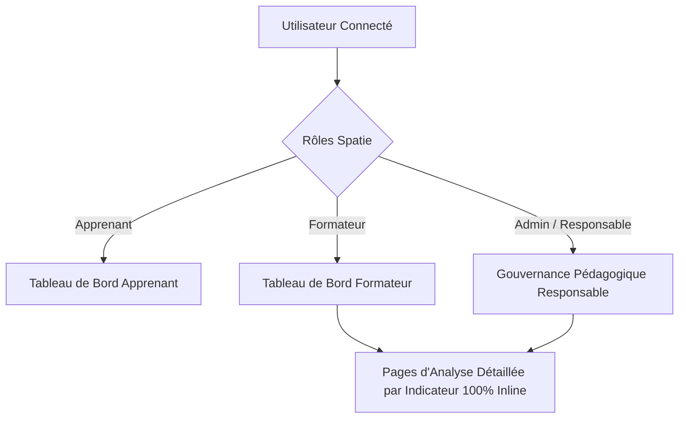

# Règles de Gestion : Module PkgTableauBord

Ce document centralise l'ensemble des règles de gestion fonctionnelles, techniques et docimologiques du module **PkgTableauBord**, articulées autour du modèle de données, de l'architecture des profils utilisateurs et de la matrice canonique des 9 indicateurs.

---

## 1. Modèle de Données & Architecture Backend

### A. Convention de Nommage Obligatoire (`cache_`)
> [!IMPORTANT]
> Tout champ calculable, agrégé ou dénormalisé persisté en base de données pour accélérer les requêtes de pilotage et l'affichage des KPIs **DOIT impérativement être préfixé par `cache_`** (ex : `cache_date_lancement`, `cache_nombre_tentatives_prototype`, `cache_date_entree_file`).

### B. Enrichissement des Tables Existantes
- **Table `affectation_projets`** :
  - `cache_date_lancement` (DateTime NULL) : Horodatage officiel du lancement du projet pour le groupe.
  - `date_fin_live_coding_collectif` (DateTime NULL) : Horodatage $t_0$ de fin de démonstration au tableau.
  - `seuil_blocage_minutes` (Int DEFAULT 30) : Fenêtre d'autonomie allouée aux pairs avant remédiation.
- **Table `realisation_projets`** :
  - `cache_date_lancement` (DateTime NULL) : Dénormalisation de la date de lancement.
  - `cache_date_premiere_soumission` (DateTime NULL) : Horodatage de la 1ère soumission de tâche.
  - `cache_nombre_tentatives_prototype` (SmallInteger DEFAULT 0) : Nombre d'évaluations du prototype N2.
  - `cache_est_valide_prototype_premier_essai` (Boolean NULL) : Validé dès le 1er essai (`true`/`false`/`null`).
  - `cache_date_validation_prototype` (DateTime NULL) : Date de validation effective du prototype.
- **Table `realisation_taches`** :
  - `cache_nombre_revisions` (SmallInteger DEFAULT 0) : Nombre de renvois en `REVISION_NECESSAIRE`.
  - `cache_date_entree_file` (DateTime NULL) : Entrée dans la file d'attente FIFO Live Coding.
  - `cache_date_debut_live_coding` (DateTime NULL) : Début effectif de l'épreuve de Live Coding synchrone.
  - `cache_delai_attente_minutes` (Int NULL) : Délai d'attente effectif en minutes.
  - `is_live_coding` (Boolean DEFAULT 0) : Désignation de l'apprenant démonstrateur au tableau.
- **Table `realisation_competences`** :
  - `progression_cache` (Decimal) : Progression réelle de l'apprenant sur la compétence.
  - `progression_ideal_cache` (Decimal) : Progression attendue selon le calendrier national.

### C. Tables Dédiées du Module
- **`log_activite_formateurs`** : Télémétrie de présence et charge administrative ($C_{\text{logistique}}$).
- **`remediations`** : Historique des ruptures d'autonomie et suivi des résolutions ($T_{\text{intervention}}$).
- **`session_formations` & `alignement_uas`** : Planification des formations et alignement des UA ($TCP-UA$).

### D. Gouvernance Gapp & Évitement de l'Erreur MySQL 1093
- **Attributs `$fillable`** : Ne **JAMAIS** surcharger `$fillable` manuellement dans les modèles enfants Eloquent (`RealisationProjet`, `RealisationTache`, etc.). La liste est régénérée automatiquement par Gapp dans les classes `Base/` via `gapp make:crud`.
- **Évitement Erreur 1093** : Pour toute mise à jour dénormalisée ou incrémentation sur des modèles dotés de scopes globaux (ex: apprenant actif), utiliser systématiquement `DB::table('table_name')->where('id', $id)->update(...)` ou `Model::withoutGlobalScopes()->where('id', $id)->update(...)`.

---

## 2. Architecture des Fonctionnalités par Espace d'Acteur

### A. Espace Apprenant (`admin.PkgTableauBord.apprenant`)
- **Finalité** : Autorégulation, réduction de l'anxiété et clarté sur les exigences certificatives.
- **Fonctionnalités Clés** :
  - Visualisation de son temps d'amorçage individuel ($T_{\text{amorçage}}$) comparé au rythme de promotion.
  - Statut du gating prototype ($R_{\text{gating}}$) et déblocage de l'accès au Projet Fil Rouge ($N3$).
  - Taux personnel de travail soigné au premier jet ($\tau_{\text{1er\_jet}}$).
  - Rang d'attente en temps réel dans la file FIFO Live Coding ($T_{\text{file}}$).
  - Progression individuelle dans le référentiel national ($ICP$) et couverture des UA planifiées ($TCP-UA$).

### B. Espace Formateur (`admin.PkgTableauBord.formateur`)
- **Finalité** : Pilotage synchrone en classe, détection chirurgicale des blocages et régulation des flux.
- **Fonctionnalités Clés** :
  - Suivi du rythme de démarrage collectif avec exclusion des démarrages avec absence.
  - Console de file d'attente FIFO Live Coding : appel 1-à-1 ou session collective mutualisée 4x4 Discord.
  - Flashbox d'alertes actives : affichage exclusif des apprenants ayant une tâche en `EN_REMEDIATION`.
  - Diagnostic des impasses didactiques réelles (décrochage face au calendrier idéal).
  - Diagnostic préventif des UA non planifiées dans les sessions de formation.
  - Liens directs vers chaque page d'analyse détaillée.

### C. Espace Responsable de Formation (`admin.PkgTableauBord.responsable`)
- **Finalité** : Harmonisation des exigences, benchmark multi-filières et équité certificative.
- **Fonctionnalités Clés** :
  - Barre de filtres multidimensionnels persistés via `ViewStateService` (Formateurs, Filières, Groupes, Sessions).
  - Cartes KPI macroscopiques synthétisant la santé pédagogique globale de l'établissement.
  - Matrice comparative / Benchmark multi-sessions confrontant les 9 indicateurs.
  - Audit de la charge logistique réelle par formateur.

### D. Pages d'Analyse Détaillée (`admin.PkgTableauBord.indicateurs.*`)
- Chaque indicateur dispose d'une page dédiée contrôlée par `Modules\PkgTableauBord\Controllers\IndicateurDetailController`.
- **Standard Ergonomique Inviolable** :
  - `@extends('layouts.admin-v2')`.
  - **100% Inline** : Strictement aucune fenêtre modale ou popup au chargement de page.
  - **Alpine.js** : Recherche instantanée, filtres réactifs par tranche et navigation par onglets (`x-data="{ tabActive: '...' }"`).
  - Visualisations dédiées : histogrammes temporels, scatter plots, matrices complètes et benchmarks comparatifs.

---

## 3. Matrice Référentielle des 9 Indicateurs Didactiques

| # | Symbole | Nom de l'Indicateur | Axe | Formule Canonique | Seuil Didactique | Capacité Associée |
| :- | :--- | :--- | :--- | :--- | :--- | :--- |
| **01** | $T_{\text{amorçage}}$ | Démarrage du travail | H1 | $\overline{T} = \frac{1}{\|P\|} \sum_{i \in P} (\text{date\_soumission} - D_{\text{lancement}})$ | $\le 3{,}0\text{ h}$ (Présents) | [capacité-indicateur-01-amorcage.md](../capacités/capacité-indicateur-01-amorcage.md) |
| **02** | $R_{\text{gating}}$ | Validation prototype 1er essai | H1 | $R_{\text{gating}} = \frac{N_{\text{validés\_essai\_1}}}{N_{\text{évalués}}} \times 100$ | $\ge 80\,\%$ (Excellence) | [capacité-indicateur-02-gating.md](../capacités/capacité-indicateur-02-gating.md) |
| **03** | $F_{\text{révision}}$ | Boucles de révision | H2 | $F = \frac{\sum \text{rejets}}{\text{total tâches}}$ & $\tau_{\text{1er\_jet}} = \frac{\text{tâches sans rejet}}{\text{total tâches}} \times 100$ | $\le 1{,}2$ reprises/tâche | [capacité-indicateur-03-revision.md](../capacités/capacité-indicateur-03-revision.md) |
| **04** | $C_{\text{logistique}}$ | Charge logistique formateur | H3 | Action-Cost Model décompté au niveau `Tache` (26h/sem) | $\le N_{\text{semaines}} \times 3\text{h}$ | [capacité-indicateur-04-charge-logistique.md](../capacités/capacité-indicateur-04-charge-logistique.md) |
| **05** | $T_{\text{file}}$ | Latence file FIFO Live Coding | H3 | $\overline{T}_{\text{file}} = \frac{1}{\|E\|} \sum \text{diffMinutes}(\text{début}, \text{entrée})$ | $\le 30\text{ min}$ (Discord 4x4 si $>60$) | [capacité-indicateur-05-file-attente.md](../capacités/capacité-indicateur-05-file-attente.md) |
| **06** | $T_{\text{intervention}}$ | Ruptures & Remédiations | H2 | $\tau_{\text{autonomie}} = \frac{N_{\text{total}} - N_{\text{remédiés}}}{N_{\text{total}}} \times 100$ | Déclenchement $t_0 + 30\text{ min}$ | [capacité-indicateur-06-remediation.md](../capacités/capacité-indicateur-06-remediation.md) |
| **07** | $\text{TRVS}$ | Réalisation validée par session | H4 | $\text{TRVS} = \frac{N_{\text{validées (DONE)}}}{N_{\text{attendues}}} \times 100$ | $\ge 80\,\%$ ($\Delta \text{TRVS} > 0$) | [capacité-indicateur-07-trvs.md](../capacités/capacité-indicateur-07-trvs.md) |
| **08** | $\text{ICP}$ | Couverture Compétences (ICP) | H4 | $\text{Rythme} = \frac{\overline{\text{progression\_cache}}}{\overline{\text{progression\_ideal\_cache}}} \times 100$ | Rythme $\ge 95\%$ calendrier | [capacité-indicateur-08-couverture-competences.md](../capacités/capacité-indicateur-08-couverture-competences.md) |
| **09** | $\text{TCP-UA}$ | Planification évaluative des UA | H4 | $\text{TCP-UA} = \frac{N_{\text{couvertes}}}{N_{\text{attendues}}} \times 100$ (Unicité UA) | Cible $\ge 80\,\%$ planifiées | [capacité-indicateur-09-planification-ua.md](../capacités/capacité-indicateur-09-planification-ua.md) |
