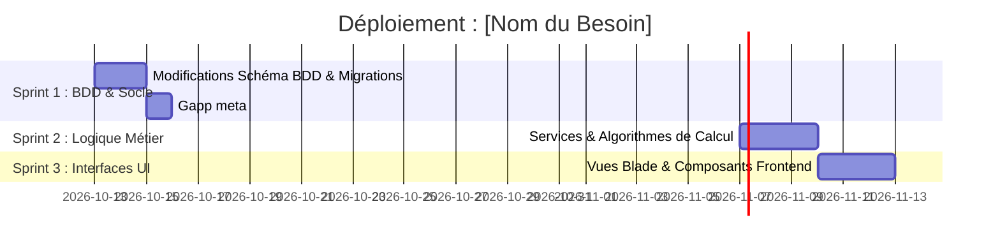

# Plan de Réalisation : [Nom du Besoin / Module]

## 1. Contexte & Objectifs
[Présentation succincte du besoin, de son ancrage métier ou didactique, et des acteurs concernés.]

---

## 2. Fonctionnalités à Créer (Backlog Fonctionnel)

### F1 : [Titre de la fonctionnalité 1]
- **Description** : [Explication détaillée du comportement attendu]
- **Acteur(s)** : [Apprenant / Formateur / Responsable]
- **Règles de Gestion & Calculs** : [Formules ou conditions métier]
- **Impact Packages SoliLMS** : [Liste des packages modifiés ou consultés]

### F2 : [Titre de la fonctionnalité 2]
...

---

## 3. Matrice d'Impact par Package SoliLMS

| Package SoliLMS | Type de Modification | Détail des Changements | Skill Associé |
| :--- | :--- | :--- | :--- |
| `Pkg[Nom]` | BDD / Modèle | Ajout colonne reference, statut... | `app-migration`, `app-model` |
| `Pkg[Nom]` | Service / Métier | Nouveau calcul, hook de transition... | `app-service` |
| `Pkg[Nom]` | UI / Vues | Nouveau composant Blade / Tailwind... | `app-blade` / `app2-front-end` |

---

## 4. Planification des Sprints de Réalisation

### Sprint 1 : Base de Données & Fondations (Migrations)
> **Objectif** : Mettre en place l'ensemble des schémas BDD nécessaires pour tout le projet.
- [ ] Création / modification des migrations avec colonne `reference` (`app-migration`)
- [ ] Déclaration des nouveaux statuts, Enums ou relations dans les Modèles (`app-model`)
- [ ] Synchronisation Gapp (`gapp meta:sync`) et mise à jour CRUD (`sys-gapp`)
- **Skills requis** : `app-migration`, `app-model`, `sys-gapp`.

### Sprint 2 : Logique Métier & Calculs
> **Objectif** : Implémenter les règles de calcul et la gestion des flux de données.
- [ ] Création / mise à jour des Services et Traits métier (`app-service`)
- [ ] Implémentation des hooks (`afterCreateRules`, `afterUpdateRules`)
- **Skills requis** : `app-service`, `pkg-[module]`.

### Sprint 3 : Contrôleurs, Routage & ViewState
> **Objectif** : Exposer les endpoints et préparer les données d'affichage.
- [ ] Ajout des routes et contrôleurs (`app-controller`, `app-route`)
- [ ] Configuration du ViewState et des filtres utilisateur (`app-controller`)
- **Skills requis** : `app-controller`, `app-route`.

### Sprint 4 : Expérience Utilisateur & Intégration UI
> **Objectif** : Construire les interfaces réactives et les composants visuels.
- [ ] Conception des composants UI (Tailwind CSS, Alpine.js ou Blade AdminLTE)
- [ ] Intégration des dashboards ou formulaires
- **Skills requis** : `app-blade`, `app2-front-end`, `sys-ux`.
