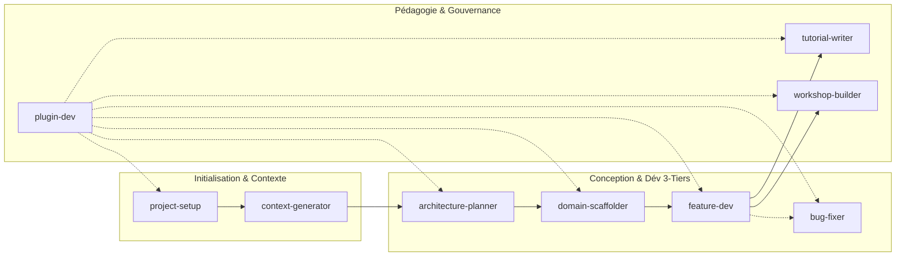

# Guide Officiel : Utilisation des Skills de l'Agent Solicode LMS

Ce guide fournit aux développeurs, formateurs et contributeurs de Solicode LMS la méthode complète pour interagir avec l'Agent IA et mobiliser ses 9 compétences modulaires.

---

## 🧭 1. Principes Fondamentaux d'Invocation

L'Agent Solicode LMS est un système d'assistance pair-programming réactif. Il sélectionne et applique ses compétences selon deux modes complémentaires :

### A. Invocation par Intention Naturelle (Recommandé)
Vous décrivez votre objectif technique ou fonctionnel en langage naturel. L'agent analyse votre intention, compare les besoins avec le catalogue des compétences et active automatiquement le skill adapté.
> **Exemple :** *« J'ai une erreur 500 dans TableUI quand je filtre par filière »* ➔ Active automatiquement [`bug-fixer`](../../skills/bug-fixer/SKILL.md).

### B. Invocation Directe et Ciblée
Vous nommez explicitement la compétence ou la combinez avec une commande slash :
> **Exemple :** *« Utilise `architecture-planner` pour analyser l'impact de l'ajout d'une table d'émargement dans PkgApprenants /plan »*

### C. Le Garde-Fou : Le Mode Consultation (`?`)
Si votre message se termine uniquement par un point d'interrogation **`?`**, l'agent entre en **mode consultation pure** :
- Il analyse, répond ou propose un plan d'action.
- **Il ne modifie aucun fichier** sans votre validation expresse.

---

## 🎯 2. Matrice Décisionnelle : Quel Skill Choisir ?

| Votre Besoin / Objectif | Compétence Mobilisée | Exemples de Prompts Déclencheurs |
| :--- | :--- | :--- |
| **Initialiser** l'environnement IA sur un projet, auditer la stack et les cahiers des charges | [`project-setup`](../../skills/project-setup/SKILL.md) | *« Initialise l'agent pour ce projet »* *« Analyse le cahier des charges dans cahiers-charges/ »* |
| **Cartographier** un package `modules/Pkg*` et produire sa fiche `AI_CONTEXT.md` | [`context-generator`](../../skills/context-generator/SKILL.md) | *« Explore modules/PkgFormation et génère son AI_CONTEXT.md »* |
| **Explorer** et auditer l'impact architectural d'une demande avant de coder (lecture seule) | [`architecture-planner`](../../skills/architecture-planner/SKILL.md) | *« Analyse l'impact de l'ajout d'un système de badges /plan »* |
| **Créer** une nouvelle entité métier, migrations avec clé `reference` et modèles 3-tiers | [`domain-scaffolder`](../../skills/domain-scaffolder/SKILL.md) | *« Crée l'entité SessionFormation dans PkgFormation avec clé reference »* |
| **Développer** une fonctionnalité 3-tiers (Contrôleur, Service, Blade custom, TableUI) | [`feature-dev`](../../skills/feature-dev/SKILL.md) | *« Implémente le calcul automatique de progression dans ProjetService »* |
| **Diagnostiquer** et réparer un crash `laravel.log`, une `BlException` ou une panne TableUI | [`bug-fixer`](../../skills/bug-fixer/SKILL.md) | *« Analyse la dernière erreur dans laravel.log et applique le fix chirurgical »* |
| **Rédiger** un tutoriel pas-à-pas progressif, reproductible et ancré dans le code | [`tutorial-writer`](../../skills/tutorial-writer/SKILL.md) | *« Rédige un tutoriel pour apprendre aux apprenants à créer un filtre TableUI »* |
| **Concevoir** un atelier guidé (TP), brief de projet ou grille d'évaluation critériée APC | [`workshop-builder`](../../skills/workshop-builder/SKILL.md) | *« Conçois un TP guidé pour l'assignation de tâches avec grille critériée APC »* |
| **Gouverner**, créer ou faire évoluer les skills, règles (`AGENTS.md`) et standards | [`plugin-dev`](../../skills/plugin-dev/SKILL.md) | *« Crée un nouveau skill pour la génération de tests Dusk »* *« Raffine la règle d'affichage des skills »* |

---

## 🛠️ 3. Fiches Détaillées par Compétence

### 1. [`project-setup`](../../skills/project-setup/SKILL.md) (Onboarding & Audit)
- **Quand l'appeler :** Au tout premier lancement sur un projet, ou pour auditer la couverture documentaire d'un module.
- **Ce qu'il fait :** Vérifie ou crée les jonctions NTFS locales (`.agents/skills`, `.agents/references`, etc.), analyse le codebase et les cahiers des charges, recommande les skills nécessaires.
- **Ce qu'il ne fait pas :** Il ne modifie pas le code applicatif.
- **Prompt Type :** *« Initialise l'agent pour le projet et vérifie que toutes les dépendances locales sont montées. »*

### 2. [`context-generator`](../../skills/context-generator/SKILL.md) (Contextualisation Modulaire)
- **Quand l'appeler :** Dès qu'un package `modules/Pkg*` vient d'être créé ou modifié et qu'on souhaite outiller l'IA pour travailler dedans avec précision.
- **Ce qu'il fait :** Scanne les modèles, services, traits, contrôleurs et règles Gapp du package, et génère `modules/Pkg.../AI_CONTEXT.md`.
- **Ce qu'il ne fait pas :** Il ne touche pas au code PHP ou Blade du package.
- **Prompt Type :** *« Analyse le package modules/PkgApprenants et produis son AI_CONTEXT.md. »*

### 3. [`architecture-planner`](../../skills/architecture-planner/SKILL.md) (Audit d'Impact en Lecture Seule)
- **Quand l'appeler :** Avant toute refactorisation, nouvel algorithme métier ou workflow impliquant plusieurs tables ou services.
- **Ce qu'il fait :** Cartographie les couches impactées (Presentation, Business, Data), identifie les risques de régression, propose un plan étape par étape sans toucher au code.
- **Ce qu'il ne fait pas :** Il n'écrit aucun code métier.
- **Prompt Type :** *« Analyse l'impact d'une refactorisation du calcul des notes dans PkgRealisationProjets /plan »*

### 4. [`domain-scaffolder`](../../skills/domain-scaffolder/SKILL.md) (Scaffolding Multi-Tiers)
- **Quand l'appeler :** Pour introduire une nouvelle entité métier dans un module existant ou nouveau.
- **Ce qu'il fait :** Génère la migration avec colonne `$table->string('reference')->unique()`, inscrit la table dans `db_schemas/modules.json`, crée les modèles Eloquent 3-tiers (`BaseModel` / `Model`), et prépare l'entité pour `gapp meta:sync`.
- **Règle absolue :** Ne lance jamais `php artisan migrate` de lui-même.
- **Prompt Type :** *« Génère la migration et les modèles pour l'entité Emargement dans PkgApprenants. »*

### 5. [`feature-dev`](../../skills/feature-dev/SKILL.md) (Développement 3-Tiers Sécurisé)
- **Quand l'appeler :** Pour implémenter une logique métier, un contrôleur, une vue Blade personnalisée ou un composant TableUI.
- **Ce qu'il fait :** Respecte les verrous Gapp (`Base/` intacts, vues `custom/`), surcharge les méthodes de préparation de données (`dataForEditView`), utilise les hooks de service (`beforeCreateRules`, `afterCreateRules`), découpe en traits si > 500 lignes.
- **Prompt Type :** *« Ajoute un bouton d'action dans TableUI pour exporter la liste des apprenants en PDF. »*

### 6. [`bug-fixer`](../../skills/bug-fixer/SKILL.md) (Diagnostic & Résolution Chirurgicale)
- **Quand l'appeler :** Dès qu'une erreur apparaît à l'écran, dans la console ou dans les logs.
- **Ce qu'il fait :** Lit la trace réelle dans `storage/logs/laravel.log`, remonte la chaîne d'appel, applique un fix chirurgical non-régressif dans la classe enfant PHP ou Blade `custom/`, et consigne le retour dans `.agents/tests/feedbacks/INC-xxx.yaml`.
- **Prompt Type :** *« Corrige l'erreur SQL column not found qui se produit lors du filtrage par formateur dans TableUI. »*

### 7. [`tutorial-writer`](../../skills/tutorial-writer/SKILL.md) (Pédagogie Technique)
- **Quand l'appeler :** Pour produire des ressources d'autoformation, de documentation développeur ou de guides pas-à-pas pour les apprenants.
- **Ce qu'il fait :** Rédige des tutoriels clairs, progressifs, vérifiables avec prérequis, étapes numérotées, extraits de code commentés et critères d'auto-évaluation.
- **Prompt Type :** *« Rédige un tutoriel guidé pour apprendre à surcharger une vue Gapp via le dossier custom/. »*

### 8. [`workshop-builder`](../../skills/workshop-builder/SKILL.md) (Ateliers & Évaluations APC)
- **Quand l'appeler :** Pour concevoir des Travaux Pratiques (TP), projets de synthèse ou grilles d'évaluation critériées selon l'Approche Par Compétences de Solicode.
- **Ce qu'il fait :** Cadre la mise en situation professionnelle, formule les livrables attendus, associe les critères de performance et construit la grille critériée.
- **Prompt Type :** *« Conçois un TP de 4 heures sur l'implémentation d'un Service avec Traits et hooks CRUD. »*

### 9. [`plugin-dev`](../../skills/plugin-dev/SKILL.md) (Ingénierie & Gouvernance IA)
- **Quand l'appeler :** Pour créer un nouveau skill, affiner une règle comportementale (`AGENTS.md`), synchroniser avec le catalogue `catalog.yaml` ou enrichir les standards.
- **Ce qu'il fait :** Respecte le gabarit normé en 10 rubriques, garantit la non-contradiction des règles, trace l'inspiration Anthropic et valide via `validate-skills.js`.
- **Prompt Type :** *« Crée un nouveau skill pour la génération automatisée de seeders de test. »*

---

## 🔄 4. Les 4 Grands Scénarios de Développement (Workflows Combinés)

### 🚀 Scénario A : Nouvelle Fonctionnalité de Bout en Bout
1. **Étape 1 (Cadrage & Impact) :**
   *Prompt :* *« Utilise `architecture-planner` pour analyser l'ajout de livrables multiples par tâche /plan »*
2. **Étape 2 (Données & Entités) :**
   *Prompt :* *« Utilise `domain-scaffolder` pour créer la migration et le modèle LivrableTache »*
   *(Le développeur exécute : `php artisan migrate`, `gapp meta:sync`, `gapp make:crud LivrableTache`)*
3. **Étape 3 (Développement Métier & UI) :**
   *Prompt :* *« Utilise `feature-dev` pour implémenter les hooks afterCreateRules et la vue custom de dépôt »*
4. **Étape 4 (Contextualisation IA) :**
   *Prompt :* *« Mets à jour le AI_CONTEXT.md de modules/PkgCreationTache »*

---

### 🩺 Scénario B : Dépannage & Résolution d'Incidents
1. **Étape 1 (Détection de panne) :**
   Une action échoue ou une page affiche une erreur.
2. **Étape 2 (Diagnostic chirurgical) :**
   *Prompt :* *« Utilise `bug-fixer` pour diagnostiquer et corriger le crash survenu lors du clic sur Supprimer »*
3. **Étape 3 (Vérification & Capitalisation) :**
   L'agent vérifie `laravel.log`, applique le correctif dans `[Model]Service.php` ou `resources/views/.../custom/`, et consigne l'incident dans `.agents/tests/feedbacks/INC-xxx.yaml`.

---

### 🎓 Scénario C : Conception d'Ateliers & Transfert Pédagogique
1. **Étape 1 (Brief TP) :**
   *Prompt :* *« Utilise `workshop-builder` pour concevoir le brief du TP sur la gestion des filtres TableUI »*
2. **Étape 2 (Tutoriel Pas-à-Pas) :**
   *Prompt :* *« Utilise `tutorial-writer` pour rédiger le guide technique d'accompagnement pour les apprenants »*

---

### ⚙️ Scénario D : Maintenance & Évolution des Compétences IA
1. **Étape 1 (Besoin d'adaptation) :**
   Un nouveau pattern architectural émerge dans l'équipe.
2. **Étape 2 (Gouvernance) :**
   *Prompt :* *« Utilise `plugin-dev` pour ajouter la règle d'encapsulation query dans les standards et valider »*
3. **Étape 3 (Contrôle déterministe) :**
   L'agent exécute `node .agents/scripts/validate-skills.js` et vérifie la conformité à 100%.

---

## 🛡️ 5. Garde-Fous et Bonnes Pratiques

> [!IMPORTANT]
> **Règles d'or à toujours garder en tête :**
> 1. **Protection Gapp :** Ne demandez jamais à l'agent de modifier directement une classe dans `Base/` ou une vue contenant `// Ce fichier est maintenu par ESSARRAJ Fouad`. L'agent doit toujours surcharger dans la classe enfant ou créer un fichier dans `custom/`.
> 2. **Migrations :** L'agent prépare le code de migration mais **ne lance jamais** `php artisan migrate` de lui-même pour prévenir toute altération accidentelle de vos données locales.
> 3. **Points d'interrogation (`?`) :** Terminez votre phrase par `?` dès que vous souhaitez simplement un avis, une analyse ou un plan d'action sans modification de code.
> 4. **Affichage systématique des skills :** L'agent affiche toujours à la fin de sa réponse la ligne des compétences mobilisées pour garantir une parfaite transparence de son exécution.
