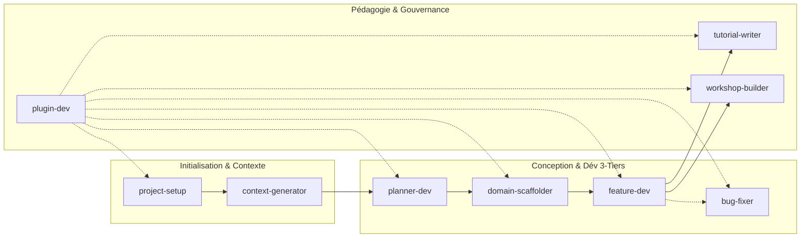

# Guide Officiel : Utilisation & Déploiement des Skills de l'Agent Solicode LMS

Ce guide fournit aux développeurs, formateurs et chefs de projet la méthode complète pour amorcer un nouveau projet vierge, interagir avec l'Agent IA et mobiliser ses 9 compétences modulaires selon la typologie de chaque projet.

---

## 🚀 0. Amorcer un Nouveau Projet Vierge (Sans `.agents` ni aucun skill)

Lorsqu'un nouveau projet est créé (qu'il s'agisse d'une application web, d'un dépôt de tutoriels Markdown ou d'un projet de formation), il ne contient initialement aucun dossier `.agents` ni aucun skill local.

### Méthode 1 : Commande d'Amorce en 1 Ligne (Recommandée)
Placez-vous dans le répertoire racine de votre nouveau projet dans le terminal et exécutez la commande d'amorce fournie par le Hub :

```powershell
node D:\solicode-lms\skills-workspace\scripts\manage-skills.cjs bootstrap
```

**Actions automatiques exécutées :**
1. **Création du socle local :** Arborescence `.agents/skills/`, `.agents/local/` et `.agents/scripts/`.
2. **Liaison des références :** Jonction NTFS `.agents/references` vers `D:\solicode-lms\skills-workspace\references`.
3. **Liaison du skill d'amorce :** Jonction NTFS unitaire vers [`project-setup`](../../skills/project-setup/SKILL.md).
4. **Gestionnaire de skills :** Copie de `.agents/scripts/manage-skills.cjs`.
5. **Manifeste initial :** Création de `.agents/skills.json` préconfiguré avec `["project-setup"]`.

---

### Méthode 2 : Alternative Manuelle PowerShell (Sans Node.js initial)
```powershell
New-Item -ItemType Directory -Force -Path ".agents\skills", ".agents\local", ".agents\scripts"
cmd /c mklink /J ".agents\references" "D:\solicode-lms\skills-workspace\references"
cmd /c mklink /J ".agents\skills\project-setup" "D:\solicode-lms\skills-workspace\.agents\skills\project-setup"
Copy-Item "D:\solicode-lms\skills-workspace\scripts\manage-skills.cjs" ".agents\scripts\"
```

---

### Étape Suivante : Invoquer l'Agent IA
Ouvrez ensuite le projet dans votre IDE (Antigravity IDE, Claude Code, Cursor, VS Code) et dites simplement à l'agent :

> 💬 **Prompt d'amorce :**  
> *« Initialise l'agent pour ce projet »* ou *« Analyse le projet et configure les compétences adaptées »*

L'agent exécute alors [`project-setup`](../../skills/project-setup/SKILL.md) v2.0.0, analyse le cahier des charges (ou vous questionne interactivement si le projet est vierge), audite un éventuel dossier `old_agent` et installe les compétences ciblées.

---

## 🧭 1. Principes Fondamentaux d'Invocation

L'Agent Solicode LMS est un système d'assistance pair-programming réactif. Il sélectionne et applique ses compétences selon deux modes complémentaires :

### A. Invocation par Intention Naturelle (Recommandé)
Vous décrivez votre objectif technique ou fonctionnel en langage naturel. L'agent analyse votre intention, compare les besoins avec le catalogue des compétences et active automatiquement le skill adapté.
> **Exemple :** *« J'ai une erreur 500 dans TableUI quand je filtre par filière »* ➔ Active automatiquement [`bug-fixer`](../../skills/bug-fixer/SKILL.md).

### B. Invocation Directe et Ciblée
Vous nommez explicitement la compétence ou la combinez avec une commande slash :
> **Exemple :** *« Utilise `planner-dev` pour analyser l'impact de l'ajout d'une table d'émargement dans PkgApprenants /plan »*

### C. Le Garde-Fou : Le Mode Consultation (`?`)
Si votre message se termine uniquement par un point d'interrogation **`?`**, l'agent entre en **mode consultation pure** :
- Il analyse, répond ou propose un plan d'action.
- **Il ne modifie aucun fichier** sans votre validation expresse.

---

## 🎯 2. Matrice Décisionnelle : Quel Skill Choisir ?

| Votre Besoin / Objectif | Compétence Mobilisée | Exemples de Prompts Déclencheurs |
| :--- | :--- | :--- |
| **Initialiser** un projet (Dev, Tutos, APC), analyser le cahier des charges, qualifier le profil ou recycler `old_agent` | [`project-setup`](../../skills/project-setup/SKILL.md) | *« Initialise l'agent pour ce projet »*<br>*« Configure l'agent pour un projet de tutoriels d'autoformation »*<br>*« Audite et recycle notre ancien dossier old_agent »* |
| **Cartographier** un package `modules/Pkg*` et produire sa fiche `AI_CONTEXT.md` | [`context-generator`](../../skills/context-generator/SKILL.md) | *« Explore modules/PkgFormation et génère son AI_CONTEXT.md »* |
| **Explorer** et auditer l'impact architectural d'une demande avant de coder (lecture seule) | [`planner-dev`](../../skills/planner-dev/SKILL.md) | *« Analyse l'impact de l'ajout d'un système de badges /plan »* |
| **Créer** une nouvelle entité métier, migrations avec clé `reference` et modèles 3-tiers | [`domain-scaffolder`](../../skills/domain-scaffolder/SKILL.md) | *« Crée l'entité SessionFormation dans PkgFormation avec clé reference »* |
| **Développer** une fonctionnalité 3-tiers (Contrôleur, Service, Blade custom, TableUI) | [`feature-dev`](../../skills/feature-dev/SKILL.md) | *« Implémente le calcul automatique de progression dans ProjetService »* |
| **Diagnostiquer** et réparer un crash `laravel.log`, une `BlException` ou une panne TableUI | [`bug-fixer`](../../skills/bug-fixer/SKILL.md) | *« Analyse la dernière erreur dans laravel.log et applique le fix chirurgical »* |
| **Rédiger** un tutoriel pas-à-pas progressif, reproductible et ancré dans le code | [`tutorial-writer`](../../skills/tutorial-writer/SKILL.md) | *« Rédige un tutoriel pour apprendre aux apprenants à créer un filtre TableUI »* |
| **Concevoir** un atelier guidé (TP), brief de projet ou grille d'évaluation critériée APC | [`workshop-builder`](../../skills/workshop-builder/SKILL.md) | *« Conçois un TP guidé pour l'assignation de tâches avec grille critériée APC »* |
| **Gouverner**, créer ou faire évoluer les skills, règles (`AGENTS.md`) et standards | [`plugin-dev`](../../skills/plugin-dev/SKILL.md) | *« Crée un nouveau skill pour la génération de tests Dusk »*<br>*« Raffine la règle d'affichage des skills »* |

---

## 🛠️ 3. Fiches Détaillées par Compétence



### 1. [`project-setup`](../../skills/project-setup/SKILL.md) (Onboarding Universel, Profils & Recyclage Legacy)
- **Quand l'appeler :** Au tout début d'un projet, pour qualifier le profil, auditer un cahier des charges ou moderniser un agent existant.
- **Ce qu'il fait :**
  - **Qualification de Profil :** Détecte si le projet est une Application Dev (Profil 1), un Dépôt de Tutoriels/Autoformation (Profil 2), ou un Référentiel APC (Profil 3). En l'absence de doc, engage un dialogue interactif.
  - **Recyclage Legacy :** Scanne `old_agent` ou `.agent/`, extrait les connaissances passives vers `.agents/local/` et archive le legacy dans `archive/old_agent/`.
  - **Installation Sélective :** Écrit `.agents/skills.json` et exécute `manage-skills.cjs install` pour monter les jonctions NTFS unitaires strictement requises.
- **Ce qu'il ne fait pas :** Il ne modifie pas le code métier applicatif.
- **Prompt Type :** *« Initialise l'agent pour un projet de tutoriels d'autoformation web »*

### 2. [`context-generator`](../../skills/context-generator/SKILL.md) (Contextualisation Modulaire)
- **Quand l'appeler :** Dès qu'un package `modules/Pkg*` vient d'être créé ou modifié.
- **Ce qu'il fait :** Scanne modèles, services, traits, contrôleurs et règles Gapp, et génère `modules/Pkg.../AI_CONTEXT.md`.
- **Prompt Type :** *« Analyse le package modules/PkgApprenants et produis son AI_CONTEXT.md. »*

### 3. [`planner-dev`](../../skills/planner-dev/SKILL.md) (Audit d'Impact en Lecture Seule)
- **Quand l'appeler :** Avant toute refactorisation, nouvel algorithme métier ou workflow multi-tables.
- **Ce qu'il fait :** Cartographie les couches impactées, identifie les risques, propose un plan étape par étape sans toucher au code.
- **Prompt Type :** *« Analyse l'impact d'une refactorisation du calcul des notes dans PkgRealisationProjets /plan »*

### 4. [`domain-scaffolder`](../../skills/domain-scaffolder/SKILL.md) (Scaffolding Multi-Tiers)
- **Quand l'appeler :** Pour introduire une nouvelle entité métier dans un module.
- **Ce qu'il fait :** Génère la migration avec clé `reference` unique, inscrit la table dans les métadonnées et prépare les modèles Eloquent 3-tiers.
- **Règle absolue :** Ne lance jamais `php artisan migrate` de lui-même.
- **Prompt Type :** *« Génère la migration et les modèles pour l'entité Emargement dans PkgApprenants. »*

### 5. [`feature-dev`](../../skills/feature-dev/SKILL.md) (Développement 3-Tiers Sécurisé)
- **Quand l'appeler :** Pour implémenter une logique métier, un contrôleur, une vue Blade personnalisée ou TableUI.
- **Ce qu'il fait :** Respecte les verrous Gapp (`Base/` intacts, vues `custom/`), surcharge les méthodes `dataForEditView`, utilise les hooks CRUD.
- **Prompt Type :** *« Ajoute un bouton d'action dans TableUI pour exporter la liste des apprenants en PDF. »*

### 6. [`bug-fixer`](../../skills/bug-fixer/SKILL.md) (Diagnostic & Résolution Chirurgicale)
- **Quand l'appeler :** Dès qu'une anomalie apparaît à l'écran ou dans `laravel.log`.
- **Ce qu'il fait :** Lit la trace réelle, applique un fix chirurgical non-régressif et consigne dans `.agents/tests/feedbacks/INC-xxx.yaml`.
- **Prompt Type :** *« Corrige l'erreur SQL column not found lors du filtrage par formateur dans TableUI. »*

### 7. [`tutorial-writer`](../../skills/tutorial-writer/SKILL.md) (Pédagogie Technique & Autoformation)
- **Quand l'appeler :** Pour produire des cours, guides pas-à-pas, ou modules d'autoformation web.
- **Ce qu'il fait :** Rédige des tutoriels progressifs, vérifiables avec prérequis, étapes et critères d'auto-évaluation.
- **Prompt Type :** *« Rédige un guide pas-à-pas sur la création d'un composant modal avec FormUI. »*

### 8. [`workshop-builder`](../../skills/workshop-builder/SKILL.md) (Ateliers & Évaluations APC)
- **Quand l'appeler :** Pour concevoir des Travaux Pratiques (TP), briefs de projet et grilles critériées APC.
- **Ce qu'il fait :** Cadre la mise en situation professionnelle et construit la grille d'évaluation critériée Solicode.
- **Prompt Type :** *« Conçois un TP guidé de 4h sur l'implémentation d'un Service avec Traits et hooks. »*

### 9. [`plugin-dev`](../../skills/plugin-dev/SKILL.md) (Ingénierie & Gouvernance IA)
- **Quand l'appeler :** Pour créer ou faire évoluer des skills, standards ou règles (`AGENTS.md`).
- **Ce qu'il fait :** Applique le gabarit normé en 10 rubriques, garantit la non-contradiction et valide via `validate-skills.cjs`.
- **Prompt Type :** *« Crée un nouveau skill pour l'automatisation des tests de régression. »*

---

## 🔄 4. Scénarios Typiques par Nature de Projet

### 💻 Scénario Projets Applicatifs (Laravel / 3-Tiers)
`planner-dev` (Impact) ➔ `domain-scaffolder` (Modélisation) ➔ `feature-dev` (Code & UI) ➔ `bug-fixer` (Si incident).

### 📚 Scénario Projets de Rédaction de Tutoriels / Autoformations
`project-setup` (Amorce Profil 2) ➔ `planner-dev` (Plan de formation) ➔ `tutorial-writer` (Rédaction des fiches pas-à-pas).

### 🎓 Scénario Ingénierie Pédagogique APC
`project-setup` (Amorce Profil 3) ➔ `workshop-builder` (Brief de projet & Grille APC) ➔ `tutorial-writer` (Supports de TP).

---

## 🛡️ 5. Garde-Fous et Bonnes Pratiques

> [!IMPORTANT]
> **Règles d'or absolues :**
> 1. **Protection Gapp :** Ne jamais modifier directement une classe dans `Base/` ou une vue contenant `// Ce fichier est maintenu par ESSARRAJ Fouad`. Surcharger dans la classe enfant ou créer dans `custom/`.
> 2. **Migrations :** L'agent prépare le code de migration mais **ne lance jamais** `php artisan migrate` de lui-même.
> 3. **Points d'interrogation (`?`) :** Terminez par `?` pour une analyse ou un plan sans modification de code.
> 4. **Affichage systématique des skills :** L'agent affiche toujours en fin de réponse la liste compacte des skills mobilisés.
