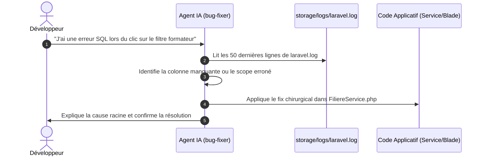

# Guide d'Utilisation : Skill `bug-fixer`

> **Compétence :** `bug-fixer`  
> **Portée :** Locale (Incubation Solicode LMS)  
> **Catégorie :** Maintenance, Diagnostic & Résolution Chirurgicale  
> **Fichier technique IA :** [`SKILL.md`](SKILL.md)

---

## 🎯 1. À quoi sert ce Skill ?

Le skill `bug-fixer` est votre dépanneur expert. Dès qu'une anomalie, un plantage, une erreur 500 ou un comportement inattendu se produit dans Solicode LMS, il effectue un diagnostic méthodique :
1. Il consulte les logs applicatifs réels (`storage/logs/laravel.log`).
2. Il isole la cause racine sans supposer arbitrairement.
3. Il applique un **correctif chirurgical minimaliste** qui ne provoque aucune régression.
4. Il consigne l'incident dans une fiche de retour d'expérience (`tests/feedbacks/INC-xxx.yaml`) pour enrichir la base de connaissances.

---

## 💬 2. Comment l'Invoquer ? (Prompts Clés en Main)

### A. Par intention naturelle (Recommandé)
Décrivez simplement le symptôme observé :
- *« J'ai une erreur 500 dans TableUI quand je filtre par filière. Analyse la cause et répare. »*
- *« L'enregistrement d'une affectation de projet échoue silencieusement, peux-tu regarder les logs ? »*
- *« Une exception BlException s'affiche avec le message 'Session fermée', d'où cela vient-il ? »*

### B. Invocation directe
- *« Utilise `bug-fixer` pour diagnostiquer la dernière erreur dans laravel.log. »*
- *« Applique `bug-fixer` sur la panne de suppression multiple dans la table des apprenants. »*

### C. Mode consultation pure (`?`)
Si vous souhaitez d'abord comprendre sans modifier de code, terminez par un point d'interrogation :
- *« Pourquoi cette erreur SQL column not found se produit-elle ? »*

---

## 🛡️ 3. Ce qu'il fait vs Ce qu'il ne fait pas

| Ce que fait `bug-fixer` ✅ | Ce que NE fait PAS `bug-fixer` ❌ |
| :--- | :--- |
| Remonte la pile d'appels (`Stack Trace`) réelle | Ne modifie JAMAIS les classes protégées dans `Base/` |
| Corrige dans la classe enfant PHP ou Blade `custom/` | Ne touche jamais aux fichiers verrouillés `ESSARRAJ Fouad` |
| Respecte les verrous du générateur Gapp | Ne lance pas de refactorisation massive hors périmètre |
| Trace l'incident dans une fiche `INC-xxx.yaml` | Ne supprime aucune donnée en base sans confirmation |

---

## 📋 4. Scénario d'Utilisation Pas-à-Pas

---

## 💡 5. Astuces pour un Dépannage Efficace
- **Toujours reproduire l'erreur juste avant d'invoquer le skill** : cela place la trace d'erreur tout en bas de `laravel.log`.
- **Indiquer l'URL ou l'écran concerné** : mentionner le contrôleur ou le package (`PkgApprenants`, `PkgFormation`) accélère l'identification de la vue ou du service responsable.
