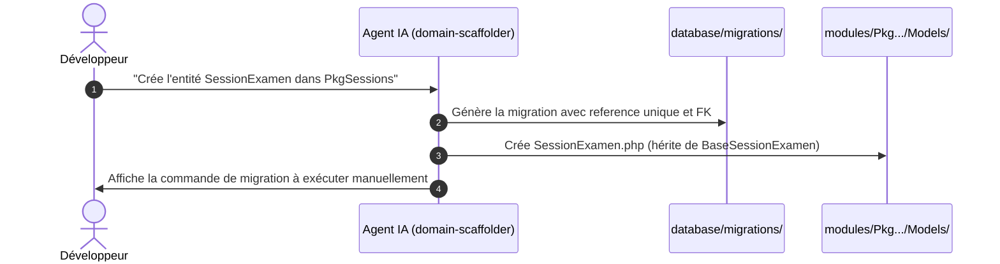

# Guide d'Utilisation : Skill `domain-scaffolder`

> **Compétence :** `domain-scaffolder`  
> **Portée :** Locale (Incubation Solicode LMS)  
> **Catégorie :** Modélisation Métier, Migrations Laravel & Scaffolding Multi-Tiers  
> **Fichier technique IA :** [`SKILL.md`](SKILL.md)

---

## 🎯 1. À quoi sert ce Skill ?

Le skill `domain-scaffolder` est le constructeur d'entités métier pour Solicode LMS. Dès que vous avez besoin d'introduire une nouvelle table ou une nouvelle entité dans un module (`modules/Pkg*`), il génère le socle complet :
1. **Migration Laravel Gapp-Compatible :** Génération du fichier de migration avec colonne `$table->string('reference')->unique();`.
2. **Modèles Eloquent 3-Tiers :** Préparation du modèle enfant `[Model].php` héritant de `Base[Model].php`.
3. **Préparation Gapp :** Inscription de l'entité pour la synchronisation des métadonnées `gapp meta:sync`.

---

## 💬 2. Comment l'Invoquer ? (Prompts Clés en Main)

- *« Crée l'entité Emargement dans modules/PkgApprenants avec les champs date, statut, apprenant_id et seance_id. »*
- *« Génère la migration et les modèles pour l'entité LivrableProjet dans PkgRealisationProjet avec clé unique reference. »*
- *« Ajoute une table de liaison CompetenceProjet avec coefficient et note_seuil dans PkgCompetences. »*

---

## 🛡️ 3. Règle d'Or Inviolable : Pas de `artisan migrate` Autonome !

> [!CAUTION]
> **Interdiction d'Exécution en Aveugle :**  
> `domain-scaffolder` génère le code propre de la migration (`database/migrations/...`), mais **ne lance JAMAIS** `php artisan migrate` de sa propre initiative. L'exécution de la migration est réservée au développeur humain après relecture du schéma.

---

## 📋 4. Scénario d'Utilisation Typique

