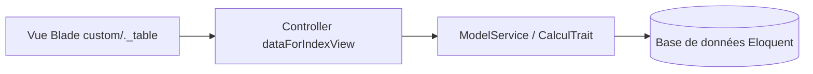

# Guide d'Utilisation : Skill `feature-dev`

> **Compétence :** `feature-dev`  
> **Portée :** Locale (Incubation Solicode LMS)  
> **Catégorie :** Développement Multi-Couches (Service, Blade custom, TableUI)  
> **Fichier technique IA :** [`SKILL.md`](SKILL.md)

---

## 🎯 1. À quoi sert ce Skill ?

Le skill `feature-dev` est le moteur de développement principal pour Solicode LMS. Il intervient pour **développer, étendre ou modifier une fonctionnalité traversante** à travers toutes les couches de l'application :
1. **Couche Présentation (Frontend) :** Vues Blade personnalisées (`custom/_table.blade.php`, `custom/_fields.blade.php`), contrôles asynchrones JavaScript (`TableUI.js`, `FilterUI.js`, modales).
2. **Couche HTTP (Contrôleurs) :** Surcharge propre des méthodes Template Method (`dataForEditView`, `dataForCreateView`), validation de formulaires `FormRequest`.
3. **Couche Métier (Services 3-tiers) :** Implémentation des règles métier dans `[Model]Service.php`, hooks de cycle de vie CRUD (`beforeCreateRules`, `afterCreateRules`), découpage modulaire en Traits.

---

## 💬 2. Comment l'Invoquer ? (Prompts Clés en Main)

### A. Exemples de Prompts Concrets
- *« Ajoute un filtre par statut d'avancement sur la table des projets dans PkgRealisationProjet. »*
- *« Implémente le calcul automatique de la note globale lors de l'évaluation d'un livrable dans LivrableService. »*
- *« Ajoute un bouton d'action groupée dans TableUI pour exporter la liste des apprenants sélectionnés en format CSV. »*
- *« Surcharge la vue d'édition de Filiere pour masquer les champs dates si la filière est inactive. »*

### B. Invocation Combinée avec `/plan`
- *« Utilise `feature-dev` pour implémenter la gestion des sous-groupes d'apprenants /plan »*

---

## 🛡️ 3. Règles d'Or et Garde-Fous Inviolables

| Ce que respecte `feature-dev` 🔒 | Règle d'Ingénierie |
| :--- | :--- |
| **Classes `Base/` Intactes** | Ne modifie JAMAIS `Base[Model].php`, `Base[Model]Service.php` |
| **Verrous `ESSARRAJ Fouad`** | En PHP, supprime le commentaire pour étendre la classe enfant. En Blade, ne touche JAMAIS au fichier de base et surcharge dans le sous-dossier `custom/`. |
| **Couche Service Obligatoire** | Aucune manipulation de données (`save()`, `update()`) en direct dans les contrôleurs. |
| **Pas de `artisan migrate`** | Prépare les migrations mais ne les exécute jamais lui-même. |

---

## 📋 4. Scénario Typique : Extension d'un CRUD Blade & Service

1. **Définition du besoin métier :** Vous formulez la demande (ex: calcul de seuil ou nouvelle colonne).
2. **Contrôle des couches impactées :** L'agent détermine la surcharge dans le Service et l'adaptation de la vue Blade `custom/`.
3. **Injection propre :** Le code est inséré sans altérer les fondations générées par Gapp.
