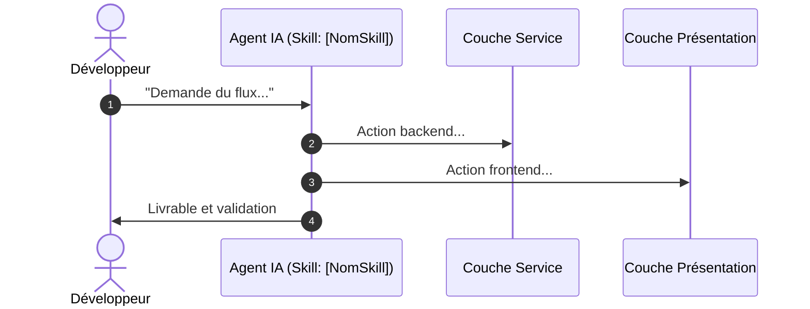

# Fiche de Flux de Travail (Workflow Blueprint) : [NomDuFlux]

## 1. Contexte & Déclencheur
- **Objectif Métier :** [Description du problème résolu par ce flux]
- **Déclencheur :** [Phrase ou intention type qui déclenche ce parcours]
- **Entrées Requises :** [Paramètres, entités, relations nécessaires]

## 2. Diagramme de Séquence

## 3. Fichiers Impactés
| Composant | Fichier Cible | Type d'Action | Protection Gapp |
| :--- | :--- | :--- | :--- |
| Service | `modules/Pkg.../Services/...` | Surcharge / Ajout | Modifiable (classe fille) |
| Vue Blade | `modules/Pkg.../resources/views/...` | Surcharge custom | Utiliser custom/ si locked |
| Frontend | `resources/js/crud/...` | Configuration | Respecter TableUI / FilterUI |

## 4. Garde-Fous & Points de Vigilance
- Point 1 : ...
- Point 2 : ...

## 5. Procédure de Vérification Manuelle
- [ ] Étape de validation 1
- [ ] Étape de validation 2
