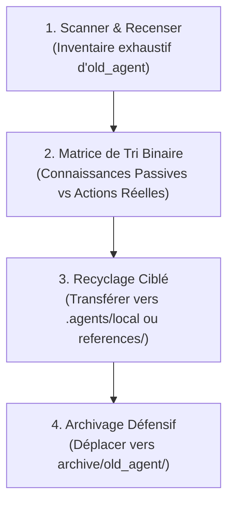

# Playbook d'Audit & Recyclage d'un Agent Existant (`old_agent`)

> **Document de référence — Méthodologie d'Assainissement & Modernisation Legacy**  
> **Composant :** `project-setup` v2.0.0 (Progressive Disclosure Resource)

---

## 1. Contexte & Problématique Legacy

Dans de nombreux projets, un dossier historique nommé `old_agent`, `.agent/`, `prompts/` ou `.cursor/` préexiste. Ces dossiers souffrent fréquemment de défauts majeurs :
- **Inflation et dispersion de faux skills :** Présence de dizaines de dossiers dans `skills/` qui ne sont en réalité que de la documentation statique (ex: `app-controller`, `app-service`, `blade-rules`), saturant la mémoire de l'agent.
- **Règles impératives contradictoires :** Directives disséminées dans plusieurs fichiers sans priorité claire.
- **Absence de standard :** Manque d'en-têtes YAML normés, absence de formats d'entrée/sortie stricts et pas de boucle de rétroaction.

L'objectif de ce playbook est de guider `project-setup` pour **auditer**, **trier**, **recycler** et **archiver** proprement ce dossier historique sans perdre la mémoire technique du projet.

---

## 2. Processus de Recyclage en 4 Étapes



---

### Étape 1 : Inventaire Exhaustif du Dossier Legacy
Scanner l'ensemble des fichiers sous `old_agent/` ou `.agent/` et catégoriser leur nature initiale :
- Fichiers de règles ou de contexte (souvent nommés `rules.md`, `guidelines.md`, `system-prompt.txt`).
- Micro-skills déclarés (souvent sous `skills/<nom-du-micro-skill>/`).
- Modèles ou templates de code (fichiers `.stub`, `.tpl`, `.example`).

---

### Étape 2 : Matrice de Tri Binaire (Passif vs Actif)

Appliquer rigoureusement la règle d'or de l'ingénierie des compétences :

| Type de Fichier Legacy | Analyse & Diagnostic | Destination de Recyclage |
| :--- | :--- | :--- |
| **Description d'une couche architecturale** (ex: `app-controller`, `app-service`, `eloquent-model`) | **Connaissance passive.** Ne constitue pas une intention d'action. L'agent doit le consulter comme documentation de référence. | Transférer vers `.agents/local/crud-backend-mechanic.md` ou vers une fiche sous `references/architecture/`. |
| **Règles d'interface & composants** (ex: `blade-custom`, `tableui-guidelines`, `modals`) | **Connaissance passive.** Règles d'affichage et conventions de syntaxe. | Transférer vers `.agents/local/crud-frontend-ui.md` ou `references/frontend/`. |
| **Spécificités d'environnement & rôles** (ex: `roles-spatie`, `database-credentials`, `urls`) | **Connaissance passive locale.** Données privées propres à cette instance du projet. | Transférer vers `.agents/local/project-conventions.md`. |
| **Action d'implémentation** (ex: `creer-crud`, `ajouter-colonne`, `generer-trait`) | **Intention d'action réelle.** Déjà couverte par le skill universel [feature-dev](../../feature-dev/SKILL.md). | Conserver la logique métier spécifique comme exemple et supprimer le micro-skill legacy au profit de `feature-dev`. |
| **Action de correction de bug** (ex: `corriger-erreur-500`, `verifier-log`) | **Intention d'action réelle.** Déjà couverte par [bug-fixer](../../bug-fixer/SKILL.md). | Recycler les motifs de logs connus dans `tests/feedbacks/` et adopter `bug-fixer`. |
| **Action d'analyse avant dev** (ex: `analyser-demande`, `planifier-sprint`) | **Intention d'action réelle.** Déjà couverte par [planner-dev](../../planner-dev/SKILL.md). | Adopter le skill canonique `planner-dev`. |

---

### Étape 3 : Injection dans le Socle Normé
1. **Création des fiches locales propres au projet :**
   - `.agents/local/project-conventions.md` (Règles métiers, rôles, particularités du dépôt).
   - `.agents/local/local-references.md` (Spécificités techniques non généralisables au Hub).
2. **Adoption des compétences universelles du Hub :**
   - Configurer `.agents/skills.json` avec les compétences universelles correspondant aux besoins identifiés.
   - Exécuter `manage-skills.cjs install` pour poser les jonctions unitaires.

---

### Étape 4 : Archivage Défensif (`archive/old_agent/`)

> [!CAUTION]
> **Risque de Conflit d'Attention & Hallucination :**
> Si le dossier `old_agent` ou l'ancien `.agent` reste présent à la racine aux côtés du nouveau `.agents`, l'agent IA subit un conflit cognitif majeur (double source de vérité, instructions divergentes).

1. Créer le répertoire neutre `archive/old_agent/` :
   ```powershell
   New-Item -ItemType Directory -Force -Path "archive\old_agent"
   ```
2. Déplacer l'intégralité du dossier legacy dans l'archive.
3. Vérifier que la racine du projet ne contient désormais **qu'un seul point d'entrée IA : `.agents/`**.
4. Valider l'intégrité du nouvel environnement via :
   ```bash
   node .agents/scripts/manage-skills.cjs list
   ```
