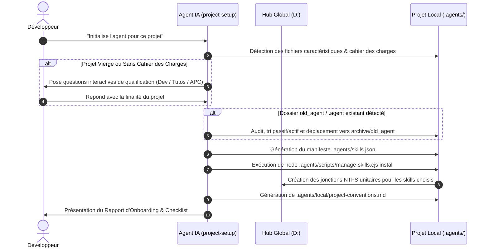

# Procédure d'Onboarding & Bootstrapping d'un Projet Vierge

> **Document de référence — Workflow d'Initialisation Multi-Projets**  
> **Composant :** `project-setup` v2.0.0 (Progressive Disclosure Resource)

---

## 1. Cas 1 : Amorcer un Nouveau Projet Vierge (Sans dossier `.agents` ni aucun skill)

Lorsqu'un développeur crée un tout nouveau projet (ex: `c:\AppServer\nouveau-projet`, ou `c:\Users\essarraj\mon-projet-tutoriel`), le projet ne possède encore aucun dossier `.agents` ni aucun skill local.

Pour permettre à l'agent IA de démarrer, deux méthodes simples d'amorce (bootstrapping) sont disponibles :

### Méthode A (Recommandée — Commande 1-Ligne via Node.js)
Ouvrez le terminal dans la racine de votre nouveau projet et lancez la commande d'amorce fournie par le Hub :

```powershell
node D:\solicode-lms\skills-workspace\scripts\manage-skills.cjs bootstrap
```

**Actions automatiques réalisées par la commande :**
1. Création de l'arborescence `.agents/skills/`, `.agents/local/` et `.agents/scripts/`.
2. Création de la jonction NTFS `.agents/references` pointant vers `D:\solicode-lms\skills-workspace\references`.
3. Création de la jonction NTFS unitaire `.agents/skills/project-setup` pointant vers le skill d'initialisation du Hub.
4. Copie locale du script de gestion `.agents/scripts/manage-skills.cjs`.
5. Création du manifeste initial `.agents/skills.json` pré-rempli avec `["project-setup"]`.

---

### Méthode B (Alternative Manuelle — PowerShell natif)
Si Node.js n'est pas invoqué directement :

```powershell
# 1. Créer les dossiers d'accueil
New-Item -ItemType Directory -Force -Path ".agents\skills", ".agents\local", ".agents\scripts"

# 2. Poser les jonctions NTFS fondamentales
cmd /c mklink /J ".agents\references" "D:\solicode-lms\skills-workspace\references"
cmd /c mklink /J ".agents\skills\project-setup" "D:\solicode-lms\skills-workspace\.agents\skills\project-setup"

# 3. Copier le gestionnaire de skills
Copy-Item "D:\solicode-lms\skills-workspace\scripts\manage-skills.cjs" ".agents\scripts\"
```

---

## 2. Cas 2 : Déclenchement de l'Agent IA & Qualification

Une fois l'amorce posée, ouvrez le projet dans votre IDE (Antigravity IDE, Cursor, Claude Code, VS Code) et adressez-vous à votre agent :

> 💬 **Prompt utilisateur d'amorce :**  
> *« Initialise l'agent pour ce projet »* ou *« Analyse le projet et installe les compétences nécessaires »*

L'agent charge automatiquement le skill [project-setup](../SKILL.md) et déroule le protocole suivant :

---

## 3. Déroulement du Workflow d'Onboarding (5 Étapes)



### Étape 1 : Diagnostic & Analyse du Projet
- Scanner la racine du projet (fichiers de code, documentation, `cahier-des-charges.md`, `README.md`).
- Consulter la grille de [project-typology-and-profiles.md](project-typology-and-profiles.md) pour classifier le projet :
  - **Profil 1 — Application Dev Logiciel**
  - **Profil 2 — Rédaction de Tutoriels & Autoformations**
  - **Profil 3 — Ingénierie Pédagogique & Ateliers APC**
  - **Profil 4 — Projet Hybride**

### Étape 2 : Qualification Interactive (Si besoin)
Si aucun indice probant n'apparaît, l'agent pose la question de qualification au développeur :
*« Quel est l'objectif principal de ce projet : développement applicatif, rédaction de tutoriels/cours, ou conception d'ateliers pédagogiques ? »*

### Étape 3 : Audit & Recyclage Legacy (Si `old_agent` présent)
Si un dossier `old_agent` ou `.agent/` non normé préexiste :
- Appliquer le [legacy-migration-playbook.md](legacy-migration-playbook.md).
- Transférer les règles locales vers `.agents/local/project-conventions.md`.
- Déplacer l'ancien dossier dans `archive/old_agent/`.

### Étape 4 : Déploiement Granulaire des Compétences
- Rédiger le fichier `.agents/skills.json` avec la liste exacte des skills retenus pour le profil.
- Exécuter la commande de synchronisation :
  ```bash
  node .agents/scripts/manage-skills.cjs install
  ```
- Vérifier que chaque skill sélectionné est bien lié sous forme de jonction unitaire sans pollution des compétences hors profil.

### Étape 5 : Formalisation du Cadre Local & Bilan
- Rédiger `.agents/local/project-conventions.md` récapitulant les directives propres au projet.
- Présenter le rapport d'onboarding récapitulant les compétences actives, exclues, et la marche à suivre.
