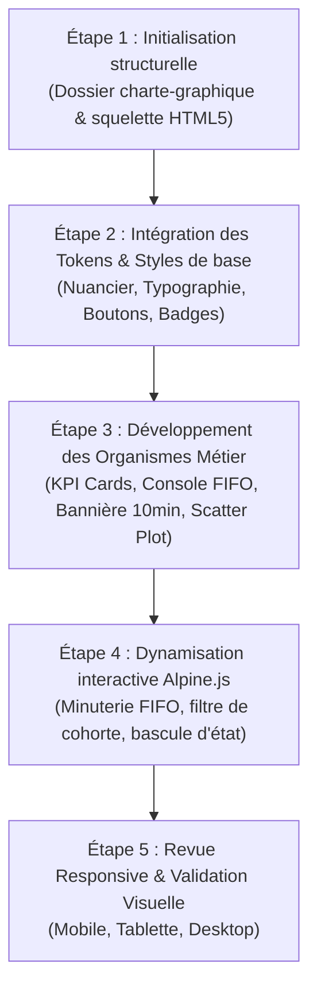

# Plan d'Action — Phase 2 : Charte Graphique & Design System Frontend V2

## 🎯 Objectif de la Phase
Concevoir la charte graphique et le Design System interactif de la version V2 de l'application pour le module **PkgTableauBord**, en conformité stricte avec les standards de l'architecture V2 ([charte existante PkgPasserQcm](file:///c:/AppServer/solicode-lms/cahiers-charges/PkgPasserQcm/charte-graphique/index.html)) : Tailwind CSS, Alpine.js, police `Inter` et exclusion formelle de Bootstrap et jQuery.

Ce livrable constitue le socle visuel et ergonomique obligatoire avant le développement des maquettes (Phase 4) et des composants Blade V2 (Sprint 4).

---

## 🎨 1. Spécification des Tokens Graphiques

### 1.1. Typographie & Hiérarchie
- **Famille de police** : `Inter`, sans-serif (chargée via Google Fonts).
- **Échelle typographique et rôles** :
  - `text-xs` (12px) : Badges, timestamps, libellés secondaires d'indicateurs.
  - `text-sm` (14px) : Textes de navigation, cellules de tableaux, descriptions didactiques.
  - `text-base` (16px) : Textes courants, boutons principaux d'action.
  - `text-lg` / `text-xl` (18px - 20px) : Titres de sections, sous-totaux et en-têtes de cartes.
  - `text-2xl` / `text-3xl` (24px - 30px) : Valeurs majeures des indicateurs KPI et métriques clés.

### 1.2. Palette de Couleurs Sémantique & Fonctionnelle
| Catégorie | Classes Tailwind (Fond / Texte / Bordure) | Usage Métier & Cas d'Application |
| :--- | :--- | :--- |
| **Fond d'application** | `bg-slate-50` | Arrière-plan global, repos visuel et contraste avec les cartes. |
| **Surfaces & Cartes** | `bg-white border-slate-200` | Cartes KPI, tableaux, panneaux de commande et tiroirs latéraux. |
| **Texte Principal** | `text-slate-900` | Valeurs chiffrées, titres et libellés majeurs. |
| **Texte Secondaire** | `text-slate-500` | Sous-titres, unités de mesure, horodatages. |
| **Accent & Identité** | `bg-indigo-600 text-indigo-700 border-indigo-200` | Boutons d'action prioritaires, filtres actifs, KPI principal. |
| **Succès / Optimal** | `bg-emerald-50 text-emerald-700 border-emerald-200` | Gating validé, progression dans les temps, $\text{ICP} \ge 90\%$. |
| **Alerte / Révision** | `bg-amber-50 text-amber-700 border-amber-200` | Temps d'attente élevé, boucle de révision active, retard modéré. |
| **Critique / Blocage** | `bg-rose-50 text-rose-700 border-rose-200` | Apprenant bloqué $> 10$ min, écart IA important, note critique. |
| **File FIFO / Neutre** | `bg-sky-50 text-sky-700 border-sky-200` | Statut en attente de passage, file d'attente Live Coding. |

---

## 🧩 2. Bibliothèque de Composants UI Dashboard

La charte graphique matérialise une suite complète de composants réutilisables dédiés aux tableaux de bord des trois acteurs (Apprenant, Formateur, Responsable) :

### 2.1. Composants Atomiques & Moléculaires
1. **Badges d'État & Pastilles** :
   - Statut de gating : *Validé 1er essai* (`emerald`), *Révision nécessaire* (`amber`), *Non présenté* (`slate`).
   - File d'attente : *Rang N* (`sky`), *En évaluation* (`indigo`), *Ajourné* (`rose`).
2. **Boutons d'Action Contextuels** :
   - Bouton Primaire (`bg-indigo-600 hover:bg-indigo-700 text-white`).
   - Bouton Rapide Formateur (*"Démarrer Live Coding"*, *"Session 4x4"*, *"Valider"*).
   - Bouton d'Alerte & Entraide (*"Former trinôme"*, *"Déclencher remédiation"*).
3. **Micro-Visualisations** :
   - Barres de progression segmentées (taux d'avancement sprint).
   - Sparklines SVG (tendance d'activité et charge logistique).

### 2.2. Composants Organismes (Cockpits & Consoles)
1. **KPI Stat Card Réactive** :
   - Valeur principale en grand format (`text-2xl font-bold`).
   - Libellé explicite avec infobulle didactique au survol.
   - Badge de variation relative (+/- comparé à la cohorte ou au sprint précédent).
   - Mini-jauge circulaire ou barre d'objectif intégrée.
2. **File d'Attente Interactive (Console FIFO Live Coding)** :
   - Rang de passage prioritaire numéroté.
   - Identité apprenant avec avatar UI et statut de présence.
   - Chronomètre d'attente dynamique en temps réel (`min:sec`).
   - Menu d'actions rapides (1-à-1, groupé, ajournement).
3. **Bannière d'Alerte "Seuil 10 min Post-Live Coding"** :
   - Conteneur d'alerte haute visibilité avec pulsation visuelle subtile.
   - Liste des apprenants en situation de blocage.
   - Action en un clic pour affecter un tuteur ou créer une fiche d'intervention.
4. **Jauge d'Avancement & Corrélation IA (Scatter Plot)** :
   - Représentation graphique de la dispersion des notes ($N2$ vs $N3$).
   - Mise en évidence des divergences $\Delta_{\text{IA}} > +5$ points pour le jury.
5. **Barre de Filtrage & Drill-Down Hiérarchique** :
   - Navigation contextuelle : Établissement $\rightarrow$ Filière $\rightarrow$ Groupe/Classe $\rightarrow$ Sprint $\rightarrow$ Apprenant.

---

## 💻 3. Livrable Technique : `charte-graphique/index.html`

- **Emplacement cible** : `cahiers-charges/PkgTableauBord/charte-graphique/index.html`.
- **Technologies intégrées** :
  - **Tailwind CSS (CDN)** : Utilisation exclusive des classes utilitaires pour l'ensemble du style.
  - **Alpine.js (CDN)** : Orchestration de l'interactivité (onglets de navigation du styleguide, simulateur de file FIFO, compteurs temps réel, infobulles).
  - **Google Fonts `Inter`** : Typographie officielle SoliLMS V2.
  - **Heroicons (SVG inline)** : Icônes vectorielles légères et sémantiques.

---

## 🗺️ 4. Déroulement de la Réalisation

---

## ✅ 5. Checklist de Réalisation & Validation
- [x] Dossier `cahiers-charges/PkgTableauBord/charte-graphique/` initialisé.
- [x] Fichier `charte-graphique/index.html` conçu et documenté.
- [x] Cohérence chromatique et typographique validée avec `PkgPasserQcm`.
- [x] Interactions Alpine.js fonctionnelles sans rechargement de page.
- [x] Validation responsive complète (Mobile, Tablette, Desktop).
