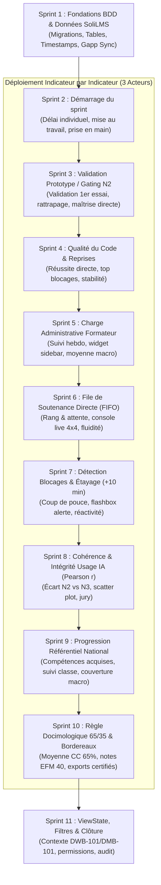

# Plan de Réalisation en Sprints — Module `PkgTableauBord`

## 🎯 Vision & Stratégie de Réalisation
Le développement du module **`PkgTableauBord`** est articulé autour de deux principes directeurs :
1. **Regroupement initial de la base de données (Sprint 1)** : Toutes les migrations, tables, colonnes d'horodatage et index d'optimisation sont conçus et appliqués dès le départ pour que SoliLMS dispose immédiatement du modèle de données requis pour tous les indicateurs.
2. **Déploiement itératif indicateur par indicateur pour les trois acteurs (Sprints 2 à 10)** : Chaque sprint implémente un indicateur spécifique dans sa globalité — de son service de calcul backend jusqu'à son intégration concrète sur les interfaces des 3 profils (**Apprenant**, **Formateur**, **Responsable de formation**).
3. **Consolidation & Gouvernance ViewState (Sprint 11)** : Finalisation des contrôleurs, persistance des filtres multi-classes (`DWB-101`, `DMB-101`) et scellement des exports.

---

## 🗺️ Feuille de Route Synthétique des Sprints



---

## 🏃 Spécification Détaillée des Sprints

### 🗄️ Sprint 1 : Fondations Base de Données & Modèle Métier SoliLMS
> **Règle Critique** : L'ensemble des modifications de schéma BDD est concentré dans ce sprint pour préserver la stabilité du système. Les migrations sont créées par l'agent et exécutées manuellement par le développeur (`php artisan migrate`).

- **Migrations BDD (`app-migration`)** :
  1. **Table `realisation_taches`** :
     - `date_premiere_soumission` (`timestamp NULL`) : Horodatage du 1er passage à `TO_APPROVE` (Indicateur 01).
     - `nombre_revisions` (`int unsigned DEFAULT 0`) : Compteur des passages en `REVISION_NECESSAIRE` (Indicateur 03).
     - `date_entree_file` (`timestamp NULL`, indexé) : Arrivée dans la file FIFO (Indicateur 05).
     - `date_debut_live_coding` (`timestamp NULL`) : Début effectif de l'évaluation (Indicateur 05).
     - `delai_attente_minutes` (`int unsigned NULL`) : Temps d'attente calculé (Indicateur 05).
     - `session_live_coding_id` (`bigint unsigned NULL`) : Clé pour mutualisation 4x4.
     - `nombre_tentatives` (`int unsigned DEFAULT 0`) : Nombre d'essais sur le prototype N2 (Indicateur 02).
     - `est_valide_premier_essai` (`boolean NULL DEFAULT NULL`) : Indicateur de réussite directe (Indicateur 02).
  2. **Table `affectation_projets`** (ou sessions de travail) :
     - `date_lancement` (`timestamp NULL`, indexé) : Début du sprint par le formateur (Indicateur 01).
     - `date_fin_live_coding_collectif` (`timestamp NULL`) : Fin de la séance collective (+10 min) (Indicateur 06).
  3. **Table `workflow_taches`** :
     - Nouvel état `BESOIN_REVISION` (*"Besoin de révision (+10 min)"*).
  4. **Nouvelles Tables Créées** (avec colonne `reference` obligatoire) :
     - `remediations` : Gestion des prises en charge apprenants (Indicateur 06).
     - `log_activite_formateurs` : Horodatage du temps passé sur les interfaces (Indicateur 04).
     - `bordereaux_officiels` : Enregistrement scellé des notes 65/35 (Indicateur 09).
  5. **Table `realisation_modules`** :
     - `note_cc_officielle` (`decimal(4,2) NULL`), `note_efm_officielle` (`decimal(4,2) NULL`), `statut_docimologique`.
- **Synchronisation Gapp** : `gapp meta:sync` & régénération des CRUDs enfants.
- **Skills requis** : `app-migration`, `app-model`, `sys-gapp`.

---

### ⏱️ Sprint 2 : Indicateur 01 — Démarrage du Travail
*Mesure du délai entre le lancement du sprint et le premier livrable soumis.*
- **Backend (`app-service`)** :
  - Hook dans `RealisationTacheCrudTrait` pour figer `date_premiere_soumission`.
  - Service : méthode `calculerTempsAmorcage(affectationId, apprenantId = null)` dans `DashboardCalculTrait`.
- **Intégration UI 3 Acteurs (`app-blade`, `app2-front-end`)** :
  - **Apprenant** : Carte *"Mon délai de démarrage"* (`1h15`, comparaison avec la moyenne classe `1h45`).
  - **Formateur** : KPI *"Temps moyen de mise au travail"* (`1h45`, ratio `17/20` apprenants démarrés).
  - **Responsable** : KPI *"Délai moyen de prise en main du sprint"* (`1h50`, comparatif `DWB-101` vs `DMB-101`).

---

### 🛡️ Sprint 3 : Indicateur 02 — Validation du Prototype (Gating N2)
*Mesure de l'assimilation autonome des prérequis techniques dès la première tentative.*
- **Backend (`app-service`)** :
  - Hook de clôture de soutenance : incrémentation de `nombre_tentatives` et assignation de `est_valide_premier_essai`.
  - Service : méthode `calculerTauxGatingPremierEssai(...)`.
- **Intégration UI 3 Acteurs (`app-blade`, `app2-front-end`)** :
  - **Apprenant** : Carte *"Validation du Prototype"* (`Validé (1er essai)`, déblocage du projet fil rouge).
  - **Formateur** : KPI *"Validation au 1er passage"* (`75%`, `15 validés / 5 en séance de rattrapage`) avec bouton de planification de session.
  - **Responsable** : KPI *"Taux de maîtrise directe des prototypes"* (`78%` national).

---

### 🔄 Sprint 4 : Indicateur 03 — Qualité du Code & Reprises par Tâche
*Mesure de la stabilité du code et identification des notions nécessitant un réalignement.*
- **Backend (`app-service`)** :
  - Hook d'incrémentation automatique de `nombre_revisions` lors de la transition vers `REVISION_NECESSAIRE`.
  - Service : méthode `calculerFrequenceRevision(...)` et identification du Top 3 des tâches bloquantes.
- **Intégration UI 3 Acteurs (`app-blade`, `app2-front-end`)** :
  - **Apprenant** : Composant *"Qualité du premier rendu"* (`85% de réussite directe`, `0.2 reprise/tâche`).
  - **Formateur** : Panel *"Tâches Nécessitant un Réalignement"* (Top 3 des tâches à forte itération avec bouton de clarification).
  - **Responsable** : Matrice benchmark colonne *"Stabilité du code & clarté des consignes"*.

---

### ⏱️ Sprint 5 : Indicateur 04 — Suivi & Allègement de la Charge Administrative
*Contrôle du volume horaire hebdomadaire consacré au pilotage administratif sur SoliLMS.*
- **Backend & Frontend JS (`app-service`, `app2-front-end`)** :
  - Script heartbeat discret (ping toutes les 60s avec seuil d'inactivité de 5 min).
  - Enregistrement dans `log_activite_formateurs`.
  - Service : agrégation hebdomadaire `calculerChargeLogistiqueFormateur(...)`.
- **Intégration UI 3 Acteurs (`app-blade`, `app2-front-end`)** :
  - **Apprenant** : Masqué (non pertinent pour l'apprenant).
  - **Formateur** : Widget de pied de sidebar *"Temps administratif"* (`1h45 / 3h`, jauge de conformité `≤ 2.5h`).
  - **Responsable** : KPI *"Temps administratif moyen par formateur"* (`2.1 h/semaine`, badge `-45% de charge`).

---

### ⏳ Sprint 6 : Indicateur 05 — File de Soutenance en Direct (FIFO Live Coding)
*Régulation dynamique des passages en soutenance individuelle et mutualisée.*
- **Backend (`app-service`)** :
  - Hook de passage à `READY_FOR_LIVE_CODING` (consignation `date_entree_file`).
  - Service : `recupererFileAttenteFIFO(classeId)` ordonné par `date_entree_file ASC` et estimation du délai d'attente.
- **Intégration UI 3 Acteurs (`app-blade`, `app2-front-end`)** :
  - **Apprenant** : Bannière *"Votre rang de passage en direct"* (`Rang #2`, temps estimé `18 min`, heure de passage `14h45`).
  - **Formateur** : KPI *"Temps d'attente moyen en file"* (`28 min`) + Console FIFO interactive (appeler apprenant, valider prototype, lancer session mutualisée 4x4).
  - **Responsable** : Benchmark colonne *"Attente Moyenne File"* (`28 min` DWB-101 vs `32 min` DMB-101).

---

### 🚨 Sprint 7 : Indicateur 06 — Détection des Blocages & Étayage (+10 min)
*Prise en charge immédiate des apprenants sans livrable 10 minutes après la session collective.*
- **Backend (`app-service`)** :
  - Job planifié / déclencheur : `VerifierSeuilDixMinutesJob` basculant les tâches en souffrance à `BESOIN_REVISION`.
  - Service de gestion des remédiations (création trinôme d'entraide, atelier de soutien).
- **Intégration UI 3 Acteurs (`app-blade`, `app2-front-end`)** :
  - **Apprenant** : Notification didactique bienveillante *"Besoin d'un coup de pouce ?"* (proposition de tuteur pair).
  - **Formateur** : KPI *"Taux de prise en charge des blocages"* (`88%`) + Flashbox d'alerte rouge (`Amine +14 min`, `Sara +11 min`) avec actions en un clic.
  - **Responsable** : KPI *"Réactivité de l'accompagnement pédagogique"* (`90%`).

---

### 🧠 Sprint 8 : Indicateur 07 — Cohérence & Intégrité face à l'IA (Pearson $r$)
*Contrôle de l'authenticité des apprentissages en comparant le prototype surveillé ($N2$) et le projet outillé ($N3$).*
- **Backend (`app-service`)** :
  - Algorithme de calcul du coefficient de corrélation linéaire de Pearson $r$ sur les paires de notes normalisées sur 20.
  - Détection des écarts anormaux : $\Delta_{\text{IA}} = \text{Note } N3 - \text{Note } N2 > +5\text{ pts}$.
- **Intégration UI 3 Acteurs (`app-blade`, `app2-front-end`)** :
  - **Apprenant** : Masqué (neutralisation du stress de surveillance).
  - **Formateur** : Tableau docimologique avec colonne *"Écart Soutenance vs Projet Libre"* et alerte rouge sur cas suspect.
  - **Responsable** : KPI *"Indice de cohérence docimologique (Usage IA)"* (`r = 0.78`) + Scatter plot interactif avec zone de suspicion + bouton de convocation de jury.

---

### 🎓 Sprint 9 : Indicateur 08 — Progression dans le Référentiel National
*Suivi de la couverture des micro-compétences nationales pour l'apprenant et la cohorte.*
- **Backend (`app-service`)** :
  - Service d'agrégation `calculerCouverturePedagogique(groupeId)` basé sur `realisation_micro_competences`.
  - Détection des compétences fragiles de la classe.
- **Intégration UI 3 Acteurs (`app-blade`, `app2-front-end`)** :
  - **Apprenant** : KPI *"Progression dans le référentiel"* (`85%`, `17 / 20 compétences validées`).
  - **Formateur** : KPI *"Couverture du programme par la classe"* (`85% acquis`, diagnostic des points d'attention).
  - **Responsable** : KPI *"Taux de couverture du référentiel national"* (`91.2%`, benchmark inter-centres).

---

### 📜 Sprint 10 : Indicateur 09 — Règle Docimologique 65/35 & Bordereaux d'Examen
*Calcul réglementaire officiel de la note CC (sur 20) et EFM (sur 40), et scellement des bordereaux.*
- **Backend (`app-service`)** :
  - `ConversionEvaluationService::genererBordereauOfficiel($groupeId)` appliquant :
    $$\text{Note CC} = \text{Moyenne}(N2), \quad \text{Note EFM} = 2 \times (0{,}65 \times \text{Note CC} + 0{,}35 \times N3)$$
  - Contrôle d'intégrité ($100\%$ des notes renseignées avant scellement).
- **Intégration UI 3 Acteurs (`app-blade`, `app2-front-end`)** :
  - **Apprenant** : KPI *"Moyenne provisoire de Contrôle Continu"* (`16.5 / 20`, composante 65%).
  - **Formateur** : Tableau des notes CC et EFM calculées + statut *"20 / 20 évalués"* + bouton de transmission.
  - **Responsable** : KPI *"Conformité des bordereaux d'examen"* (`100% conformes`) + Exports officiels Excel (CC) et PDF scellé (EFM).

---

### 🎛️ Sprint 11 : Intégration Globale, ViewState & Permissions
*Assemblage final, mémorisation des filtres utilisateur et sécurité d'accès.*
- **Architecture Backend & Sécurité (`app-controller`, `app-route`)** :
  - Respect strict de l'ordre d'appel ViewState :
    ```php
    $this->viewState->setContextKeyIfEmpty('tableauBord.formateur');
    $this->tableauBordService->loadLastFilterIfEmpty();
    ```
  - Routes web sécurisées par rôles Spatie (`apprenant`, `formateur`, `responsable`).
  - Sélecteur de promotion interactif (`DWB-101`, `DMB-101`) et effectif étalonné à 20 apprenants.
- **Vérification Finale** : Audit d'accessibilité, validation responsive et tests ergonomiques.

---

## 📋 Matrice des Sprints et Responsabilités

| Sprint | Périmètre Métier & Indicateur | BDD / Tables Impactées | Acteurs Livrés | Skill Responsable |
| :--- | :--- | :--- | :--- | :--- |
| **Sprint 1** | **Fondations BDD Globales SoliLMS** | `realisation_taches`, `affectation_projets`, `remediations`, `log_activite_formateurs`, `bordereaux_officiels` | Système | `app-migration`, `app-model`, `sys-gapp` |
| **Sprint 2** | **Indicateur 01** : Démarrage du sprint | `date_premiere_soumission`, `date_lancement` | Apprenant, Formateur, Responsable | `app-service`, `app-blade` |
| **Sprint 3** | **Indicateur 02** : Validation Prototype / Gating | `nombre_tentatives`, `est_valide_premier_essai` | Apprenant, Formateur, Responsable | `app-service`, `app-blade` |
| **Sprint 4** | **Indicateur 03** : Qualité du code & Reprises | `nombre_revisions` | Apprenant, Formateur, Responsable | `app-service`, `app-blade` |
| **Sprint 5** | **Indicateur 04** : Charge administrative formateur | `log_activite_formateurs` | Formateur, Responsable | `app-service`, `app2-front-end` |
| **Sprint 6** | **Indicateur 05** : File FIFO Live Coding | `date_entree_file`, `date_debut_live_coding`, `delai_attente_minutes` | Apprenant, Formateur, Responsable | `app-service`, `app-blade`, `app-crud-js` |
| **Sprint 7** | **Indicateur 06** : Blocages & Remédiation (+10 min) | `workflow_taches` (`BESOIN_REVISION`), `remediations` | Apprenant, Formateur, Responsable | `app-service`, `app-blade` |
| **Sprint 8** | **Indicateur 07** : Cohérence & Intégrité IA ($r$) | Index appariement $N2$ vs $N3$ | Formateur, Responsable | `app-service`, `app-blade` |
| **Sprint 9** | **Indicateur 08** : Progression Référentiel National | Index `realisation_micro_competences` | Apprenant, Formateur, Responsable | `app-service`, `app-blade` |
| **Sprint 10** | **Indicateur 09** : Docimologie 65/35 & Bordereaux | `realisation_modules`, `bordereaux_officiels` | Apprenant, Formateur, Responsable | `app-service`, `app-blade` |
| **Sprint 11** | **ViewState, Filtres de Classe & Sécurité** | Filtres persistés `UserModelFilter` | Apprenant, Formateur, Responsable | `app-controller`, `app-route`, `sys-ux` |
