# Plan Global de Réalisation Itérative — Module `PkgTableauBord`

## 🎯 Vision & Stratégie Itérative "Vertical Slice"

Le développement du module **`PkgTableauBord`** adopte une démarche agile **itérative de bout en bout (tranche verticale)** :
> **Chaque sprint est centré sur un indicateur unique et autonome**, intégrant successivement :
> 1. **Étape BDD** : Les migrations de schéma nécessaires à cet indicateur spécifique (colonnes, index, nouvelles tables avec champ `reference` obligatoire).
> 2. **Étape Métier** : Les calculs, hooks de cycle de vie et règles d'agrégation dans la couche Service.
> 3. **Étape Frontend UI** : L'intégration simultanée sur les tableaux de bord des **trois acteurs** (**Apprenant**, **Formateur**, **Responsable de formation**) selon les maquettes validées.
> 4. **Étape Recette** : La validation sur une cohorte étalon de **20 apprenants** (`DWB-101`).

---

## 🗺️ Feuille de Route des 10 Sprints Itératifs

```mermaid
flowchart TD
    subgraph Iterations ["Déploiement Itératif Indicateur par Indicateur (BDD + Service + UI 3 Acteurs)"]
        S1["Sprint 1 : Indicateur 01 — Démarrage du sprint (T_amorçage)<br/>• BDD : date_premiere_soumission & date_lancement<br/>• Métier : calcul délai & comparaison classe<br/>• UI : Mon délai (Apprenant) / Prise en main (Formateur & Resp)"] --> S2
        
        S2["Sprint 2 : Indicateur 02 — Validation Prototype / Gating N2 (R_gating)<br/>• BDD : nombre_tentatives & est_valide_premier_essai<br/>• Métier : hook soutenance & calcul taux 1er passage<br/>• UI : Validation Prototype (Apprenant) / Suivi 1er passage (Formateur & Resp)"] --> S3
        
        S3["Sprint 3 : Indicateur 03 — Qualité du Code & Reprises (F_révision)<br/>• BDD : nombre_revisions<br/>• Métier : hook transition révision & Top 3 blocages<br/>• UI : Qualité 1er rendu (Apprenant) / Tâches à réaligner (Formateur & Resp)"] --> S4
        
        S4["Sprint 4 : Indicateur 04 — Suivi Charge Administrative (C_logistique)<br/>• BDD : table log_activite_formateurs (avec reference)<br/>• Métier : heartbeat JS & calcul temps hebdo<br/>• UI : Widget temps sidebar (Formateur) / Moyenne macro (Responsable)"] --> S5
        
        S5["Sprint 5 : Indicateur 05 — File de Soutenance en Direct (FIFO - T_file)<br/>• BDD : timestamps file FIFO & session_live_coding_id<br/>• Métier : algorithme d'ordonnancement FIFO & mutualisation 4x4<br/>• UI : Rang & attente (Apprenant) / Console live (Formateur) / Benchmark (Resp)"] --> S6
        
        S6["Sprint 6 : Indicateur 06 — Blocages & Étayage Post-Séance (+10 min)<br/>• BDD : état BESOIN_REVISION & table remediations<br/>• Métier : job alerte seuil 10 min & gestion trinômes d'aide<br/>• UI : Coup de pouce (Apprenant) / Flashbox rouge (Formateur) / Réactivité (Resp)"] --> S7
        
        S7["Sprint 7 : Indicateur 07 — Cohérence & Intégrité Usage IA (Pearson r)<br/>• BDD : index appariement notes N2 vs N3<br/>• Métier : corrélation de Pearson r & alerte delta > 5 pts<br/>• UI : Écart soutenance (Formateur) / Scatter plot & alerte jury (Responsable)"] --> S8
        
        S8["Sprint 8 : Indicateur 08 — Progression dans le Référentiel National (ICP)<br/>• BDD : optimisation index micro-compétences<br/>• Métier : taux de couverture global référentiel (hors découpage module)<br/>• UI : Compétences acquises (Apprenant) / Diagnostic classe (Formateur) / Couverture macro (Resp)"] --> S9
        
        S9["Sprint 9 : Indicateur 09 — Règle Docimologique 65/35 & Bordereaux<br/>• BDD : notes officielles CC/EFM & table bordereaux_officiels<br/>• Métier : formule docimologique 65/35 & scellement d'examen<br/>• UI : Moyenne CC 65% (Apprenant) / Grille 20/20 (Formateur) / Bordereaux certifiés (Resp)"]
    end

    S9 --> S10["Sprint 10 : Consolidation Globale, ViewState Multi-Classes & Clôture<br/>• ViewState : setContextKeyIfEmpty avant loadLastFilterIfEmpty<br/>• Filtres persistés DWB-101 / DMB-101, permissions Spatie & audit de recette"]
```



---

## 🏃 Spécification Détaillée des Sprints Itératifs

---

### ⏱️ Sprint 1 : Indicateur 01 — Démarrage du Travail
*Mesure du délai entre le lancement du sprint et le premier livrable soumis.*

1. **Étape BDD (`app-migration`)** :
   - Migration `add_amorcage_columns_to_realisation_taches_and_affectations` :
     - Table `realisation_taches` (`PkgRealisationTache`) : colonne `date_premiere_soumission` (`timestamp NULL`).
     - Table `affectation_projets` (`PkgRealisationProjets`) : colonne `date_lancement` (`timestamp NULL`, indexé).
   - Exécution manuelle développeur : `php artisan migrate`.
2. **Étape Métier (`app-service`)** :
   - Hook de cycle de vie dans `RealisationTacheService` pour figer `date_premiere_soumission` lors de la 1ère soumission.
   - Méthode `calculerTempsAmorcage($affectationId, $apprenantId = null)` dans `DashboardCalculTrait`.
3. **Étape UI 3 Acteurs (`app-blade`, `app2-front-end`)** :
   - **Apprenant** : Carte *"Mon délai de démarrage"* (`1h15`, comparaison moyenne classe `1h45`).
   - **Formateur** : KPI *"Temps moyen de mise au travail"* (`1h45`, ratio `17/20` démarrés).
   - **Responsable** : KPI *"Délai moyen de prise en main du sprint"* (`1h50`, comparatif `DWB-101` vs `DMB-101`).

---

### 🛡️ Sprint 2 : Indicateur 02 — Validation du Prototype (Gating N2)
*Mesure de l'assimilation autonome des prérequis techniques dès la première tentative.*

1. **Étape BDD (`app-migration`)** :
   - Migration `add_gating_columns_to_realisation_taches_table` :
     - Table `realisation_taches` : `nombre_tentatives` (`int unsigned DEFAULT 0`), `est_valide_premier_essai` (`boolean NULL DEFAULT NULL`).
   - Exécution manuelle développeur : `php artisan migrate`.
2. **Étape Métier (`app-service`)** :
   - Hook de clôture de soutenance : incrémentation de `nombre_tentatives` et assignation de `est_valide_premier_essai = ($nombre_tentatives == 1)`.
   - Méthode `calculerTauxGatingPremierEssai($affectationId)`.
3. **Étape UI 3 Acteurs (`app-blade`, `app2-front-end`)** :
   - **Apprenant** : Carte *"Validation du Prototype"* (`Validé (1er essai)`, déverrouillage de la suite du projet).
   - **Formateur** : KPI *"Validation au 1er passage"* (`75%`, `15 validés / 5 en séance de rattrapage`) + bouton de convocation session de rattrapage.
   - **Responsable** : KPI *"Taux de maîtrise directe des prototypes"* (`78%` promotion et benchmark).

---

### 🔄 Sprint 3 : Indicateur 03 — Qualité du Code & Reprises par Tâche
*Mesure de la stabilité du code et identification des notions nécessitant un réalignement.*

1. **Étape BDD (`app-migration`)** :
   - Migration `add_revisions_column_to_realisation_taches_table` :
     - Table `realisation_taches` : `nombre_revisions` (`int unsigned DEFAULT 0`).
   - Exécution manuelle développeur : `php artisan migrate`.
2. **Étape Métier (`app-service`)** :
   - Hook dans `RealisationTacheService` : incrémentation automatique de `nombre_revisions` lors du passage à `REVISION_NECESSAIRE`.
   - Méthode `calculerFrequenceRevision($affectationId)` et extraction du Top 3 des tâches à forte reprise.
3. **Étape UI 3 Acteurs (`app-blade`, `app2-front-end`)** :
   - **Apprenant** : Carte *"Qualité du premier rendu"* (`85% de réussite directe`, `0.2 reprise/tâche`).
   - **Formateur** : Panel *"Tâches Nécessitant un Réalignement"* (Top 3 des tâches à forte itération avec bouton de clarification collective).
   - **Responsable** : Matrice benchmark colonne *"Stabilité du code & clarté des consignes"*.

---

### ⏱️ Sprint 4 : Indicateur 04 — Suivi & Allègement de la Charge Administrative
*Contrôle du volume horaire hebdomadaire consacré au pilotage administratif sur SoliLMS.*

1. **Étape BDD (`app-migration`)** :
   - Inscription dans `db_schemas/modules.json` (`PkgFormation` ou `PkgTableauBord`).
   - Migration `create_log_activite_formateurs_table` :
     - Colonnes : `id`, `reference` (`string unique`), `formateur_id` (FK), `session_token`, `date_debut`, `date_fin`, `duree_secondes`, `page_uri`, `timestamps()`.
   - Exécution manuelle développeur : `php artisan migrate` & `gapp meta:sync`.
2. **Étape Métier (`app-service`, JS)** :
   - Script heartbeat discret (ping toutes les 60s avec coupure après 5 min d'inactivité).
   - Service : méthode `calculerChargeLogistiqueFormateur($formateurId, $semaine)` et évaluation du respect du seuil ($\le 2.5\text{ h/semaine}$).
3. **Étape UI 3 Acteurs (`app-blade`, `app2-front-end`)** :
   - **Apprenant** : Masqué.
   - **Formateur** : Widget de pied de sidebar *"Temps administratif"* (`1h45 / 3h`, jauge verte sous le seuil max).
   - **Responsable** : KPI *"Temps administratif moyen par formateur"* (`2.1 h/semaine`, badge vert `-45% de charge`).

---

### ⏳ Sprint 5 : Indicateur 05 — File de Soutenance en Direct (FIFO Live Coding)
*Régulation dynamique des passages en soutenance individuelle et mutualisée.*

1. **Étape BDD (`app-migration`)** :
   - Migration `add_fifo_columns_to_realisation_taches_table` :
     - Table `realisation_taches` : `date_entree_file` (`timestamp NULL`, indexé), `date_debut_live_coding` (`timestamp NULL`), `delai_attente_minutes` (`int unsigned NULL`), `session_live_coding_id` (`bigint unsigned NULL`).
   - Exécution manuelle développeur : `php artisan migrate`.
2. **Étape Métier (`app-service`)** :
   - Hook de passage à `READY_FOR_LIVE_CODING` consignant `date_entree_file`.
   - Service : méthode `recupererFileAttenteFIFO($affectationId)` ordonnée par `date_entree_file ASC` et estimation du délai moyen d'attente ($T_{\text{file}}$).
   - Méthode de regroupement 4x4 (mutualisation d'une session de live coding).
3. **Étape UI 3 Acteurs (`app-blade`, `app2-front-end`)** :
   - **Apprenant** : Bannière dynamique *"Votre rang de passage en direct"* (`Rang #2`, temps estimé `18 min`, heure estimée `14h45`).
   - **Formateur** : KPI *"Temps d'attente moyen en file"* (`28 min`) + Console live interactive FIFO (boutons d'appel, validation, lancement session mutualisée 4x4).
   - **Responsable** : Benchmark colonne *"Attente Moyenne File"* (`28 min` DWB-101 vs `32 min` DMB-101).

---

### 🚨 Sprint 6 : Indicateur 06 — Détection des Blocages & Étayage (+10 min)
*Prise en charge immédiate des apprenants sans livrable 10 minutes après la session collective.*

1. **Étape BDD (`app-migration`)** :
   - Ajout de l'état `BESOIN_REVISION` dans `workflow_taches` / seeder.
   - Migration `add_fin_session_to_affectation_projets_table` : `date_fin_live_coding_collectif` (`timestamp NULL`).
   - Migration `create_remediations_table` (avec `reference` unique, `realisation_tache_id`, `apprenant_id`, `formateur_id`, `type_remediation`, `statut`).
   - Inscription dans `db_schemas/modules.json` (`PkgRealisationTache`).
   - Exécution manuelle développeur : `php artisan migrate` & `gapp meta:sync`.
2. **Étape Métier (`app-service`)** :
   - Job de détection d'échéance : bascule automatique en `BESOIN_REVISION` des apprenants sans livrable à $T + 10\text{ min}$.
   - Service de remédiation : assignation rapide de binômes tuteurs ou ateliers de soutien.
3. **Étape UI 3 Acteurs (`app-blade`, `app2-front-end`)** :
   - **Apprenant** : Notification didactique *"Besoin d'un coup de pouce ?"* (proposition de binôme ou d'aide).
   - **Formateur** : KPI *"Taux de prise en charge des blocages"* (`88%`) + Flashbox d'alerte rouge (`Amine +14 min`, `Sara +11 min`) avec actions d'étayage immédiates.
   - **Responsable** : KPI *"Réactivité de l'accompagnement pédagogique"* (`90%` de prise en charge).

---

### 🧠 Sprint 7 : Indicateur 07 — Cohérence & Intégrité face à l'IA (Pearson $r$)
*Contrôle de l'authenticité des apprentissages en comparant le prototype surveillé ($N2$) et le projet outillé ($N3$).*

1. **Étape BDD (`app-migration`)** :
   - Ajout d'index composites sur `realisation_taches` et `realisation_projets` pour optimiser l'appariement des paires de notes $N2$ et $N3$.
   - Exécution manuelle développeur : `php artisan migrate`.
2. **Étape Métier (`app-service`)** :
   - Implémentation de la formule du coefficient de corrélation linéaire de Pearson :
     $$r = \frac{\sum (N2 - \overline{N2})(N3 - \overline{N3})}{\sqrt{\sum (N2 - \overline{N2})^2 \sum (N3 - \overline{N3})^2}}$$
   - Détection des écarts anormaux : $\Delta_{\text{IA}} = N3 - N2 > +5\text{ pts}$.
3. **Étape UI 3 Acteurs (`app-blade`, `app2-front-end`)** :
   - **Apprenant** : Masqué (neutralisation du stress de surveillance).
   - **Formateur** : Tableau docimologique avec colonne *"Écart Soutenance vs Projet Libre"* et surbrillance rouge des alertes.
   - **Responsable** : KPI *"Indice de cohérence docimologique (Usage IA)"* (`r = 0.78`) + Scatter plot interactif avec zone de suspicion + bouton de convocation de jury.

---

### 🎓 Sprint 8 : Indicateur 08 — Progression dans le Référentiel National
*Suivi de la couverture globale des micro-compétences nationales pour l'apprenant et la cohorte.*

1. **Étape BDD (`app-migration`)** :
   - Optimisation des index sur `realisation_micro_competences` (`PkgApprentissage`) pour le calcul macroscopique.
   - Exécution manuelle développeur : `php artisan migrate`.
2. **Étape Métier (`app-service`)** :
   - Service `calculerCouverturePedagogique($groupeId)` : calcul de l'Indicateur de Couverture Pédagogique ($\text{ICP}$) sur **l'ensemble du référentiel/programme de formation** (et non par module isolé).
   - Diagnostic des micro-compétences fragiles au niveau de la promotion.
3. **Étape UI 3 Acteurs (`app-blade`, `app2-front-end`)** :
   - **Apprenant** : Carte *"Progression dans le référentiel"* (`85%`, `17 / 20 compétences validées`).
   - **Formateur** : KPI *"Couverture du programme par la classe"* (`85% acquis`, liste des points de fragilité).
   - **Responsable** : KPI *"Taux de couverture du référentiel national"* (`91.2%`, benchmark comparatif `DWB-101` vs `DMB-101`).

---

### 📜 Sprint 9 : Indicateur 09 — Règle Docimologique 65/35 & Bordereaux d'Examen
*Calcul réglementaire officiel de la note CC (sur 20) et EFM (sur 40), et scellement officiel des bordereaux.*

1. **Étape BDD (`app-migration`)** :
   - Migration `add_docimologie_columns_to_realisation_modules_table` : `note_cc_officielle` (`decimal(4,2) NULL`), `note_efm_officielle` (`decimal(4,2) NULL`), `statut_docimologique` (`string DEFAULT 'en_cours'`).
   - Migration `create_bordereaux_officiels_table` : `id`, `reference` (`string unique`), `groupe_id`, `module_id`, `annee_formation_id`, `date_scellement`, `hash_signature`, `statut`, `timestamps()`.
   - Inscription dans `db_schemas/modules.json` (`PkgApprentissage`).
   - Exécution manuelle développeur : `php artisan migrate` & `gapp meta:sync`.
2. **Étape Métier (`app-service`)** :
   - Algorithme officiel :
     $$\text{Note CC} = \text{Moyenne}(N2), \quad \text{Note EFM} = 2 \times (0{,}65 \times \text{Note CC} + 0{,}35 \times N3)$$
   - Contrôle d'intégrité ($100\%$ des notes renseignées sur les 20 apprenants avant scellement).
3. **Étape UI 3 Acteurs (`app-blade`, `app2-front-end`)** :
   - **Apprenant** : KPI *"Moyenne provisoire de Contrôle Continu"* (`16.5 / 20`, composante 65%).
   - **Formateur** : Tableau docimologique certifié avec statut *"20 / 20 évalués"* et bouton de transmission officielle.
   - **Responsable** : KPI *"Conformité des bordereaux d'examen"* (`100%`) + Exports officiels Excel (CC) et PDF scellé (EFM).

---

### 🎛️ Sprint 10 : Consolidation Globale, ViewState Multi-Classes & Clôture
*Assemblage final, mémorisation des contextes de filtrage et sécurité d'accès Spatie.*

1. **Architecture Backend & Filtres Persistés (`app-controller`, `app-service`)** :
   - Application stricte de la règle d'or ViewState :
     ```php
     // OBLIGATOIRE : 1er définir le contexte, 2ème charger le filtre
     $this->viewState->setContextKeyIfEmpty('tableauBord.formateur');
     $this->tableauBordService->loadLastFilterIfEmpty();
     $filterVariables = $this->viewState->getFilterVariables('tableauBord');
     ```
   - Persistance des filtres multi-promotions (`DWB-101`, `DMB-101`).
2. **Sécurité & Routage (`app-route`)** :
   - Protection des 3 endpoints par rôles et permissions Spatie (`apprenant`, `formateur`, `responsable`).
3. **Recette Finale & Clôture** :
   - Validation bout en bout des 9 indicateurs sur données réelles d'une classe de 20 apprenants.
   - Contrôle de cohérence de l'interface responsive et du composant sidebar rétractable.

---

## 📋 Matrice Récapitulative des Sprints Itératifs

| Sprint | Indicateur Métier | Étape BDD (Migrations & Schéma) | Étape Métier (Service) | Interfaces Livrées |
| :--- | :--- | :--- | :--- | :--- |
| **Sprint 1** | **Ind-01 : Démarrage du sprint** | `date_premiere_soumission`, `date_lancement` | `calculerTempsAmorcage` | Apprenant, Formateur, Responsable |
| **Sprint 2** | **Ind-02 : Validation Prototype (Gating)** | `nombre_tentatives`, `est_valide_premier_essai` | `calculerTauxGatingPremierEssai` | Apprenant, Formateur, Responsable |
| **Sprint 3** | **Ind-03 : Qualité du code & Reprises** | `nombre_revisions` | `calculerFrequenceRevision`, Top 3 blocages | Apprenant, Formateur, Responsable |
| **Sprint 4** | **Ind-04 : Charge administrative formateur** | Table `log_activite_formateurs` | Heartbeat & `calculerChargeLogistiqueFormateur` | Formateur, Responsable |
| **Sprint 5** | **Ind-05 : File FIFO Live Coding** | Timestamps FIFO, `session_live_coding_id` | Ordonnancement FIFO, session 4x4 | Apprenant, Formateur, Responsable |
| **Sprint 6** | **Ind-06 : Blocages & Remédiation (+10 min)** | État `BESOIN_REVISION`, table `remediations` | Job +10 min, gestion remédiations | Apprenant, Formateur, Responsable |
| **Sprint 7** | **Ind-07 : Cohérence Usage IA (Pearson $r$)** | Index optimisation paires $N2$/$N3$ | Corrélation $r$, détection $\Delta > 5$ pts | Formateur, Responsable |
| **Sprint 8** | **Ind-08 : Progression Référentiel National** | Index `realisation_micro_competences` | Couverture macroscopique ($\text{ICP}$) | Apprenant, Formateur, Responsable |
| **Sprint 9** | **Ind-09 : Docimologie 65/35 & Bordereaux** | Colonnes notes CC/EFM, table `bordereaux_officiels` | Formule officielle 65/35, scellement | Apprenant, Formateur, Responsable |
| **Sprint 10** | **Consolidation Globale & ViewState** | Persistance filtres `UserModelFilter` | Ordre ViewState, permissions Spatie | Apprenant, Formateur, Responsable |
