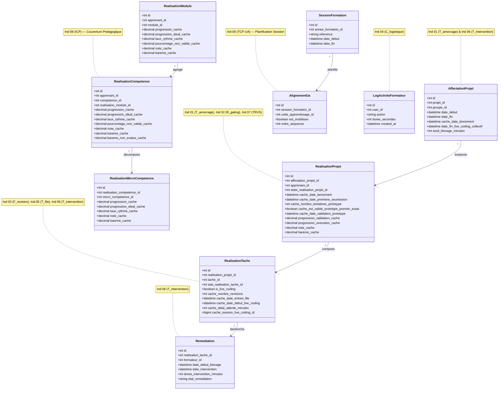

# Diagramme de Classes des Données Calculées et Mises en Cache (`cache_`) — Tableau de Bord

Ce document formalise l'architecture des données calculées et dénormalisées (`cache_` et `_cache`) requises pour le fonctionnement en temps réel et les performances optimales du **Tableau de Bord** (Module `PkgTableauBord`) de Solicode LMS.

---

## 1. Diagramme de Classes Mermaid



---

## 2. Inventaire Exhaustif des Colonnes Mises en Cache

| Modèle & Table | Colonne BDD | Type SQL | Nullable | Indicateur Associé | Rôle & Utilité dans le Tableau de Bord | Déclencheur / Hook de Calcul |
| :--- | :--- | :---: | :---: | :---: | :--- | :--- |
| **AffectationProjet**<br>`affectation_projets` | `cache_date_lancement` | `datetime` | Oui | **Ind 01** — $T_{\text{amorçage}}$ | Date officielle de lancement pédagogique de l'affectation du projet pour la cohorte. | Initialisé lors du clic formateur ou synchro calendrier. |
| **RealisationProjet**<br>`realisation_projets` | `cache_date_lancement` | `datetime` | Oui | **Ind 01** — $T_{\text{amorçage}}$ | Dénormalisation de la date effective de démarrage du projet pour l'apprenant. | Synchronisé avec `AffectationProjet::cache_date_lancement`. |
| **RealisationProjet**<br>`realisation_projets` | `cache_date_premiere_soumission` | `datetime` | Oui | **Ind 01** — $T_{\text{amorçage}}$ | Horodatage exact de la première tâche soumise (`A_VALIDER` / `READY_FOR_LIVE_CODING`). | Saisi de manière idempotente lors de la 1ère soumission de tâche de niveau 1. |
| **RealisationProjet**<br>`realisation_projets` | `cache_nombre_tentatives_prototype` | `smallint` | Non (défaut: 0) | **Ind 02** — $R_{\text{gating}}$ | Nombre total de passages / évaluations du prototype Niveau 2. | Incrémenté lors de chaque soutenance / évaluation de tâche prototype. |
| **RealisationProjet**<br>`realisation_projets` | `cache_est_valide_prototype_premier_essai` | `boolean` | Oui (null=non évalué) | **Ind 02** — $R_{\text{gating}}$ | Statut de réussite immédiate du prototype au 1er passage (`true`, `false` ou `null`). | Évalué dès la fin de la 1ère tentative sur la tâche prototype. |
| **RealisationProjet**<br>`realisation_projets` | `cache_date_validation_prototype` | `datetime` | Oui | **Ind 02** — $R_{\text{gating}}$ | Horodatage de la validation finale du prototype (déverrouille la phase d'autonomie N3). | Enregistré lors du passage de la tâche prototype à l'état `VALIDEE`. |
| **RealisationProjet**<br>`realisation_projets` | `progression_validation_cache` | `decimal(5,2)` | Non (défaut: 0) | **Ind 07** — $\text{TRVS}$ | Taux d'avancement des tâches validées sur le projet (base du TRVS). | Recalculé lors de chaque validation / rejet de tâche du projet. |
| **RealisationProjet**<br>`realisation_projets` | `progression_execution_cache` | `decimal(5,2)` | Non (défaut: 0) | Vue Projet | Taux global des tâches terminées ou en cours. | Recalculé lors des transitions d'états des tâches. |
| **RealisationProjet**<br>`realisation_projets` | `note_cache` | `decimal(5,2)` | Oui | **Ind 07** — $\text{TRVS}$ / Pearson | Note globale calculée du projet (surveillé N2 + autonome N3). | Recalculé via `CalculNotesRealisationProjetService`. |
| **RealisationProjet**<br>`realisation_projets` | `bareme_cache` | `decimal(5,2)` | Non (défaut: 0) | **Ind 07** — $\text{TRVS}$ | Somme des barèmes des tâches affectées. | Recalculé lors de la composition du livrable / projet. |
| **RealisationTache**<br>`realisation_taches` | `cache_nombre_revisions` | `smallint` | Non (défaut: 0) | **Ind 03** — $F_{\text{révision}}$ | Compteur cumulé des retours formateur avec demande de reprise (`REVISION_NECESSAIRE`). | Incrémenté à chaque transition de la tâche vers l'état révision. |
| **RealisationTache**<br>`realisation_taches` | `cache_date_entree_file` | `datetime` | Oui | **Ind 05** — $T_{\text{file}}$ | Timestamp d'arrivée dans la file d'attente FIFO Live Coding (`READY_FOR_LIVE_CODING`). | Enregistré lors du passage de la tâche à `READY_FOR_LIVE_CODING`. |
| **RealisationTache**<br>`realisation_taches` | `cache_date_debut_live_coding` | `datetime` | Oui | **Ind 05** — $T_{\text{file}}$ | Timestamp de démarrage effectif de la session de Live Coding avec le formateur. | Enregistré lors du passage à `LIVE_CODING_EN_COURS`. |
| **RealisationTache**<br>`realisation_taches` | `cache_delai_attente_minutes` | `integer` | Oui | **Ind 05** — $T_{\text{file}}$ | Durée exacte d'attente passée dans la file en minutes. | Calculé : `diffInMinutes(cache_date_entree_file, cache_date_debut_live_coding)`. |
| **RealisationTache**<br>`realisation_taches` | `cache_session_live_coding_id` | `bigint` | Oui | **Ind 05** — $T_{\text{file}}$ | Identifiant de la session mutualisée de passage (groupe de 4 apprenants Discord). | Assigné lors du lancement groupé de session Live Coding synchrone. |
| **RealisationCompetence**<br>`realisation_competences` | `progression_cache` | `decimal(5,2)` | Non (défaut: 0) | **Ind 08** — $\text{ICP}$ | Pourcentage réel de progression de la compétence (agrégation des micro-compétences). | Recalculé en cascade via `RealisationCompetenceCalculTrait`. |
| **RealisationCompetence**<br>`realisation_competences` | `progression_ideal_cache` | `decimal(5,2)` | Non (défaut: 0) | **Ind 08** — $\text{ICP}$ | Progression théorique idéale attendue selon le calendrier pédagogique. | Calculé via `CalculProgressionIdealService` (temporalité linéaire). |
| **RealisationCompetence**<br>`realisation_competences` | `taux_rythme_cache` | `decimal(5,2)` | Non (défaut: 0) | **Ind 08** — $\text{ICP}$ | Ratio d'allure : `progression_cache / progression_ideal_cache`. | Détermine si l'apprenant est en avance, à l'heure ou en retard. |
| **RealisationCompetence**<br>`realisation_competences` | `pourcentage_non_valide_cache`| `decimal(5,2)` | Non (défaut: 0) | **Ind 08** — $\text{ICP}$ | Taux de micro-compétences échouées ou rejetées. | Recalculé lors des évaluations sommatives. |
| **RealisationModule**<br>`realisation_modules` | `progression_cache` | `decimal(5,2)` | Non (défaut: 0) | Synthèse Formation | Moyenne pondérée des compétences du module. | Recalculé en cascade via `RealisationModuleCalculTrait`. |
| **RealisationModule**<br>`realisation_modules` | `progression_ideal_cache` | `decimal(5,2)` | Non (défaut: 0) | Synthèse Formation | Calendrier idéal du module. | Calculé à partir des dates de début et fin de module. |
| **RealisationMicroCompetence**<br>`realisation_micro_competences` | `progression_cache` | `decimal(5,2)` | Non (défaut: 0) | Feuille d'évaluation | Statut binaire converti en pourcentage ($0\%$ ou $100\%$). | Mis à jour lors de l'évaluation de la micro-compétence (`DONE`). |

---

## 3. Règles Techniques d'Implémentation & Gouvernance

1. **Préfixe Obligatoire `cache_`** :
   - Tout nouveau champ persistant issu d'un calcul ou d'une dénormalisation pour accélérer les requêtes du Dashboard **DOIT impérativement porter le préfixe `cache_`** (ex: `cache_date_premiere_soumission`, `cache_nombre_revisions`).
   - Les champs historiques (`progression_cache`, `note_cache`, `bareme_cache`) sont conservés pour rétrocompatibilité avec la cascade docimologique Gapp.

2. **Évitement de l'Erreur MySQL 1093** :
   - Pour les incrémentations (`cache_nombre_revisions`) ou les mises à jour directes par clé primaire, **ne jamais utiliser `Model::where('id', $id)->update(...)`** lorsqu'un scope global complexe ou des sous-requêtes sont actifs sur `RealisationTache`.
   - Utiliser systématiquement :
     ```php
     DB::table('realisation_taches')->where('id', $id)->update([
         'cache_nombre_revisions' => DB::raw('COALESCE(cache_nombre_revisions, 0) + 1')
     ]);
     ```

3. **Idempotence & Valeurs par Défaut** :
   - L'enregistrement des timestamps (`cache_date_premiere_soumission`, `cache_date_lancement`) doit vérifier l'absence de valeur antérieure pour ne jamais écraser la date initiale.
   - Les compteurs entiers sont initialisés à `0` (jamais `null`).
