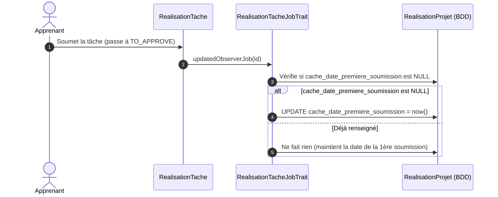

# Plan d'Implémentation — Sprint 1 : Indicateur 01 (Démarrage du Travail $T_{\text{amorçage}}$)

## 🎯 1. Description du Sprint & Objectifs Métier

Ce premier sprint réalise de bout en bout (**tranche verticale**) l'**Indicateur 01 — Démarrage du travail** ($T_{\text{amorçage}}$), de la base de données jusqu'aux tableaux de bord des trois acteurs (**Apprenant**, **Formateur**, **Responsable de formation**).

### Définition Métier de l'Indicateur :
$$T_{\text{amorçage}} = \text{cache\_date\_premiere\_soumission} - \text{cache\_date\_lancement}$$
- **Rôle pédagogique** : Mesurer la latence entre le top départ d'un sprint de projet donné par le formateur et la soumission de la première tâche pour validation par l'apprenant.
- **Règles d'Architecture SoliLMS appliquées** :
  1. **Convention de nommage des champs calculables** : Tout champ dénormalisé ou mis en cache en base de données pour accélérer les requêtes KPI **DOIT être préfixé par `cache_`**.
  2. **Emplacement de `cache_date_premiere_soumission`** : Il représente la mise en validation de la première tâche d'un projet pour un apprenant donné $\rightarrow$ **il appartient à la table `realisation_projets`** (modèle `RealisationProjet`).
  3. **Emplacement de `cache_date_lancement`** : Il représente le lancement officiel du sprint par le formateur pour la promotion $\rightarrow$ **il appartient à la table `affectation_projets`** (modèle `AffectationProjet`), avec recopie optionnelle sur `realisation_projets` pour éliminer toute jointure lors du calcul SQL.

---

## ⚠️ User Review Required

> [!IMPORTANT]
> **Points d'arbitrage validés avec le développeur :**
> - **Préfixe `cache_`** : Les colonnes sont nommées `cache_date_premiere_soumission` et `cache_date_lancement`.
> - **Table de rattachement** : `cache_date_premiere_soumission` est positionné sur `realisation_projets` (et non `realisation_taches`).
> - **Règle BDD inviolable** : L'agent génère le fichier de migration Laravel. L'exécution de `php artisan migrate` est effectuée manuellement par le développeur.

---

## 🧠 2. Algorithmes de Calcul des Champs `cache_`

### A. Calcul de `cache_date_premiere_soumission` (Table `realisation_projets`)



#### 1. Calcul Événementiel (Temps Réel via `JobManager`) :
- **Déclencheur** : Lorsqu'une `RealisationTache` liée à un `RealisationProjet` change d'état vers un état de soumission/validation (`workflowTache.code == 'TO_APPROVE'` ou `'READY_FOR_LIVE_CODING'`).
- **Règle de persistance** :
  ```php
  // Si le champ n'est pas encore renseigné, on fige l'instant présent
  if (is_null($realisationProjet->cache_date_premiere_soumission)) {
      $realisationProjet->update([
          'cache_date_premiere_soumission' => now()
      ]);
  }
  ```

#### 2. Calcul de Rattrapage Historique (Batch / Seeder / Commande) :
Pour les projets existants en base n'ayant pas encore ce cache :
```php
$premiereSoumission = HistoriqueRealisationTache::whereHas('realisationTache', function ($q) use ($projetId) {
        $q->where('realisation_projet_id', $projetId);
    })
    ->whereHas('etatRealisationTache.workflowTache', function ($q) {
        $q->whereIn('code', ['TO_APPROVE', 'READY_FOR_LIVE_CODING']);
    })
    ->min('created_at');

$realisationProjet->update([
    'cache_date_premiere_soumission' => $premiereSoumission
]);
```

---

### B. Calcul de `cache_date_lancement` (Table `affectation_projets`)

#### 1. Définition et Règles de Calcul :
- **Source prioritaire (Explicite)** : L'horodatage précis (`dateTime`) où le formateur valide le lancement de la session ou du projet.
- **Source calculée automatique (Par activité)** : Si non renseigné manuellement, le système prend le plus ancien des événements suivants :
  $$\text{cache\_date\_lancement} = \min \left( \text{MIN}(\text{date\_passage\_IN\_PROGRESS}), \, \text{date\_debut à 09:00} \right)$$
- **Code de calcul dans `AffectationProjetCalculTrait`** :
  ```php
  public function determinerDateLancement(AffectationProjet $affectation): Carbon
  {
      if ($affectation->cache_date_lancement) {
          return Carbon::parse($affectation->cache_date_lancement);
      }

      // Recherche de la première tâche passée en "IN_PROGRESS" par un apprenant du groupe
      $premierDemarrage = HistoriqueRealisationTache::whereHas('realisationTache.realisationProjet', function ($q) use ($affectation) {
              $q->where('affectation_projet_id', $affectation->id);
          })
          ->whereHas('etatRealisationTache.workflowTache', function ($q) {
              $q->where('code', 'IN_PROGRESS');
          })
          ->min('created_at');

      $dateLancement = $premierDemarrage 
          ? Carbon::parse($premierDemarrage)
          : ($affectation->date_debut ? Carbon::parse($affectation->date_debut)->setTime(9, 0, 0) : $affectation->created_at);

      $affectation->update(['cache_date_lancement' => $dateLancement]);

      return $dateLancement;
  }
  ```

---

## 🛠️ 3. Modifications Proposées (Proposed Changes)

### Composant 1 : Migrations BDD (`modules/PkgRealisationProjets/Database/Migrations/`)

#### [NEW] `2026_10_13_120000_add_cache_dashboard_columns_to_affectation_projets_table.php`
Ajout de la colonne `cache_date_lancement` dans `affectation_projets`.
```php
Schema::table('affectation_projets', function (Blueprint $table) {
    $table->dateTime('cache_date_lancement')->nullable()->after('date_fin')->index();
});
```

#### [NEW] `2026_10_13_120100_add_cache_dashboard_columns_to_realisation_projets_table.php`
Ajout de la colonne `cache_date_premiere_soumission` (et dénormalisation de `cache_date_lancement`) dans `realisation_projets`.
```php
Schema::table('realisation_projets', function (Blueprint $table) {
    $table->dateTime('cache_date_premiere_soumission')->nullable()->after('date_fin')->index();
    $table->dateTime('cache_date_lancement')->nullable()->after('cache_date_premiere_soumission')->index();
});
```

---

### Composant 2 : Logique Métier & Calculs (`PkgRealisationProjets` & `PkgRealisationTache`)

#### [MODIFY] `modules/PkgRealisationProjets/Services/Traits/RealisationProjet/RealisationProjetCalculTrait.php`
- Ajout de `mettreAJourDatePremiereSoumission(RealisationProjet $projet)` :
  - Détecte si `cache_date_premiere_soumission` est vide et l'initialise.
  - Synchronise également `$projet->cache_date_lancement = $projet->affectationProjet->cache_date_lancement`.
- Ajout de `calculerTempsAmorcageMinutes(RealisationProjet $projet): ?int` :
  - Renvoie la différence en minutes entre `cache_date_premiere_soumission` et `cache_date_lancement`.

#### [MODIFY] `modules/PkgRealisationTache/Services/Traits/RealisationTache/RealisationTacheJobTrait.php`
- Dans la méthode `updatedObserverJob(int $id, string $token)` :
  - Dès que `etat_realisation_tache_id` change vers `TO_APPROVE` ou `READY_FOR_LIVE_CODING`, appeler `$realisationProjetService->mettreAJourDatePremiereSoumission($realisationTache->realisationProjet)`.

---

### Composant 3 : Service de Tableau de Bord (`modules/PkgTableauBord/Services/`)

#### [NEW] `modules/PkgTableauBord/Services/Traits/DashboardIndicateur01Trait.php`
Méthodes de calcul pour les 3 acteurs :
1. `getIndicateurAmorcageApprenant(int $realisationProjetId)` :
   - Renvoie le délai individuel formaté (ex: `1h15`), la moyenne de sa classe (`1h45`), et l'écart relatif.
2. `getIndicateurAmorcageFormateur(int $affectationProjetId)` :
   - Calcule le temps moyen de mise au travail de la classe (ex: `1h45`), le nombre d'apprenants ayant démarré (`17 / 20`), et la liste des apprenants en retard d'amorçage.
3. `getIndicateurAmorcageResponsable(array $groupeIds)` :
   - Calcule le temps moyen macroscopique et le benchmark inter-promotions (`DWB-101` : `1h45` vs `DMB-101` : `1h55`).

---

### Composant 4 : Interfaces Utilisateur V2 (Blade & Tailwind)

Intégration du KPI conformément aux maquettes validées :
- **Vue Apprenant** : Carte *"Mon délai de démarrage"* :
  - Valeur : `1h 15min`
  - Comparatif : `Moyenne promo : 1h 45min`
  - Statut visuel : Badge vert `Démarrage rapide`.
- **Vue Formateur** : Carte KPI *"Temps moyen de mise au travail"* :
  - Valeur : `1h 45min`
  - Progression : `17 / 20 apprenants démarrés (85%)`
  - Action : Bouton de relance pour les 3 retardataires.
- **Vue Responsable** : Carte KPI *"Délai moyen de prise en main du sprint"* :
  - Valeur : `1h 50min`
  - Comparatif : `DWB-101 (1h45)` vs `DMB-101 (1h55)`.

---

## 🧪 4. Plan de Vérification (Verification Plan)

### A. Vérification BDD & Migrations
1. Génération des deux fichiers de migration dans `modules/PkgRealisationProjets/Database/Migrations/`.
2. Notification au développeur pour exécuter manuellement :
   ```bash
   php artisan migrate
   ```
3. Vérification des colonnes créées via `SHOW COLUMNS FROM realisation_projets;`.

### B. Vérification des Algorithmes de Calcul
1. **Test unitaire / Tinker** :
   - Passer une tâche d'un projet de test à l'état `TO_APPROVE`.
   - Vérifier que `cache_date_premiere_soumission` sur `realisation_projets` est immédiatement horodaté.
   - Re-soumettre une seconde tâche du même projet : vérifier que la date ne change pas (idempotence).
2. **Test du calcul $T_{\text{amorçage}}$** :
   - Fixer `cache_date_lancement = 09:00` et `cache_date_premiere_soumission = 10:15`.
   - Vérifier que la méthode renvoie exactement `75 minutes` (`1h 15min`).

### C. Vérification UI 3 Acteurs
1. Affichage de la carte sur le dashboard Apprenant.
2. Affichage du KPI et du ratio 17/20 sur le dashboard Formateur.
3. Affichage du benchmark multi-promotions sur le dashboard Responsable.
