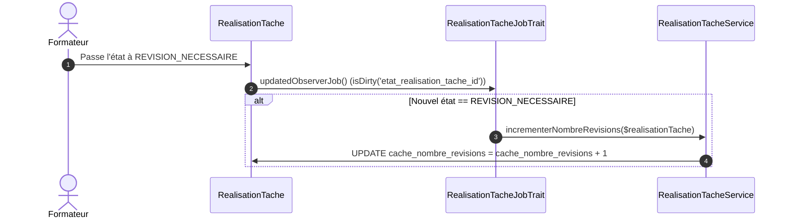

# Plan d'Implémentation — Sprint 3 : Indicateur 03 (Fréquence des Boucles de Révision $F_{\text{révision}}$)

## 🎯 1. Description du Sprint & Objectifs Métier

Ce troisième sprint implémente de bout en bout (**tranche verticale**) l'**Indicateur 03 — Fréquence Moyenne des Boucles de Révision / Qualité du Premier Rendu** ($F_{\text{révision}}$) sur le module `PkgTableauBord` :
- **BDD** : Ajout de la colonne dénormalisée `cache_nombre_revisions` sur la table `realisation_taches`.
- **Backend / Événements** : Détection et incrémentation automatique lors des transitions vers l'état `REVISION_NECESSAIRE` via `RealisationTacheJobTrait` et `RealisationTacheService`.
- **Services** : Calculs statistiques de fréquence unitaire, micro (Apprenant), méso (Formateur, avec extraction du Top 3 des tâches nécessitant un réalignement) et macro (Responsable, benchmark inter-promotions).
- **Frontend V2** : Nouveau composant Blade `kpi-revision.blade.php` et intégration dans les 3 vues étendant obligatoirement `layouts.admin-v2`.
- **Gouvernance de l'agent** : Enrichissement itératif du skill `pkg-tableau-bord` (Sprints 1, 2 et 3).

### Définition Métier de l'Indicateur :
$$F_{\text{révision}} = \frac{1}{K} \sum_{k=1}^{K} C_{\text{rejets}}(k)$$
$$\tau_{\text{conforme\_1er\_jet}} = \frac{K_{(C_{\text{rejets}}=0)}}{K} \times 100$$
- **Rôle pédagogique** : Mesurer l'autonomie et la stabilité du livrable dès le premier rendu, détecter les consignes ambiguës ou les blocages cognitifs (surcharge extrinsèque).

---

## ⚠️ Points d'Arbitrage & Règles SoliLMS

> [!CRITICAL]
> - **Règle BDD Inviolable** : L'agent génère le fichier de migration Laravel. L'exécution de `php artisan migrate` est effectuée **exclusivement par le développeur**.
> - **Convention `cache_`** : Le champ porte obligatoirement le préfixe `cache_` (`cache_nombre_revisions`).
> - **Règle Gapp `$fillable`** : Interdiction formelle de surcharger manuellement `$fillable` dans `RealisationTache.php`. La synchronisation est assurée par Gapp via `gapp make:crud RealisationTache`.
> - **Layout V2** : Conservation exclusive du design épuré V2 avec Tailwind CSS (`layouts.admin-v2`).

---

## 🧠 2. Algorithmes de Calcul & Seuils Didactiques

### A. Cycle de Vie Événementiel lors d'un Rejet en Révision

### B. Seuils Didactiques & Statuts Visuels

| Zone | Seuil $F_{\text{révision}}$ | Diagnostic Didactique | Statut & Badge UI |
| :--- | :---: | :--- | :--- |
| 🟢 **Optimal** | $< 0{,}5$ itération | Consignes limpides, critères d'acceptation maîtrisés dès le 1er jet. | `bg-emerald-50 text-emerald-700` *"Qualité initiale élevée"* |
| 🟡 **Vigilance** | $0{,}5 \le F \le 1{,}2$ itérations | Ajustements ordinaires du code, démarche d'apprentissage normale. | `bg-amber-50 text-amber-700` *"Ajustements en cours"* |
| 🔴 **Alerte Tâtonnement** | $> 1{,}2$ itérations | Flou des critères ou surcharge cognitive $\rightarrow$ démarche par essais-erreurs. | `bg-rose-50 text-rose-700` *"Réalignement requis"* |

---

## 📅 3. Déroulement Prévu des Étapes du Sprint 3

### Étape 1 : Base de Données (`app-migration`)
- Fichier : `modules/PkgRealisationTache/Database/Migrations/2026_10_13_160000_add_cache_nombre_revisions_to_realisation_taches_table.php`
- Colonne : `cache_nombre_revisions` (`unsignedInteger`, `default(0)`).
- Action Développeur : `php artisan migrate`, `gapp meta:sync`, `gapp make:crud RealisationTache`.

### Étape 2 : Traçage Métier & Incrémentation Événementielle (`pkg-realisation-tache`)
- Méthode dans `RealisationTacheService` : `incrementerNombreRevisions(RealisationTache $realisationTache)`.
- Intégration dans `RealisationTacheJobTrait` : détection de l'état `REVISION_NECESSAIRE`.

### Étape 3 : Calculs Statistiques dans la Couche Service (`pkg-tableau-bord`)
- Création du trait `DashboardIndicateur03Trait` :
  - `getIndicateurRevisionApprenant($realisationProjet)` : Fréquence individuelle et taux de réussite 1er jet.
  - `getIndicateurRevisionFormateur($affectationProjet)` : Fréquence de cohorte, taux sans reprise, et extraction du **Top 3 des tâches nécessitant un réalignement**.
  - `getIndicateurRevisionResponsable(array $groupeIds = [], ?int $projetId = null)` : Fréquence macroscopique et benchmark inter-promotions.
- Intégration dans `TableauBordService`.

### Étape 4 : Contrôleurs & Vues Blade V2 (`app-controller`, `app-blade`)
- Injection dans les contrôleurs (`TableauBordApprenantController`, `TableauBordFormateurController`, `TableauBordResponsableController`).
- Création du composant `modules/PkgTableauBord/resources/views/components/kpi-revision.blade.php`.
- Intégration dans `apprenant/index.blade.php`, `formateur/index.blade.php` et `responsable/index.blade.php`.

### Étape 5 : Commande Artisan de Rattrapage & Recette
- Commande `php artisan dashboard:recalculer-revisions` : analyse `historique_realisation_taches` pour initialiser `cache_nombre_revisions`.
- Recette live des 3 contrôleurs.
