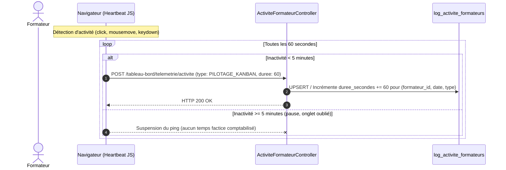

# Plan d'Implémentation — Sprint 4 : Indicateur 04 (Charge Logistique Hebdomadaire du Formateur $C_{\text{logistique}}$)

## 🎯 1. Description du Sprint & Objectifs Métier

Ce quatrième sprint implémente la tranche verticale complète de l'**Indicateur 04 — Volume horaire hebdomadaire de charge logistique et administrative** ($C_{\text{logistique}}$) sur le module `PkgTableauBord` :
- **BDD** : Création de la table `log_activite_formateurs` avec colonne `reference` unique obligatoire pour stocker le temps effectif agrégé par formateur, type d'activité, date et semaine ISO-8601.
- **Frontend / Télémétrie Client** : Module JavaScript / Alpine.js de heartbeat discret (ping de 60s) avec **verrou d'inactivité à 5 minutes** (suspension automatique sans interaction utilisateur) et exclusion des sessions directes de Live Coding.
- **Backend / Contrôleur de Télémétrie** : Endpoint sécurisé `ActiviteFormateurController@ping` pour réceptionner et incrémenter le temps actif de manière idempotente.
- **Services Métier** : Trait `DashboardIndicateur04Trait` dans `TableauBordService` calculant le volume horaire hebdomadaire individuel (Formateur) avec ventilation ($T_{\text{pilotage}}$, $T_{\text{file}}$, $T_{\text{bordereaux}}$) et la charge moyenne d'équipe avec benchmark par formateur (Responsable).
- **Composants Blade V2** : Nouveau composant `kpi-charge-logistique.blade.php`, intégration dans `formateur/index.blade.php` et `responsable/index.blade.php` sous `layouts.admin-v2`.
- **Outil de Simulation & Recette** : Commande artisan `dashboard:simuler-activite-formateurs` pour peupler des données réalistes de test et valider les calculs et le rendu en live.

### Formule Mathématique Métier :
$$C_{\text{logistique}}(f, w) = T_{\text{pilotage}}(f, w) + T_{\text{file}}(f, w) + T_{\text{bordereaux}}(f, w)$$
$$T_{\text{activite}}(f, w) = \frac{\sum \text{durée\_interactions\_actives}(f, w)}{3600}$$
$$\text{Charge Moyenne Collective} = \frac{1}{|F|} \sum_{f \in F} C_{\text{logistique}}(f, w)$$

---

## ⚠️ Points d'Arbitrage & Règles SoliLMS

> [!CRITICAL]
> - **Règle BDD Inviolable** : L'agent génère le fichier de migration Laravel avec la colonne `reference` unique. L'exécution de `php artisan migrate` est effectuée **exclusivement par le développeur**.
> - **Sécurité & Télémétrie** : L'endpoint de heartbeat vérifie obligatoirement l'authentification et le profil Formateur actif.
> - **Verrou d'Inactivité** : Si l'utilisateur reste inactif plus de 5 minutes consécutives (`mousemove`, `keydown`, `click`, `scroll`), aucun ping n'est émis.
> - **Règle Gapp `$fillable`** : Interdiction formelle de surcharger manuellement `$fillable` dans le modèle `LogActiviteFormateur.php`.
> - **Layout V2** : Conservation exclusive du design épuré V2 avec Tailwind CSS (`layouts.admin-v2`).

---

## 🧠 2. Architecture & Seuils Didactiques

### A. Flux de Télémétrie et Détection d'Inactivité

### B. Seuils Didactiques & Statuts Visuels

| Zone | Seuil $C_{\text{logistique}}$ | Diagnostic Didactique | Statut & Badge UI |
| :--- | :---: | :--- | :--- |
| 🟢 **Optimal (Allégé)** | $\le 2{,}5\,h/\text{sem}$ | Micro-suivi fluide et automatisé. Temps maximal libéré pour le tutorat actif. | `bg-emerald-50 text-emerald-700` *"Logistique optimisée"* |
| 🟡 **Vigilance** | $2{,}5\,h < C \le 5{,}0\,h/\text{sem}$ | Charge notable mais soutenable, surveillance des pics d'évaluation. | `bg-amber-50 text-amber-700` *"Charge notable"* |
| 🔴 **Saturation Administrative** | $> 5{,}0\,h/\text{sem}$ | **Surcharge bureaucratique** : le formateur passe trop de temps sur le pointage. | `bg-rose-50 text-rose-700` *"Surcharge bureaucratique"* |

---

## 📅 3. Déroulement des Étapes du Sprint 4

### Étape 1 : Schéma de Données & Modèle (`app-migration`, `app-model`)
- Migration : `modules/PkgTableauBord/Database/Migrations/2026_10_13_170000_create_log_activite_formateurs_table.php`
  - Colonnes : `id`, `formateur_id`, `type_activite`, `duree_secondes`, `date_activite`, `semaine_annee`, `reference`, `timestamps`.
  - Clés étrangères et index composites : `['formateur_id', 'semaine_annee']`, `['date_activite']`, `['type_activite']`.
- Modèle : `Modules\PkgTableauBord\Models\LogActiviteFormateur`
  - Constantes d'activités : `TYPE_PILOTAGE_KANBAN`, `TYPE_GESTION_FILE_FIFO`, `TYPE_EXPORT_BORDEREAU`.
  - Relations : `formateur()` vers `Modules\PkgFormation\Models\Formateur`.
- Action Développeur : `php artisan migrate`.

### Étape 2 : Endpoint de Télémétrie & Script Heartbeat (`app-controller`, `app-blade`)
- Contrôleur : `Modules\PkgTableauBord\Controllers\ActiviteFormateurController`
  - Méthode `ping(Request $request)` : validation des types autorisés, résolution du formateur connecté, enregistrement ou incrémentation idempotente (+60s).
- Routes : `POST /tableau-bord/telemetrie/activite` dans `tableauBordRoute.custom.php`.
- Composant Blade / JS : `resources/views/components/telemetrie-activite.blade.php`
  - Script heartbeat avec écouteurs d'événements utilisateur et minuterie de veille 5 minutes.

### Étape 3 : Logique Métier & Calculs Statistiques (`app-service`, `pkg-tableau-bord`)
- Création du trait : `Modules\PkgTableauBord\Services\Traits\DashboardIndicateur04Trait.php`
  - `getIndicateurChargeLogistiqueFormateur(?Formateur $formateur, ?string $semaine = null): array`
  - `getIndicateurChargeLogistiqueResponsable(?string $semaine = null): array`
- Intégration dans `TableauBordService`.

### Étape 4 : Contrôleurs & Vues Blade V2 (`app-controller`, `app-blade`)
- Injection dans `TableauBordFormateurController` et `TableauBordResponsableController`.
- Nouveau composant Blade : `resources/views/components/kpi-charge-logistique.blade.php`.
- Intégration dans `formateur/index.blade.php` (grille des 4 indicateurs + jauge 3h) et inclusion du composant de télémétrie.
- Intégration dans `responsable/index.blade.php` (carte macroscopique globale 4ème KPI + colonne benchmark par formateur).

### Étape 5 : Outil de Simulation & Recette Live
- Commande artisan : `php artisan dashboard:simuler-activite-formateurs` permettant de générer des données de télémétrie réalistes sur la semaine courante.
- Tests PHPUnit / scripts de recette live sur les contrôleurs formateur et responsable.
- Mise à jour de la documentation du skill `pkg-tableau-bord`.
