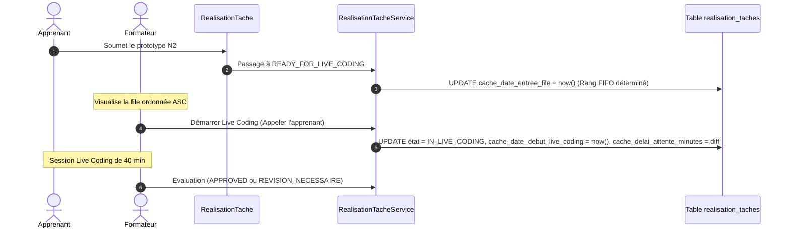

# Plan d'Implémentation — Sprint 5 : Indicateur 05 (Délai de Traitement de la File d'Attente $T_{\text{file}}$)

## 🎯 1. Description du Sprint & Objectifs Métier

Ce cinquième sprint implémente la tranche verticale complète de l'**Indicateur 05 — Délai Moyen de Traitement de la File d'Attente Live Coding** ($T_{\text{file}}$ ou $W_{\text{file}}$) sur le module `PkgTableauBord` :
- **BDD** : Ajout des colonnes dénormalisées de gestion de file FIFO sur la table `realisation_taches` (`cache_date_entree_file`, `cache_date_debut_live_coding`, `cache_delai_attente_minutes`, `cache_session_live_coding_id`).
- **Backend / Événements** : Traçage automatique des transitions de statut de workflow vers `READY_FOR_LIVE_CODING` (entrée dans la file FIFO) et `IN_LIVE_CODING` (démarrage du Live Coding et calcul du délai d'attente effectif).
- **Services Métier** : Trait `DashboardIndicateur05Trait` dans `TableauBordService` calculant :
  - **Pour l'Apprenant** : Son statut d'attente, son rang FIFO exact (`Rang #1`, `Rang #2`...), le temps d'attente déjà écoulé et l'estimation de l'heure de passage.
  - **Pour le Formateur** : La file d'attente active ordonnée par `cache_date_entree_file ASC`, l'identification de l'apprenant en cours de soutenance, le délai moyen de prise en charge et le diagnostic de cadence.
  - **Pour le Responsable** : Le délai d'attente moyen macroscopique et le benchmark inter-promotions pour détecter les goulets d'étranglement didactiques.
- **Composants Blade V2** : Nouveau composant `kpi-file-attente.blade.php` et console opérationnelle FIFO `file-attente-console.blade.php` pour le formateur, bandeau dynamique pour l'apprenant, intégration dans les trois vues sous `layouts.admin-v2`.
- **Simulation & Recette** : Commande artisan `dashboard:simuler-file-attente` pour peupler des cas concrets de file d'attente (apprenants en attente, apprenant en cours) et valider la réactivité des vues.

### Formule Mathématique Métier :
$$T_{\text{file}}(j) = \frac{t_{\text{début\_live\_coding}}(j) - t_{\text{soumission\_prototype}}(j)}{60} \quad (\text{en minutes})$$
$$T_{\text{file\_moyen}} = \frac{1}{M} \sum_{j=1}^{M} T_{\text{file}}(j)$$
$$T_{\text{estime\_passage}} = \text{Rang}_{\text{apprenant}} \times \Delta t_{\text{cadence}}$$

---

## ⚠️ Points d'Arbitrage & Règles SoliLMS

> [!CRITICAL]
> - **Règle BDD Inviolable** : L'agent génère le fichier de migration Laravel. L'exécution de `php artisan migrate` est effectuée **exclusivement par le développeur**.
> - **Convention `cache_`** : Les colonnes dénormalisées portent impérativement le préfixe `cache_` (`cache_date_entree_file`, `cache_date_debut_live_coding`, `cache_delai_attente_minutes`, `cache_session_live_coding_id`).
> - **Règle Gapp `$fillable`** : Interdiction de surcharger `$fillable` dans `RealisationTache.php`.
> - **Layout V2** : Conservation exclusive du design épuré V2 avec Tailwind CSS (`layouts.admin-v2`).

---

## 🧠 2. Architecture & Seuils Didactiques

### A. Cycle de Vie d'une Tâche dans la File FIFO

### B. Seuils Didactiques & Statuts Visuels

| Zone | Seuil $T_{\text{file}}$ | Diagnostic Didactique | Statut & Badge UI |
| :--- | :---: | :--- | :--- |
| 🟢 **Fluide** | $\le 30\,\text{min}$ | Cadence optimale, absorption immédiate des prototypes soumis. | `bg-emerald-50 text-emerald-700` *"File fluide"* |
| 🟡 **Vigilance** | $30\,\text{min} < T \le 60\,\text{min}$ | Flux d'évaluation ralenti, accumulation progressive. | `bg-amber-50 text-amber-700` *"Charge notable"* |
| 🔴 **Saturation** | $> 60\,\text{min}$ ou $\ge 5$ en attente | **Goulet d'étranglement critique** : risque de démotivation. | `bg-rose-50 text-rose-700` *"Goulet critique (session 4x4 recommandée)"* |

---

## 📅 3. Déroulement des Étapes du Sprint 5

### Étape 1 : Schéma de Données (`app-migration`)
- Migration : `modules/PkgRealisationTache/Database/Migrations/2026_10_13_180000_add_file_attente_columns_to_realisation_taches_table.php`
  - `cache_date_entree_file` (`timestamp NULL`, indexé)
  - `cache_date_debut_live_coding` (`timestamp NULL`)
  - `cache_delai_attente_minutes` (`unsignedInteger NULL`)
  - `cache_session_live_coding_id` (`string NULL`, indexé)
- Action Développeur : `php artisan migrate`, `gapp meta:sync`, `gapp make:crud RealisationTache`.

### Étape 2 : Traçage Métier & Incrémentation Événementielle (`pkg-realisation-tache`)
- Intégration dans `RealisationTacheJobTrait` et `RealisationTacheService` :
  - Détection transition `READY_FOR_LIVE_CODING` : enregistre `cache_date_entree_file = now()`.
  - Détection transition `IN_LIVE_CODING` : enregistre `cache_date_debut_live_coding = now()` et calcule `cache_delai_attente_minutes`.
  - Méthode d'action : `demarrerLiveCoding(RealisationTache $realisationTache, ?string $sessionId = null)`.

### Étape 3 : Couche Service & Calculs Statistiques (`pkg-tableau-bord`, `app-service`)
- Création du trait : `Modules\PkgTableauBord\Services\Traits\DashboardIndicateur05Trait.php`
  - `getIndicateurFileAttenteApprenant(RealisationProjet $realisationProjet, User $user): array`
  - `getIndicateurFileAttenteFormateur(?AffectationProjet $affectationProjet): array`
  - `getIndicateurFileAttenteResponsable(array $groupeIds = [], ?int $projetId = null): array`
- Intégration dans `TableauBordService`.

### Étape 4 : Contrôleurs & Vues Blade V2 (`app-controller`, `app-blade`)
- Injection dans `TableauBordApprenantController`, `TableauBordFormateurController`, `TableauBordResponsableController`.
- Composant carte KPI : `resources/views/components/kpi-file-attente.blade.php`.
- Console opérationnelle FIFO : `resources/views/components/file-attente-console.blade.php` pour le formateur.
- Bandeau d'attente FIFO dynamique pour l'apprenant dans `apprenant/index.blade.php`.
- Matrice comparative dans `responsable/index.blade.php`.

### Étape 5 : Outil de Simulation & Recette Live
- Commande artisan : `php artisan dashboard:simuler-file-attente`.
- Tests unitaires et fonctionnels complets.
- Mise à jour du skill `pkg-tableau-bord`.
