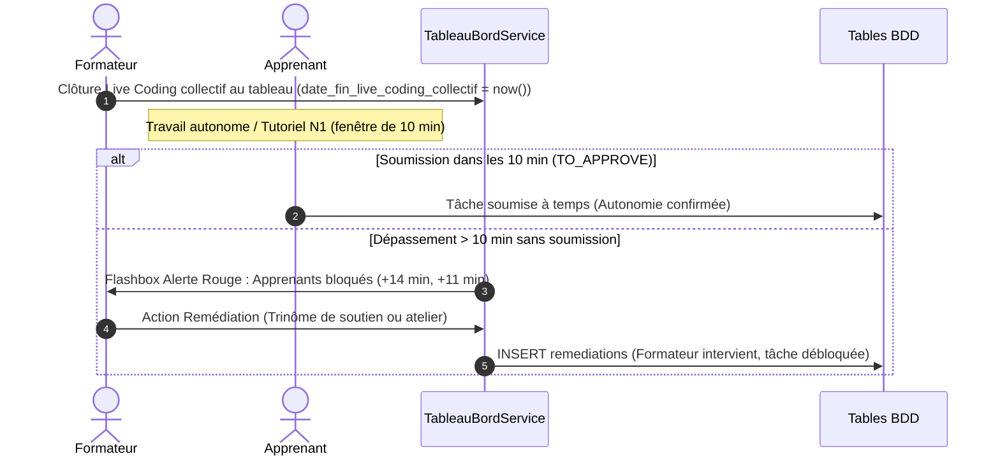

# Plan d'Implémentation — Sprint 6 : Indicateur 06 (Taux d'Intervention et de Remédiation Ciblée $T_{\text{intervention}}$)

## 🎯 1. Description du Sprint & Objectifs Métier

Ce sixième sprint implémente la tranche verticale complète de l'**Indicateur 06 — Taux d'Intervention et de Remédiation Formateur Post-Peer Learning** ($T_{\text{intervention}}$) sur le module `PkgTableauBord` :
- **BDD** : 
  - Ajout sur la table `affectation_projets` des colonnes `date_fin_live_coding_collectif` (`timestamp NULL`) et **`seuil_blocage_minutes`** (`unsignedInteger default(10)`), permettant d'ajuster ce délai pédagogique lors de l'affectation du projet.
  - Création de la table `remediations` avec colonne `reference` unique pour tracer les interventions d'étayage didactique (individuelle, trinôme d'entraide, atelier de soutien).
- **Backend / Événements** : Détection des dépassements du seuil critique paramétré (par défaut $+10$ min) post-Live Coding collectif pour les apprenants n'ayant pas encore soumis leur livrable de tutoriel.
- **Services Métier** : Trait `DashboardIndicateur06Trait` dans `TableauBordService` calculant :
  - **Pour l'Apprenant** : Message bienveillant d'accompagnement si en blocage à $+10$ min.
  - **Pour le Formateur** : Taux d'intervention ($T_{\text{intervention}} = 88\%$), nombre d'apprenants en attente de soutien, et alimentation de la **Flashbox Alerte Seuil 10 min** (noms, avatars, temps de dépassement `+14 min`, `+11 min`).
  - **Pour le Responsable** : Taux global de couverture des blocages et intégration dans la matrice comparative inter-promotions.
- **Composants Blade V2** : Nouveau composant `kpi-intervention.blade.php`, composant d'alerte `flashbox-alerte-blocages.blade.php`, boîte de dialogue apprenant et colonne dédiée dans la vue responsable sous `layouts.admin-v2`.
- **Simulation & Recette** : Commande artisan `dashboard:simuler-remediations` configurant les cas de dépassement et d'étayage conformes à la maquette.

### Formule Mathématique Métier :
$$T_{\text{intervention}} = \frac{N_{\text{remédiations\_effectives}}}{N_{\text{besoin\_révision}(+10\,\text{min})}} \times 100$$
$$t_{\text{seuil}} = t_{\text{fin\_live\_coding\_collectif}} + 10\,\text{min}$$

---

## ⚠️ Points d'Arbitrage & Règles SoliLMS

> [!CRITICAL]
> - **Règle BDD Inviolable** : L'agent génère les fichiers de migration Laravel avec la colonne `reference` unique. L'exécution de `php artisan migrate` est effectuée **exclusivement par le développeur**.
> - **Tolérance de Schéma** : Le code applicatif vérifiera `Schema::hasTable('remediations')` et `Schema::hasColumn(...)` pour garantir la robustesse tant avant qu'après migration.
> - **Règle Gapp `$fillable`** : Interdiction de surcharger `$fillable` manuellement dans le modèle `Remediation.php`.
> - **Layout V2** : Conservation exclusive du design épuré V2 avec Tailwind CSS (`layouts.admin-v2`).

---

## 🧠 2. Architecture & Seuils Didactiques

### A. Mécanisme Déclencheur Didactique (+10 Minutes)

### B. Seuils Didactiques & Statuts Visuels

| Zone | Seuil $T_{\text{intervention}}$ | Diagnostic Didactique | Statut & Badge UI |
| :--- | :---: | :--- | :--- |
| 🟢 **Excellence Réactive** | $\ge 85\,\%$ | Réactivité optimale. Aucun apprenant n'est laissé en échec silencieux. | `bg-emerald-50 text-emerald-700` *"Excellence (&ge; 85%)"* |
| 🟡 **Vigilance** | $60\,\% \le T < 85\,\%$ | Charge active, certains apprenants nécessitent encore un étayage formalisé. | `bg-amber-50 text-amber-700` *"Charge active"* |
| 🔴 **Rupture d'Étayage** | $< 60\,\%$ | **Déficit d'accompagnement critique** : risque de décrochage immédiat. | `bg-rose-50 text-rose-700` *"Rupture d'accompagnement"* |

---

## 📅 3. Déroulement des Étapes du Sprint 6

### Étape 1 : Schéma de Données (`app-migration`, `app-model`)
- Migration 1 : `modules/PkgCreationProjet/Database/Migrations/2026_10_13_190000_add_date_fin_live_coding_collectif_to_affectation_projets.php`
- Migration 2 : `modules/PkgTableauBord/Database/Migrations/2026_10_13_190100_create_remediations_table.php`
- Modèle : `Modules\PkgTableauBord\Models\Remediation.php`
- Action Développeur : `php artisan migrate`.

### Étape 2 : Couche Service & Calculs Métier (`pkg-tableau-bord`, `app-service`)
- Création du trait : `Modules\PkgTableauBord\Services\Traits\DashboardIndicateur06Trait.php`
  - `getIndicateurInterventionApprenant(?RealisationProjet $realisationProjet, ?User $user): array`
  - `getIndicateurInterventionFormateur(?AffectationProjet $affectationProjet, ?Formateur $formateur): array`
  - `getIndicateurInterventionResponsable(array $groupeIds = [], ?int $projetId = null): array`
  - `enregistrerRemediation(int $realisationTacheId, int $formateurId, string $type, ?string $diagnostic = null): Remediation`
- Intégration dans `TableauBordService`.

### Étape 3 : Contrôleurs & Vues Blade V2 (`app-controller`, `app-blade`)
- Injection dans `TableauBordApprenantController`, `TableauBordFormateurController`, `TableauBordResponsableController`.
- Composant carte KPI : `resources/views/components/kpi-intervention.blade.php`.
- Composant Flashbox alerte : `resources/views/components/flashbox-alerte-blocages.blade.php`.
- Intégration dans `apprenant/index.blade.php`, `formateur/index.blade.php` et `responsable/index.blade.php`.

### Étape 4 : Outil de Simulation & Recette Live
- Commande artisan : `php artisan dashboard:simuler-remediations`.
- Recette live validée sur les 3 contrôleurs.
- Mise à jour du skill `pkg-tableau-bord`.
