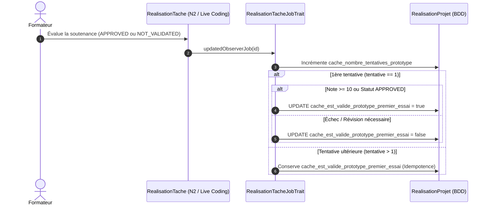
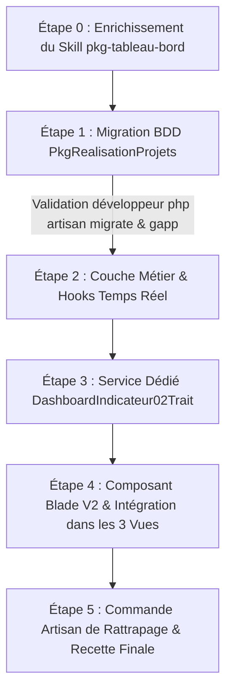

# Plan d'Implémentation — Sprint 2 : Indicateur 02 (Validation du Prototype $R_{\text{gating}}$)

## 🎯 1. Description du Sprint & Objectifs Métier

Ce deuxième sprint implémente de bout en bout (**tranche verticale**) l'**Indicateur 02 — Validation du Prototype au Premier Essai** ($R_{\text{gating}}$) sur le module `PkgTableauBord` :
- **BDD** : Ajout des colonnes horodatées et dénormalisées portant obligatoirement le préfixe `cache_`.
- **Backend / Événements** : Détection et traçage du premier passage lors de la soutenance/évaluation du prototype Niveau 2 (Live Coding) via `RealisationTacheJobTrait` / Observers.
- **Services** : Calculs statistiques agrégés de réussite directe, seuils didactiques et ratios pour les 3 acteurs (**Apprenant**, **Formateur**, **Responsable de formation**).
- **Frontend V2** : Nouveau composant Blade [kpi-gating.blade.php](file:///c:/AppServer/solicode-lms/modules/PkgTableauBord/resources/views/components/kpi-gating.blade.php) et intégration dans les 3 vues étendant obligatoirement `layouts.admin-v2`.
- **Gouvernance de l'agent** : Enrichissement itératif du skill `pkg-tableau-bord` sans anticiper les sprints 3 à 9.

### Définition Métier de l'Indicateur :
$$R_{\text{gating}} = \frac{N_{\text{validés\_essai\_1}}}{N_{\text{évalués}}} \times 100$$
- **Rôle pédagogique** : Mesurer l'assimilation autonome des fondamentaux techniques (Niveau 2 *Adapter*) dès la première tentative, conditionnant l'accès débloqué au Projet Fil Rouge (Niveau 3 *Transposer*).
- **Règles d'Architecture SoliLMS appliquées** :
  1. **Convention de nommage `cache_`** : Tout champ dénormalisé ou issu d'un calcul pour accélérer les KPIs porte obligatoirement le préfixe `cache_` (ex: `cache_nombre_tentatives_prototype`, `cache_est_valide_prototype_premier_essai`).
  2. **Table de rattachement** : Chaque projet a un jalon de validation de prototype $\rightarrow$ rattachement sur la table `realisation_projets` (modèle `RealisationProjet`).
  3. **Règle Gapp `$fillable`** : Interdiction formelle de surcharger manuellement `$fillable` dans les modèles enfants ; synchronisation exclusive via `gapp make:crud RealisationProjet`.

---

## ⚠️ Points d'Arbitrage Validés avec le Développeur

> [!IMPORTANT]
> - **Règle BDD Inviolable** : L'agent génère le fichier de migration Laravel. L'exécution de `php artisan migrate` est effectuée **exclusivement par le développeur**.
> - **Validation Séquentielle** : Comme pour le Sprint 1, chaque étape technique est validée par le développeur avant de passer à la suivante.
> - **Architecture Layout V2** : Les vues de tableau de bord étendent obligatoirement `@extends('layouts.admin-v2')` et n'affichent **que les indicateurs fonctionnels** (Indicateurs 01 et 02).

---

## 🧠 2. Algorithmes de Calcul & Cycle de Vie Événementiel

### A. Déroulement Événementiel lors de l'Évaluation du Prototype



### B. Seuils Didactiques & Statuts Visuels

| Zone | Seuil $R_{\text{gating}}$ | Diagnostic Didactique | Statut & Badge UI |
| :--- | :---: | :--- | :--- |
| 🟢 **Excellence** | $\ge 80\,\%$ | Excellente assimilation des fondamentaux techniques. | `Excellence (>= 80%)` (Vert émeraude) |
| 🟡 **Vigilance** | $65\,\% \le R < 80\,\%$ | Hétérogénéité du groupe ; prérequis partiellement acquis. | `Vigilance (65-80%)` (Ambre) |
| 🔴 **Alerte** | $< 65\,\%$ | Illusion de maîtrise ; besoin immédiat de remédiation. | `Alerte (< 65%)` (Rose / Rouge) |

---

## 🛠️ 3. Découpage du Sprint en Étapes de Réalisation



---

### Étape 0 : Enrichissement du Skill `pkg-tableau-bord` (Socle de Référence)

**Objectif** : Mettre à jour la documentation du skill pour formaliser les règles de l'Indicateur 02.
- **Fichiers modifiés** :
  - `.agent/skills/pkg-tableau-bord/règles-gestion/règle-gestion-bdd-pkg-tableau-bord.md` : Ajout des colonnes `cache_nombre_tentatives_prototype`, `cache_est_valide_prototype_premier_essai`.
  - `.agent/skills/pkg-tableau-bord/règles-gestion/règle-gestion-indicateurs-pkg-tableau-bord.md` : Fiche détaillée de l'Indicateur 02 ($R_{\text{gating}}$).
  - `.agent/skills/pkg-tableau-bord/règles-gestion/règle-gestion-fonctionnalites-pkg-tableau-bord.md` : Ajout des fonctionnalités Gating pour Apprenant, Formateur, Responsable.

---

### Étape 1 : Migration Base de Données (`PkgRealisationProjets`)

**Objectif** : Créer le fichier de migration Laravel pour ajouter les colonnes nécessaires sur la table `realisation_projets`.
- **Fichier créé** :
  - `modules/PkgRealisationProjets/Database/Migrations/2026_10_13_130000_add_cache_gating_columns_to_realisation_projets_table.php` :
    ```php
    Schema::table('realisation_projets', function (Blueprint $table) {
        $table->unsignedSmallInteger('cache_nombre_tentatives_prototype')->default(0)->after('cache_date_lancement');
        $table->boolean('cache_est_valide_prototype_premier_essai')->nullable()->default(null)->after('cache_nombre_tentatives_prototype')->index();
        $table->dateTime('cache_date_validation_prototype')->nullable()->default(null)->after('cache_est_valide_prototype_premier_essai');
    });
    ```
- **Arrêt & Action Développeur** :
  1. `php artisan migrate`
  2. `gapp meta:sync`
  3. `gapp make:crud RealisationProjet`

---

### Étape 2 : Couche Métier & Hooks Événementiels

**Objectif** : Implémenter l'écoute d'évaluation du prototype et le calcul de premier passage.
- **Fichiers modifiés** :
  1. `modules/PkgRealisationProjets/Services/Traits/RealisationProjet/RealisationProjetCalculTrait.php` :
     - `mettreAJourGatingPrototype(RealisationProjet $projet, bool $estValide): void` :
       - Incrémente `cache_nombre_tentatives_prototype`.
       - Si premier essai : fige `cache_est_valide_prototype_premier_essai = $estValide`.
       - Si validé : renseigne `cache_date_validation_prototype = now()`.
  2. `modules/PkgRealisationTache/Services/Traits/RealisationTache/RealisationTacheJobTrait.php` :
     - Déclencheur : Lorsqu'une tâche de prototype (Niveau 2 / `is_live_coding`) passe à `APPROVED` ou `NOT_VALIDATED` / `REVISION_NECESSAIRE`, déclenche le calcul sur le `RealisationProjet`.

---

### Étape 3 : Service Dédié & Trait de Calcul KPI (`PkgTableauBord`)

**Objectif** : Développer le trait de calcul pour l'Indicateur 02 et l'injecter dans `TableauBordService`.
- **Fichiers modifiés / créés** :
  1. `modules/PkgTableauBord/Services/Traits/DashboardIndicateur02Trait.php` :
     - `getIndicateurGatingApprenant(RealisationProjet $realisationProjet): array` :
       - Statut individuel : `Validé (1er essai)` (vert), `En remédiation` (orange), ou `En attente d'évaluation`.
       - Accès Projet : `Débloqué` vs `Verrouillé`.
     - `getIndicateurGatingFormateur(AffectationProjet $affectationProjet): array` :
       - Taux de réussite au premier passage : $R_{\text{gating}} = N_{\text{validés\_1er}} / N_{\text{évalués}} \times 100$.
       - Effectif : `$valides / $evalues ($en_remediation en rattrapage)`.
       - Statut : `Excellence` ($\ge 80\%$), `Vigilance` ($65-80\%$), `Alerte` ($< 65\%$).
       - Liste nominative des apprenants orientés en remédiation.
     - `getIndicateurGatingResponsable(array $groupeIds): array` :
       - Taux macroscopique global et benchmark comparatif par promotion.
  2. `modules/PkgTableauBord/Services/TableauBordService.php` : Utilise `DashboardIndicateur02Trait`.

---

### Étape 4 : Composants Blade V2 & Intégration dans les 3 Vues

**Objectif** : Créer le composant graphique réutilisable et intégrer l'Indicateur 02 dans les vues respectant `layouts.admin-v2`.
- **Fichiers créés / modifiés** :
  1. `modules/PkgTableauBord/resources/views/components/kpi-gating.blade.php` : Composant Blade V2 avec Tailwind CSS affichant le statut apprenant ou la jauge formateur/responsable.
  2. `modules/PkgTableauBord/resources/views/apprenant/index.blade.php` : Intégration de la carte *"Validation du Prototype"* aux côtés de l'Indicateur 01.
  3. `modules/PkgTableauBord/resources/views/formateur/index.blade.php` : Intégration de la carte *"Validation au 1er passage"* et du bloc de convocation à l'atelier de remédiation.
  4. `modules/PkgTableauBord/resources/views/responsable/index.blade.php` : Ajout de la colonne $R_{\text{gating}}$ dans la matrice benchmark inter-promotions.

---

### Étape 5 : Commande Artisan de Rattrapage & Recette Finale

**Objectif** : Peupler les colonnes `cache_` sur les données existantes et tester l'ensemble.
- **Fichier créé** :
  - Commande Artisan `php artisan dashboard:recalculer-gating` : analyse l'historique des notes et validations des prototypes pour initialiser `cache_nombre_tentatives_prototype` et `cache_est_valide_prototype_premier_essai`.
- **Vérifications** :
  - Test d'idempotence (une 2nde évaluation ne modifie pas le résultat du premier essai).
  - Test de compilation Blade sans erreur.
  - Vérification visuelle sur les 3 dashboards.

---

## 🧪 4. Critères de Validation du Sprint 2

| Critère | Description | Méthode de Validation |
| :--- | :--- | :--- |
| **BDD & Gapp** | Colonnes `cache_` créées et synchronisées dans `BaseRealisationProjet` | `SHOW COLUMNS` & `$fillable` vérifié |
| **Idempotence** | Le statut du premier essai reste figé même après validation au 2nd passage | Test unitaire / script test |
| **Temps Réel** | L'évaluation d'un prototype met à jour le KPI sans délai | Observer / JobManager |
| **UI 3 Acteurs** | Les 3 dashboards affichent les données réelles issues de la BDD | Navigateur / compilation Blade |
