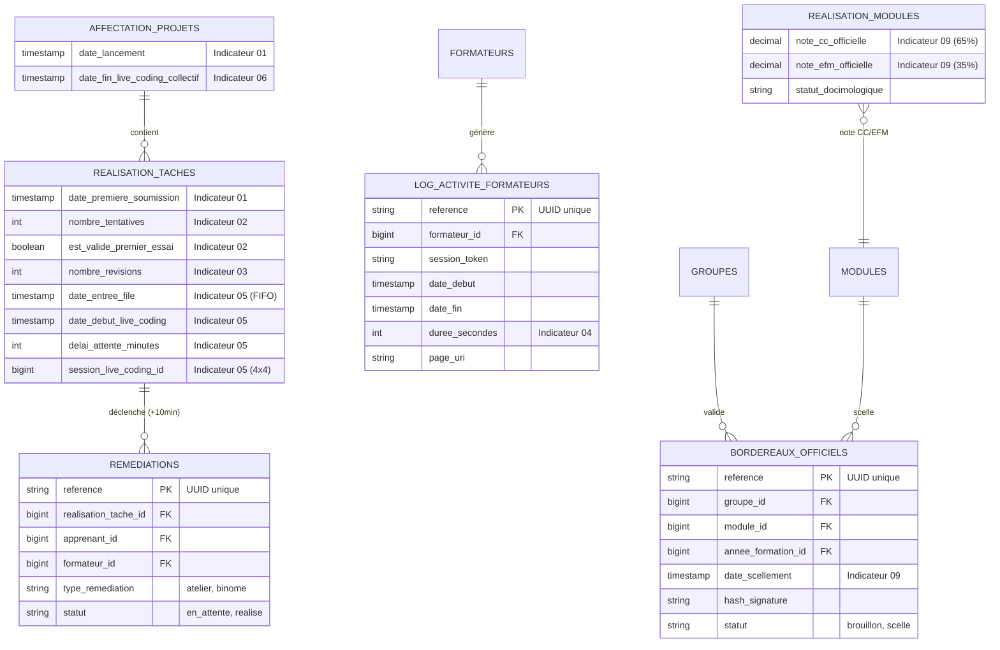

# Plan du Sprint 1 — Fondations Base de Données & Modèle Métier SoliLMS

- **Module principal** : `PkgTableauBord` (et extensions des modules `PkgRealisationTache`, `PkgRealisationProjets`, `PkgApprentissage`, `PkgFormation`)
- **Phase** : Phase 5 — Réalisation Technique
- **Skills mobilisés** : `app-migration`, `app-model`, `sys-gapp`, `sys-analyse`
- **Statut** : 🟡 Prêt pour exécution

---

## 🎯 1. Vision & Objectif du Sprint 1

Conformément à la **Règle Critique d'Intégrité BDD**, l'intégralité des modifications de schéma nécessaires aux 9 indicateurs de pilotage (Annexe M) pour les trois acteurs (**Apprenant**, **Formateur**, **Responsable de formation**) est regroupée et scellée dans ce **Sprint 1**.

### Objectifs Clés :
1. **Évolutions de Schéma Non Destructives** : Étendre les tables existantes sans impacter le fonctionnement actuel du LMS.
2. **Création des Nouvelles Entités Métier** : Ajouter les tables requises pour les remédiations, les logs d'activité et les bordereaux d'examen avec champ `reference` obligatoire.
3. **Préparation Gapp** : Inscrire les nouvelles entités dans `db_schemas/modules.json` et synchroniser les métadonnées (`gapp meta:sync`).
4. **Protocole de Sécurité** : Générer le code des migrations avec méthode `down()` réversible. **L'exécution de `php artisan migrate` est strictement réservée au développeur**.

---

## 🗺️ 2. Cartographie des Tables & Modifications BDD



---

## 📋 3. Matrice de Traçabilité : Indicateurs ↔ Colonnes BDD

| N° | Indicateur Métier | Table Impactée | Package | Colonnes / Entités Ajoutées | Rôle Technique |
| :--- | :--- | :--- | :--- | :--- | :--- |
| **01** | **Démarrage du Travail** | `realisation_taches`<br>`affectation_projets` | `PkgRealisationTache`<br>`PkgRealisationProjets` | `date_premiere_soumission`<br>`date_lancement` | Calcul de la latence de démarrage ($T_{\text{amorçage}}$). |
| **02** | **Validation Prototype (Gating N2)** | `realisation_taches` | `PkgRealisationTache` | `nombre_tentatives`<br>`est_valide_premier_essai` | Mesure du taux de réussite directe sans reprise ($R_{\text{gating}}$). |
| **03** | **Qualité du Code & Reprises** | `realisation_taches` | `PkgRealisationTache` | `nombre_revisions` | Comptabilisation des boucles de révision ($F_{\text{révision}}$). |
| **04** | **Charge Administrative Formateur** | `log_activite_formateurs` | `PkgFormation` / `PkgTableauBord` | *Nouvelle table complète* | Mesure du temps passé sur SoliLMS ($C_{\text{logistique}}$). |
| **05** | **File FIFO Live Coding** | `realisation_taches` | `PkgRealisationTache` | `date_entree_file`<br>`date_debut_live_coding`<br>`delai_attente_minutes`<br>`session_live_coding_id` | Ordonnancement chronologique strict FIFO ($T_{\text{file}}$) et sessions 4x4. |
| **06** | **Détection Blocages (+10 min)** | `workflow_taches`<br>`affectation_projets`<br>`remediations` | `PkgRealisationTache`<br>`PkgRealisationProjets` | État `BESOIN_REVISION`<br>`date_fin_live_coding_collectif`<br>*Nouvelle table* `remediations` | Détection automatique des retards post-séance et suivi des étayages. |
| **07** | **Cohérence Usage IA (Pearson $r$)** | `realisation_taches`<br>`realisation_projets` | `PkgRealisationTache`<br>`PkgRealisationProjets` | Index d'appariement notes $N2$ (prototype) vs $N3$ (projet libre) | Détection des écarts anormaux $\Delta > 5$ pts et corrélation $r$. |
| **08** | **Progression Référentiel National** | `realisation_micro_competences` | `PkgApprentissage` | Index d'agrégation globale par compétence et promotion | Taux de couverture macroscopique ($\text{ICP}$). |
| **09** | **Règle Docimologique 65/35** | `realisation_modules`<br>`bordereaux_officiels` | `PkgApprentissage` | `note_cc_officielle`<br>`note_efm_officielle`<br>*Nouvelle table* `bordereaux_officiels` | Calcul officiel $\tau_{\text{conformité}}$ et scellement d'examen. |

---

## 🏃 4. Découpage en Tâches Opérationnelles (WBS)

### Phase 1 : Inscription des Tables & Relations (`modules.json`)
- [ ] **Tâche 1.1** : Mettre à jour `db_schemas/modules.json` :
  - Ajouter `remediations` dans `PkgRealisationTache`.
  - Ajouter `log_activite_formateurs` dans `PkgFormation` (ou `PkgTableauBord`).
  - Ajouter `bordereaux_officiels` dans `PkgApprentissage`.

### Phase 2 : Génération des Migrations d'Extension (Tables Existantes)
- [ ] **Tâche 1.2** : Migration `add_dashboard_columns_to_realisation_taches_table` dans `PkgRealisationTache` :
  - `date_premiere_soumission` (`timestamp NULL`)
  - `nombre_revisions` (`unsignedInteger DEFAULT 0`)
  - `date_entree_file` (`timestamp NULL`, indexé)
  - `date_debut_live_coding` (`timestamp NULL`)
  - `delai_attente_minutes` (`unsignedInteger NULL`)
  - `session_live_coding_id` (`unsignedBigInteger NULL`)
  - `nombre_tentatives` (`unsignedInteger DEFAULT 0`)
  - `est_valide_premier_essai` (`boolean NULL DEFAULT NULL`)
- [ ] **Tâche 1.3** : Migration `add_dashboard_columns_to_affectation_projets_table` dans `PkgRealisationProjets` :
  - `date_lancement` (`timestamp NULL`, indexé)
  - `date_fin_live_coding_collectif` (`timestamp NULL`)
- [ ] **Tâche 1.4** : Migration `add_docimologie_columns_to_realisation_modules_table` dans `PkgApprentissage` :
  - `note_cc_officielle` (`decimal(4,2) NULL`)
  - `note_efm_officielle` (`decimal(4,2) NULL`)
  - `statut_docimologique` (`string(50) DEFAULT 'en_cours'`)

### Phase 3 : Génération des Migrations de Création (Nouvelles Tables)
- [ ] **Tâche 1.5** : Migration `create_remediations_table` dans `PkgRealisationTache` :
  - `id`, `reference` (`string unique`)
  - `realisation_tache_id` (`foreignId constrained onDelete cascade`)
  - `apprenant_id` (`foreignId constrained onDelete cascade`)
  - `formateur_id` (`foreignId nullable constrained onDelete set null`)
  - `type_remediation` (`enum: atelier, binome, individuel`)
  - `statut` (`enum: en_attente, prise_en_charge, terminee`)
  - `timestamps()`
- [ ] **Tâche 1.6** : Migration `create_log_activite_formateurs_table` dans `PkgFormation` :
  - `id`, `reference` (`string unique`)
  - `formateur_id` (`foreignId constrained onDelete cascade`)
  - `session_token` (`string(64) NULL`)
  - `date_debut` (`timestamp`)
  - `date_fin` (`timestamp NULL`)
  - `duree_secondes` (`unsignedInteger DEFAULT 0`)
  - `page_uri` (`string NULL`)
  - `timestamps()`
- [ ] **Tâche 1.7** : Migration `create_bordereaux_officiels_table` dans `PkgApprentissage` :
  - `id`, `reference` (`string unique`)
  - `groupe_id` (`foreignId constrained onDelete cascade`)
  - `module_id` (`foreignId constrained onDelete cascade`)
  - `annee_formation_id` (`foreignId constrained onDelete cascade`)
  - `date_scellement` (`timestamp NULL`)
  - `hash_signature` (`string(64) NULL`)
  - `statut` (`enum: brouillon, valide, scelle DEFAULT 'brouillon'`)
  - `timestamps()`

### Phase 4 : Workflow & Seeders
- [ ] **Tâche 1.8** : Créer le Seeder ou mettre à jour `EtatRealisationTacheSeeder` pour inclure l'état `BESOIN_REVISION` (*"Besoin de révision (+10 min)"*).

### Phase 5 : Validation Manuelle Développeur & Synchronisation Gapp
- [ ] **Tâche 1.9** : Fournir la commande de migration au développeur :
  ```bash
  php artisan migrate
  ```
- [ ] **Tâche 1.10** : Synchronisation des métadonnées Gapp :
  ```bash
  gapp meta:sync
  ```

---

## 🛡️ 5. Règles Critiques & Précautions d'Exécution

> [!IMPORTANT]
> **Interdiction d'exécution automatique** : L'agent écrit les migrations, met à jour `modules.json` et prépare les seeders. Il **ne doit jamais exécuter `php artisan migrate`**.

1. **Présence de `reference` unique** : Toutes les nouvelles tables (`remediations`, `log_activite_formateurs`, `bordereaux_officiels`) disposent obligatoirement d'une colonne `$table->string('reference')->unique();`.
2. **Méthode `down()` obligatoire et réversible** : Chaque migration dispose d'un rollback complet (suppression des colonnes et des contraintes de clés étrangères associées).
3. **Index de performance** : Les colonnes fréquemment requêtées pour le temps réel (`date_entree_file`, `date_lancement`, `session_token`) sont explicitement indexées.

---

## ✅ 6. Critères d'Acceptation (Definition of Done)

- [ ] L'ensemble des 6 migrations est rédigé et positionné dans les bons répertoires de packages.
- [ ] Le fichier `db_schemas/modules.json` contient les 3 nouvelles tables.
- [ ] Le développeur a exécuté `php artisan migrate` avec succès sans conflit de schéma.
- [ ] La commande `gapp meta:sync` a intégré les nouvelles entités et relations dans les métadonnées.
- [ ] La BDD SoliLMS est prête à accueillir le développement des services de calcul à partir du **Sprint 2**.
