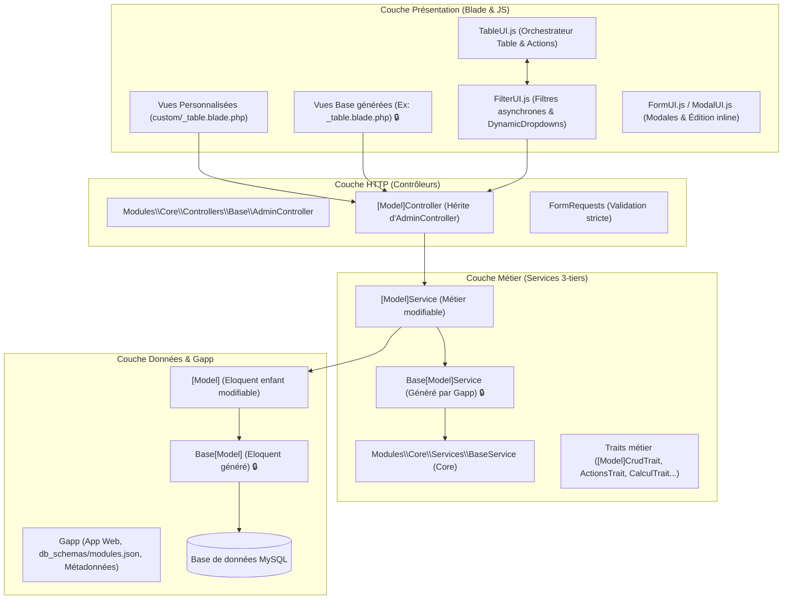
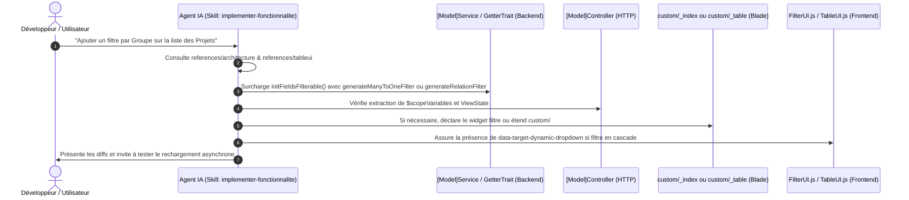
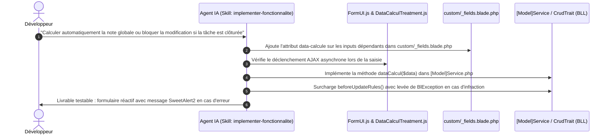
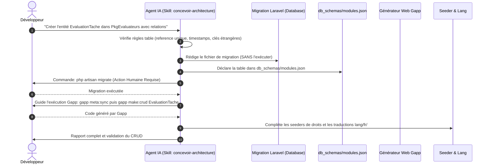
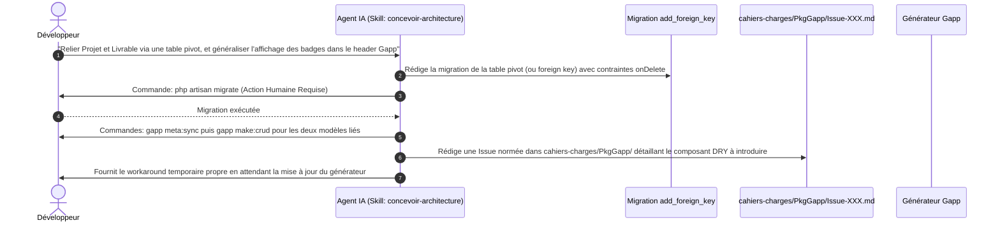
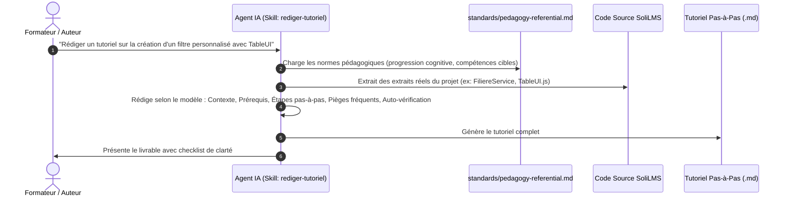
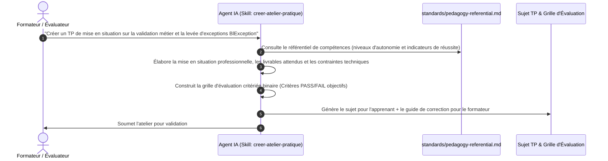

# Étape 1 : Analyse des Flux Réels, Cartographie & Recyclage du Legacy

> **Document de référence — Phase de Cadrage et d'Audit (Étape 1)**  
> **Projet :** Solicode LMS (Active LMS)  
> **Date :** 2026-10-24  
> **Statut :** Soumis à validation avant passage à l'Étape 2  

---

## 1. Cartographie Technique de Solicode LMS

L'audit factuel du codebase `c:\AppServer\solicode-lms` révèle une architecture multi-couches modulaire, fortement outillée par un générateur de code interne (**Gapp**) et des composants d'interface propriétaires (**TableUI**, **FormUI**, **FilterUI**).



### 1.1 Structure des Packages Modulaires (`modules/`)
Le projet n'est pas un monolithe Laravel classique dans `app/` ; il est découpé en **19 modules autonomes** dans `modules/` :
- **Noyau :** `Core` (contrats de base, `BaseService`, `AdminController`, `BaseModel`, gestion des messages d'erreur `BlException`, ViewState).
- **Domaines Métier :** `PkgApprenants`, `PkgApprentissage`, `PkgFormation`, `PkgCreationProjet`, `PkgCreationTache`, `PkgRealisationProjets`, `PkgRealisationTache`, `PkgSessions`, `PkgCompetences`, `PkgEvaluateurs`, `PkgQcm`, `PkgPasserQcm`, `PkgTableauBord`, `PkgWidgets`, `PkgNotification`, `PkgAutorisation`.
- **Générateur & Système :** `PkgGapp`.

### 1.2 Le Générateur Gapp et ses Lignes Rouges Inviolables
Gapp pilote la génération automatique du socle CRUD. Son respect conditionne la stabilité du projet :
1. **Fichiers protégés (En-tête de lock) :**
   - Classes `Base/` PHP (`Base[Model].php`, `Base[Model]Service.php`, `Base[Model]Controller.php`) marquées par `// Ce fichier est maintenu par ESSARRAJ Fouad` : **Interdiction formelle de modification**.
   - Fichiers Blade cœurs (`_table.blade.php`, `_fields.blade.php`, `_index.blade.php`) marqués par `{{-- Ce fichier est maintenu par ESSARRAJ Fouad --}}` : **Interdiction de modification directe**.
2. **Mécanisme d'extension propre :**
   - **En PHP :** Surcharge dans la classe enfant (`[Model]`, `[Model]Service`, `[Model]Controller`) ou dans les Traits dédiés (`modules/Pkg.../Services/Traits/[Model]/`).
   - **En Blade :** Utilisation des vues dans le sous-dossier `custom/` (ex: `resources/views/filiere/custom/_table.blade.php` qui étend `_table.blade.php` et surcharge `@section('filiere-table-tbody')`).
   - **En cas de modification structurelle du générateur :** Rédaction obligatoire d'une issue dans `cahiers-charges/PkgGapp/` (comme documenté dans l'issue `001-generalisation-scope-variables-crud-header.md`).
3. **Interdiction d'exécuter des migrations :** L'agent IA génère le code du fichier de migration (`php artisan make:module-migration ...`), mais **n'exécute JAMAIS** `php artisan migrate` de sa propre initiative. L'exécution est déléguée au développeur humain.
4. **Attributs `$fillable` :** Ne jamais surcharger `$fillable` manuellement dans les classes enfants ; Gapp s'en charge dans les classes `Base/`.

### 1.3 Le Framework Frontend Propriétaire (`resources/js/crud/`)
L'interface repose sur un framework JavaScript modulaire dédié aux tables de données et modales :
- **`TableUI.js`** : Orchestre les actions de listing, tri multi-colonnes, pagination, bascule de vue (`IndexViewSwitcherAction`), édition inline (`CellOrchestrator`), et suppression en masse (`BulkAction`).
- **`FilterUI.js`** : Gère l'écoute des formulaires de filtres avec debounce (500ms), l'adaptation dynamique au contexte (`adapterPourContext`), et les listes déroulantes dépendantes en cascade (`DynamicDropdownTreatment`).
- **`FormUI.js` & `ModalUI.js`** : Interception AJAX des soumissions et gestion de modales imbriquées (via `iziModal` et `CrudModalManager`).

---

## 2. Reconstitution des 6 Flux de Travail Canoniques (2 par Catégorie)

Pour couvrir de manière exhaustive la réalité du projet Solicode LMS sans créer de dispersion, nous modélisons **deux flux de référence concrets pour chacune des trois catégories fondamentales** :

---

### Catégorie A : Flux de Développement (Implémentation & UI)

#### Flux 1.1 : Extension d'un CRUD — Ajout d'un Filtre Dynamique & TableUI
*Ce flux représente l'évolution d'affichage la plus fréquente sur les tables existantes.*



* **Déclencheur :** Demande d'ajout ou de filtrage en cascade sur un listing de données.
* **Entrées nécessaires :** Entité cible (ex: `Projet`), champ/relation cible (ex: `groupe_id`), type de filtre (ManyToOne, Relation dépendante, ManyToMany).
* **Fichiers impactés :**
  1. `modules/Pkg[Module]/Services/[Model]Service.php` (ou Trait `[Model]GetterTrait.php`) : Surcharge de `initFieldsFilterable()` avec `$this->fieldsFilterable[] = $this->generateManyToOneFilter(...)`.
  2. `modules/Pkg[Module]/Controllers/[Model]Controller.php` : Vérification de la prise en compte par le ViewState via `AdminController`.
  3. `resources/js/crud/components/FilterUI.js` & Blade : Configuration de l'attribut `data-target-dynamic-dropdown` et de la route AJAX pour les listes déroulantes dépendantes.
* **Points de blocage & Garde-fous :**
  - Vérifier impérativement les `$scopeVariables` pour ne pas écraser un filtre parent contextualisé.
  - Ne jamais modifier `Base[Model]Service.php`.
  - Ne jamais réinventer de scripts inline jQuery : s'appuyer sur l'orchestrateur `TableUI.js`.

---

#### Flux 1.2 : Logique Métier & Formulaire Dynamique — Calculs `data-calcule`, FormUI & Hooks CRUD
*Ce flux intervient lors de l'ajout d'une règle de gestion, d'un calcul automatique dans un formulaire ou d'une validation métier bloquante.*



* **Déclencheur :** Besoin d'un champ recalculé en direct à la saisie, ou ajout d'une validation métier stricte (BLL).
* **Entrées nécessaires :** Formulaire cible, champs sources du calcul, formule métier ou règle d'invalidation.
* **Fichiers impactés :**
  1. `modules/Pkg[Module]/resources/views/[model]/custom/_fields.blade.php` : Marquage des inputs avec `data-calcule="champ_cible"`.
  2. `modules/Pkg[Module]/Services/[Model]Service.php` :
     - Méthode `dataCalcul($data)` pour recalculer l'entité sans persistance lors de la saisie.
     - Méthodes de hooks `beforeCreateRules(&$data)` ou `beforeUpdateRules(&$data, $id)` pour valider la règle métier.
  3. Levée d'exception BLL : `throw new BlException("Message explicatif en Français");` (capturée automatiquement par le Handler global et affichée dans SweetAlert2 / Toast).
* **Points de blocage & Garde-fous :**
  - Interdiction de mettre de la logique métier lourde ou des redirections d'erreur dans le Controller HTTP.
  - Ne pas appeler `$model->save()` directement dans le service ou dans un hook (risque de boucle infinie).
  - Modifier le fichier `custom/_fields.blade.php` et non le fichier `_fields.blade.php` généré par Gapp.

---

### Catégorie B : Flux d'Architecture & Gapp (Modélisation & Évolution)

#### Flux 2.1 : Conception & Création d'une Nouvelle Entité 3-tiers (Migration, Modèle, Service, Gapp)
*Ce flux modélise la création complète d'une nouvelle table et de son socle applicatif.*



* **Déclencheur :** Spécification d'une nouvelle entité métier.
* **Entrées nécessaires :** Nom du modèle, module d'appartenance (`Pkg[Nom]`), colonnes, contraintes et relations Eloquent.
* **Fichiers impactés :**
  1. `modules/Pkg[Module]/Database/Migrations/xxxx_xx_xx_create_[table]_table.php` : Migration avec colonne obligatoire `$table->string('reference')->unique();`.
  2. `db_schemas/modules.json` : Inscription de la nouvelle table sous le package correspondant.
  3. Classes générées par Gapp : `Base[Model].php`, `Base[Model]Service.php`, `Base[Model]Controller.php`.
  4. Classes enfants métier : `[Model].php`, `[Model]Service.php`, `[Model]Controller.php`.
  5. `modules/Pkg[Module]/resources/lang/fr/[model].php` : Fichiers de traductions des labels et pluriels.
  6. `modules/Pkg[Module]/Database/Seeders/[Model]Seeder.php` : Droits d'accès et permissions Spatie.
* **Points de blocage & Garde-fous :**
  - **Ligne rouge absolue :** L'agent IA a l'interdiction d'exécuter `php artisan migrate`. Il doit s'arrêter et attendre le développeur.
  - Champ `reference` obligatoire pour l'idempotence des seeders et de Gapp.
  - Ne jamais surcharger `$fillable` manuellement dans la classe fille.

---

#### Flux 2.2 : Ajout de Relations (Clé Étrangère / Pivot) & Remontée d'Issue Gapp (Évolution du Générateur)
*Ce flux intervient lors de la liaison de deux entités existantes ou quand un template généré par Gapp doit évoluer de manière pérenne.*



* **Déclencheur :** Ajout d'une relation (ManyToOne ou ManyToMany via table pivot) ou besoin d'une modification structurelle sur un fichier généré par Gapp.
* **Entrées nécessaires :** Entités source et cible, type de cardinalité, modification souhaitée dans le générateur.
* **Fichiers impactés :**
  1. Migration d'ajout de relation : `php artisan make:module-migration add_[nom_relation]_to_[table]_table [Module]`.
  2. Modèles enfants : Déclaration des relations `belongsTo`, `hasMany` ou `belongsToMany`.
  3. Cahier des charges Gapp : Création d'une issue normée dans `cahiers-charges/PkgGapp/` (ex: `Issue-XXX-nom.md`) décrivant le problème, la solution DRY, les fichiers lockés impactés et le code exact.
* **Points de blocage & Garde-fous :**
  - Ne jamais modifier directement un fichier contenant `{{-- Ce fichier est maintenu par ESSARRAJ Fouad --}}` sans ouvrir une issue Gapp correspondante.
  - Pour les relations ManyToMany, interdiction d'appeler `$model->relation()->sync()` directement : toujours passer par le Service via `$service->update($id, ['relationName' => $ids])`.

---

### Catégorie C : Flux Pédagogiques (Transmission & Évaluation)

#### Flux 3.1 : Rédaction d'un Tutoriel Technique Pas-à-Pas (Guide d'Apprentissage)
*Ce flux produit des tutoriels guidés progressifs et vérifiables pour les apprenants de Solicode.*



* **Déclencheur :** Demande de conception d'un support pédagogique guidant l'acquisition d'une compétence technique.
* **Entrées nécessaires :** Compétence visée (ex: C2 - Développer des composants métier backend), niveau des apprenants, sujet technique.
* **Livrables :**
  1. Fiche de tutoriel Markdown structurée :
     - **Mise en situation :** Problématique métier réelle.
     - **Prérequis :** Connaissances et environnement nécessaires.
     - **Étapes pas-à-pas :** Instructions claires avec extraits de code réels et commentés.
     - **Pièges fréquents :** Les erreurs courantes des apprenants et comment les éviter.
     - **Auto-vérification :** Critères pour valider que l'étape fonctionne.
* **Points de blocage & Garde-fous :**
  - Interdiction de produire du code théorique ou fictif : les exemples doivent être rigoureusement fidèles à la pile SoliLMS.
  - Respect du principe de divulgation progressive : ne pas noyer l'apprenant sous des détails hors sujet.

---

#### Flux 3.2 : Conception d'un Atelier Pratique (TP) / Brief de Projet avec Grille d'Évaluation
*Ce flux génère un atelier pratique autonome et sa grille d'évaluation par compétences.*



* **Déclencheur :** Besoin d'une évaluation sommative ou formative d'apprenants sur une tâche technique autonome.
* **Entrées nécessaires :** Compétence du référentiel Solicode à évaluer, durée indicative du TP, module d'application.
* **Livrables :**
  1. **Sujet d'atelier pour l'apprenant :**
     - Contexte professionnel (User Story).
     - Cahier des charges et contraintes techniques strictes.
     - Livrables à déposer (branche Git, captures, tests).
  2. **Grille d'évaluation pour le formateur :**
     - Tableau critérié avec indicateurs observables binaires (ex: *"La méthode beforeCreateRules lève bien une BlException si le champ est invalide : OUI/NON"*).
     - Corrigé type et barème par niveau de maîtrise.
* **Points de blocage & Garde-fous :**
  - Pas d'évaluation subjective ou vague ("code bien écrit") : uniquement des assertions mesurables et vérifiables.
  - Alignement direct avec le référentiel de compétences Solicode (`standards/pedagogy-referential.md`).

---

## 3. Matrice de Recyclage et de Bascule d'`old_agent`

L'audit des **27 skills**, **7 règles** et **2 workflows** d'`old_agent` démontre une forte surcharge cognitive pour les modèles d'IA, car les connaissances passives (documentation de couche) étaient artificiellement déguisées en skills actionnables.

Voici la matrice de réallocation exacte vers la nouvelle architecture :

| Composant `old_agent` | Type Actuel | Diagnostic & Justification | Destination Cible dans le Nouveau Système |
| :--- | :---: | :--- | :--- |
| **`app-controller`** | Skill (124 lignes) | Règles architecturales HTTP, `AdminController`, `dataForEditView()`, DynamicPermission. Pas un workflow autonome. | ➔ **Référence Passive :** `references/architecture/controllers-and-http.md` |
| **`app-service`** | Skill (169 lignes) | Règles BLL, découpage en Traits, interdictions Gapp, `initFieldsFilterable()`, `BlException`. | ➔ **Référence Passive :** `references/architecture/services-and-traits.md` |
| **`app-model`** | Skill | Relations Eloquent, `BaseModel`, interdiction de surcharger `$fillable`, `reference` unique. | ➔ **Référence Passive :** `references/database/models-and-relations.md` |
| **`app-blade`** | Skill | Conventions de nommage, protection Gapp, sous-dossier `custom/`, composants Blade `<x-...>`. | ➔ **Référence Passive :** `references/frontend/blade-conventions.md` |
| **`app-crud-js`** | Skill (50 lignes) | Architecture de `TableUI.js`, classes réservées (`showIndex`, `editEntity`), modales imbriquées. | ➔ **Référence Passive :** `references/frontend/tableui-framework.md` |
| **`app-migration`** | Skill (127 lignes) | Contient une action d'ingénierie (création table). La partie règles va en référence, la procédure va dans le skill d'architecture. | ➔ **Règles :** `references/database/migrations.md`<br>➔ **Action :** Skill `concevoir-architecture` |
| **`app-db-savoir`** | Skill | Connaissances du schéma de BDD et des clés de relations. | ➔ **Référence Passive :** `references/database/schema-relations.md` |
| **`app-lang`** | Skill | Règles de gestion des traductions `resources/lang/fr/`. | ➔ **Référence Passive :** `references/standards/localization.md` |
| **`app-route`** | Skill | Règles de nommage des routes web modulaires. | ➔ **Référence Passive :** `references/architecture/routing.md` |
| **`app2-front-end`** | Skill | Doublon partiel de `app-crud-js` et styles CSS AdminLTE / Tailwind. | ➔ **Fusionné & Déprécié :** Absorbé dans `references/frontend/` |
| **`pkg-apprenant` à `pkg-tableau-bord`** (8 skills) | Skills de packages | Descriptions de tables et méthodes d'un package particulier. Ne constituent pas des compétences de l'agent. | ➔ **Fiches Contexte Locales :** `modules/Pkg.../AI_CONTEXT.md` (générées via `documenter-package`) |
| **`sys-gapp`** | Skill (46 lignes) | Configuration de métadonnées Gapp, interdiction d'édition `db_schemas/`. | ➔ **Référence & Spécifications :** `references/gapp/` *(Voir Section 4)* |
| **`sys-issue`** | Skill (61 lignes) | Rédaction d'issues Gapp dans `cahiers-charges/Pkg.../`. | ➔ **Procédure intégrée :** Skill `diagnostiquer-et-corriger` et doc Gapp |
| **`sys-analyse`** & **`sys-conception`** | Skills | Étapes de découverte et d'UML. | ➔ **Nouveau Skill Unifié :** `analyser-et-planifier` & `concevoir-architecture` |
| **`sys-redacteur-technique`** | Skill | Rédaction de tutoriels et doc. | ➔ **Nouveaux Skills :** `rediger-tutoriel` & `creer-atelier-pratique` |
| **`sys-ux`** | Skill | Principes d'ergonomie et d'alertes SweetAlert2. | ➔ **Référence Passive :** `references/frontend/ux-guidelines.md` |
| **`sys-deploy-update`** | Skill | Scripts de déploiement et commandes de mise à jour. | ➔ **Référence Technique :** `references/devops/deploy.md` |
| **`sys-agent`** & **`raffinement-agent`** | Skill & Workflow | Procédure d'auto-amélioration suite aux corrections du développeur. | ➔ **Procédure Qualité :** Intégrée au cycle de maintenance (Partie 5 SemVer & feedbacks YAML) |
| **`rules/00-regles-critiques.md`** | Règle globale | Les 7 règles d'or inviolables. | ➔ **Norme Suprême :** `standards/critical-rules.md` (injectée en tête de tout prompt) |
| **`rules/01` à `06`** | Règles | Persona, Stack, Sécurité, BDD, Issues. | ➔ **Standards & Références :** `standards/` et `references/` |

---

## 4. Organisation des Fichiers de Spécifications Gapp (Évolutifs)

En réponse directe à votre consigne (*« Donner des fichiers pour configurer et ajouter des spécifications de Gapp au fur et à mesure »*), nous créons un espace dédié aux spécifications Gapp qui sera maintenu et enrichi continuellement :

```
references/gapp/
├── 01-conventions-et-garde-fous.md    # Règles absolues (fichiers Base/, locks ESSARRAJ, migrations)
├── 02-catalogue-metadonnees.md        # Types de métadonnées (dynamicDropdown, scopeDataInEditContext, etc.)
├── 03-workflow-regeneration.md        # Procédure pas-à-pas (migrate -> sync -> make:crud -> seed)
├── 04-specifications-avancees.md      # Espace évolutif pour vos nouvelles spécifications Gapp
└── issues-templates/
    └── gapp-issue-template.md         # Modèle normé pour déclarer une issue à généraliser dans Gapp
```

### Contenu type du fichier `04-specifications-avancees.md` :
Ce fichier accueillera chaque nouvelle règle ou spécificité de Gapp au fil des versions, par exemple :
- Nouvelles métadonnées d'interface (ex: gestion des champs calculés `data-calcule`).
- Règles d'injection de composants génériques dans les headers CRUD.
- Conventions de génération des relations ManyToMany avec attributs pivots.

---

## 5. Synthèse et Livrables Clés de l'Étape 1

À l'issue de cette première étape d'analyse :
1. ✅ **La cartographie technique** exacte de Solicode LMS est documentée sans aucune modification de code applicatif.
2. ✅ **Les 3 flux traversants réels** (Extension CRUD TableUI, Architecture d'entité 3-tiers / Gapp, Tutoriel pédagogique) sont modélisés avec la séquence exacte de leurs fichiers et leurs points de friction.
3. ✅ **La matrice de recyclage des 27 anciens skills** est prête : nous passons d'un fouillis de 27 micro-skills à **une base claire de Références passives** et **9 Skills universels d'action**.
4. ✅ **L'architecture de documentation Gapp évolutive** est définie pour absorber vos besoins futurs.

---

## Critères de Validation pour Passer à l'Étape 2

Pour valider l'Étape 1 et autoriser le lancement de l'**Étape 2 (Benchmark des Plugins Anthropic & Design de l'Architecture Hybride)**, veuillez confirmer :
1. L'exactitude de la cartographie et des 3 flux canoniques décrits.
2. La validation de la matrice de recyclage des 27 skills d'`old_agent`.
3. L'organisation proposée pour les fichiers de spécifications Gapp évolutives.
