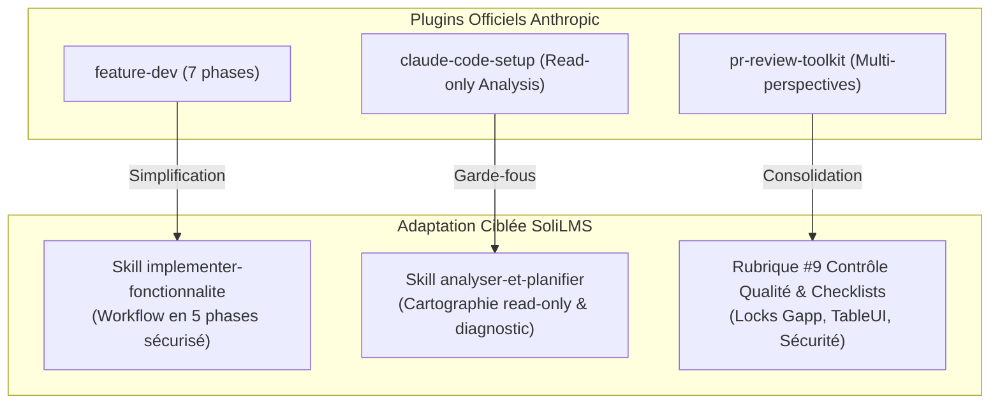
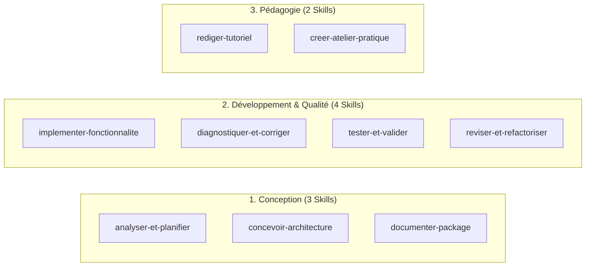

# Étape 2 : Benchmark des Plugins Anthropic & Design de l'Architecture Hybride

> **Document d'Architecture et de Spécifications Techniques (Étape 2)**  
> **Projet :** Solicode LMS (Active LMS) & Hub Global Skills  
> **Date :** 2026-10-24  
> **Statut :** Soumis à validation avant initialisation physique (Étape 3)  

---

## 1. Analyse Comparative des Deux Approches pour l'Étape 2

| Dimension | Approche Plan Personnel (`plan-gpt.md` Phase 2 : G à L) | Approche Plan Unifié (`plan-gem.md` Parties 2 & 3) | Synthèse & Arbitrage Retenu |
| :--- | :--- | :--- | :--- |
| **Inspiration Anthropic** | Analyse poussée de 3 plugins officiels (`feature-dev`, `claude-code-setup`, `pr-review-toolkit`) et extraction sous forme de matrice « pratique observée ➔ besoin Active LMS ➔ adaptation ». | Reprend l'esprit des standards ouverts (`agentskills.io`) et simplifie l'architecture en évitant la multiplication d'agents intermédiaires. | **Retenu :** Conserver la richesse méthodologique de `feature-dev` (workflow séquencé) et `claude-code-setup` (mode audit read-only), mais éliminer la sur-ingénierie des subagents multiples de `pr-review-toolkit`. |
| **Organisation des Dépôts** | Dépôt central `skills-library` avec dossiers `core/`, `profiles/`, `blueprints/`, `evals/`. Structure un peu dispersée. | Architecture Hybride binaire ultra-claire : **Hub Global Universel** (`skills-workspace`) + **Contexte Local Projet** (`.agents/local/`), reliés par lien symbolique. | **Retenu :** La structure Hybride de `plan-gem` est nettement supérieure : zéro redondance, séparation stricte des responsabilités et maintenance centralisée. |
| **Format du `SKILL.md`** | Gabarit classique en 8 rubriques inspiré d'Anthropic. | Gabarit en 10 rubriques optimisé pour la **Divulgation Progressive** (*Progressive Disclosure*) avec priorité absolue au contexte local. | **Retenu :** Le gabarit en 10 rubriques garantit que l'IA consulte systématiquement `.agents/local/` avant d'appliquer une règle générique. |
| **Dimensionnement des Skills** | Catalogue indicatif de 11 skills candidats. | Découpage net et équilibré en **9 Skills universels** (3 Conception, 4 Dév, 2 Pédagogie). | **Retenu :** 9 Skills universels. Ce dimensionnement élimine définitivement les 27 micro-skills fragmentés d'`old_agent`. |

---

## 2. Matrice d'Adaptation des Plugins Anthropic pour Solicode LMS

Pour tirer le meilleur parti des modèles Anthropic sans importer leur complexité superflue, nous avons formalisé la matrice d'extraction suivante :



| Plugin Anthropic | Pratique Observée | Problématique Solicode LMS | Adaptation Concrète Retenue pour SoliLMS |
| :--- | :--- | :--- | :--- |
| **`feature-dev`** | Parcours en 7 phases (Découverte, Exploration, Clarification, Conception, Implémentation, Revue, Validation) avec interdiction de coder avant clarification. | Biais récurrent de l'IA voulant coder immédiatement du HTML/JS générique ou touchant aux fichiers générés `Base/` sans analyser les locks. | **Workflow en 5 phases intégré dans `implementer-fonctionnalite` :**<br>1. *Exploration & Locks* (vérifier `ESSARRAJ Fouad` et `custom/`).<br>2. *Clarification & Décision* (poser max 3 questions ciblées).<br>3. *Conception du Contrat* (Services/Traits/Blade).<br>4. *Implémentation chirurgicale* (code minimaliste conforme `TableUI`).<br>5. *Validation & Revue* (checklist de non-régression). |
| **`claude-code-setup`** | Exploration en mode lecture seule (`read-only`) pour auditer un projet et recommander des configurations sans modifier les fichiers. | Risque d'altération prématurée de fichiers lors d'une simple demande d'analyse ou de compréhension. | **Mode Audit strict dans `analyser-et-planifier` :**<br>L'agent cartographie les modules, les routes et la BDD avec interdiction absolue d'exécuter des modifications ou des commandes destructives durant l'analyse. |
| **`pr-review-toolkit`** | Découpage des contrôles par agents spécialisés (sécurité, tests, erreurs silencieuses, simplification). | Lancement de 4 à 6 agents parallèles trop lourd et verbeux pour les tâches courantes sur SoliLMS. | **Checklist binaire consolidée (Rubrique #9 du `SKILL.md`) :**<br>Une checklist structurée exécutée par le skill lui-même :<br>• Aucun fichier `Base/` touché ?<br>• Aucune migration exécutée en aveugle ?<br>• `TableUI.js` respecté sans jQuery sauvage ?<br>• Gestion propre des exceptions `BlException` ? |

---

## 3. Architecture Technique Hybride Cible (Hub Global + Contexte Local)

Comme validé, le système repose sur une séparation physique stricte :

```
D:\solicode-lms\skills-workspace/          <--- HUB GLOBAL CENTRALISÉ (Git universel)
├── catalog.yaml                            # Registre officiel des skills et versions SemVer
├── CHANGELOG.md                            # Historique des versions et correctifs
├── standards/                              # Règles transversales inviolables
│   ├── critical-rules.md                  # Les 7 règles d'or (Locks Gapp, Migrations, etc.)
│   ├── general-principles.md              # Bonnes pratiques de code et sécurité
│   └── pedagogy-referential.md            # Référentiel de compétences Solicode (C1, C2, C3...)
├── references/                             # Connaissances techniques passives partagées
│   ├── architecture/
│   │   ├── layers-3tiers.md               # Contrôleurs, Services et Modèles
│   │   └── services-and-traits.md         # Découpage en Traits (Crud, Actions, Calcul...)
│   ├── frontend/
│   │   ├── blade-conventions.md           # Structure Blade, composants <x-...> et sous-dossier custom/
│   │   └── tableui-framework.md           # API TableUI.js, FilterUI.js et DynamicDropdowns
│   ├── database/
│   │   ├── migrations-and-schema.md       # Colonne reference, pas de migrate direct
│   │   └── eloquent-models.md             # Relations, interdiction de surcharge $fillable
│   └── gapp/                              # Spécifications Gapp évolutives (Demandé)
│       ├── 01-conventions-et-garde-fous.md
│       ├── 02-catalogue-metadonnees.md
│       ├── 03-workflow-regeneration.md
│       ├── 04-specifications-avancees.md  # Fichier évolutif pour vos ajouts continus
│       └── gapp-issue-template.md         # Modèle normé pour remonter une issue Gapp
├── templates/                              # Modèles réutilisables
│   ├── generic-skill.md                   # Le squelette standard en 10 rubriques
│   └── module-ai-context.md               # Modèle de fiche AI_CONTEXT.md de package
├── .agents/
│   └── skills/                            # LES 9 SKILLS ACTIONNABLES UNIVERSELS
│       ├── analyser-et-planifier/
│       ├── concevoir-architecture/
│       ├── documenter-package/
│       ├── implementer-fonctionnalite/
│       ├── diagnostiquer-et-corriger/
│       ├── tester-et-valider/
│       ├── reviser-et-refactoriser/
│       ├── rediger-tutoriel/
│       └── creer-atelier-pratique/
├── tests/                                 # Suites d'évaluation (6 cas types par skill)
│   └── feedbacks/                         # Fiches d'incidents YAML pour amélioration continue
└── scripts/                               # Outils déterministes de contrôle (Node.js natif)
    ├── validate-skills.js                 # Validation syntaxique, YAML et conformité des 10 rubriques
    └── check-references.js                # Détecteur de liens cassés et références orphelines

========================================================================================

c:\AppServer\solicode-lms/                  <--- CONTEXTE PROJET SOLICODE LMS
├── .agents/
│   ├── local/                             # DOSSIER PHYSIQUE LOCAL (Exclusif à Solicode LMS)
│   │   ├── project-conventions.md         # Conventions spécifiques et règles propres à SoliLMS
│   │   ├── tableui-local-config.md        # Spécificités des composants TableUI/FilterUI du projet
│   │   └── gapp-local-metadata.md         # Métadonnées Gapp actives dans ce projet
│   │
│   ├── skills/ ---------------------------> [LIEN SYMBOLIQUE NTFS mklink /J vers D:\solicode-lms\skills-workspace\.agents\skills]
│   └── references/ -----------------------> [LIEN SYMBOLIQUE NTFS mklink /J vers D:\solicode-lms\skills-workspace\references]
│
└── modules/
    ├── PkgFormation/AI_CONTEXT.md          # Fiches locales générées pour chaque module
    ├── PkgCreationTache/AI_CONTEXT.md
    └── ...
```

### Clarification Fondamentale : Rôle de `.agents/local/` vs Liens Symboliques

```
                     ┌────────────────────────────────────────────────────────┐
                     │           D:\solicode-lms\skills-workspace             │
                     │                 (Hub Global Partagé)                   │
                     │   - 9 Skills universels                                │
                     │   - Standards & Références universelles Laravel/Vue    │
                     └───────────────────▲─────────────────▲──────────────────┘
                                         │                 │
             LIEN SYMBOLIQUE (mklink /J) │                 │ LIEN SYMBOLIQUE (mklink /J)
                                         │                 │
          ┌──────────────────────────────┴───────┐   ┌─────┴────────────────────────────────┐
          │      c:\AppServer\solicode-lms       │   │     c:\AutreProjet\MonProjetFutur    │
          │         (Projet SoliLMS)             │   │             (Autre Projet)           │
          │                                      │   │                                      │
          │  .agents/skills/     [Lien Hub]      │   │  .agents/skills/     [Lien Hub]      │
          │  .agents/references/ [Lien Hub]      │   │  .agents/references/ [Lien Hub]      │
          │                                      │   │                                      │
          │  .agents/local/      [Dossier Local] │   │  .agents/local/      [Dossier Local] │
          │  - Modules SoliLMS (PkgFormation...) │   │  - Spécificités propres à ce projet  │
          │  - Spécificités Gapp locales         │   │  - Base de données locale            │
          └──────────────────────────────────────┘   └──────────────────────────────────────┘
```

1. **Les Liens Symboliques (`.agents/skills/` et `.agents/references/`) :**  
   Ce sont des raccourcis virtuels transparents vers le Hub Global `D:\solicode-lms\skills-workspace`. Toute modification apportée à un Skill ou à une règle globale depuis n'importe quel projet met à jour immédiatement le Hub sans copier-coller.
2. **Le Dossier `.agents/local/` (Physique & Non lié) :**  
   C'est le seul dossier de configuration qui réside **exclusivement dans le dépôt Solicode LMS**. Il contient ce qui est 100 % unique à SoliLMS et qui n'a aucun sens d'être partagé avec d'autres applications futures (ex: la liste des 19 packages `modules/`, les routes spécifiques, les clés ViewState locales). L'IA lit d'abord ce dossier en **Priorité absolue** avant d'appliquer les compétences générales des Skills.

---

## 4. Les 9 Skills Universels et Leurs Contrats d'Action

Les 27 micro-skills fragmentés d'`old_agent` sont remplacés par **9 Skills à responsabilité unifiée** :



### Détail des Contrats d'Action :

1. **`analyser-et-planifier` :** Découverte du besoin, cartographie d'un composant en lecture seule, audit d'impact et production d'un plan d'implémentation phasé.
2. **`concevoir-architecture` :** Modélisation de base de données, création de migrations conformes (avec champ `reference`), déclaration dans `modules.json`, conception des contrats d'interface et des relations Eloquent.
3. **`documenter-package` :** Génération et mise à jour automatique des fichiers `AI_CONTEXT.md` au sein de chaque package dans `modules/`.
4. **`implementer-fonctionnalite` :** Implémentation de bout en bout des fonctionnalités traversantes (Services, Traits, Contrôleurs, Vues Blade dans `custom/`, filtres `TableUI.js`, formulaires `FormUI.js`, et calculs `data-calcule`).
5. **`diagnostiquer-et-corriger` :** Analyse de bugs et exceptions BLL (`BlException`), traçage dans les logs, correction dans les classes enfants et formalisation d'issues Gapp si le problème relève du générateur.
6. **`tester-et-valider` :** Écriture et exécution de tests unitaires/fonctionnels PHPUnit et Dusk sans jamais altérer les données de production.
7. **`reviser-et-refactoriser` :** Simplification du code existant, respect des principes DRY/SOLID, extraction de logique redondante dans des Traits, sans modification du comportement fonctionnel.
8. **`rediger-tutoriel` :** Rédaction de guides pas-à-pas progressifs, vérifiables et fidèles au code réel pour la formation des apprenants.
9. **`creer-atelier-pratique` :** Conception de TP, briefs de projets et grilles d'évaluation critériées binaires (PASS/FAIL) alignées sur le référentiel de compétences Solicode.

---

## 5. Le Gabarit Standard du `SKILL.md` (Modèle en 10 Rubriques)

Chaque Skill dans `.agents/skills/[nom-du-skill]/SKILL.md` respectera rigoureusement cette structure conçue pour la divulgation progressive :

```markdown
---
name: [nom-du-skill]
description: [Description formulée à la 3ème personne, précisant clairement QUAND utiliser et QUAND NE PAS utiliser ce skill pour un routage optimal]
---

# 1. Mission
[Objectif précis et périmètre d'action du skill]

# 2. Déclenchement & Limites
[Cas d'usage positifs (Quand l'activer) et négatifs (Quand passer la main)]

# 3. Entrées & Ressources à Charger
- Priorité 1 : Fichiers du projet local (.agents/local/...)
- Priorité 2 : Références d'architecture (references/architecture/...)
- Priorité 3 : Connaissances du module (modules/Pkg.../AI_CONTEXT.md)

# 4. Contraintes & Règles Inviolables
[Rappels des règles d'or : interdiction de toucher aux classes Base/, locks ESSARRAJ, migrations manuelles]

# 5. Procédure Pas-à-Pas (Workflow)
[Étapes séquentielles ordonnées inspirées du cycle Anthropic]

# 6. Gestion des Ambiguïtés & Décisions
[Conduite à tenir en cas de données manquantes : poser max 3 questions fermées ou formuler une hypothèse explicite]

# 7. Format de Sortie & Livrables
[Structure exacte attendue pour la réponse ou les modifications de fichiers]

# 8. Contrôle Qualité (Checklist Binaire)
- [ ] Aucun fichier avec lock Gapp n'a été altéré ?
- [ ] La règle de séparation Service / Contrôleur est-elle respectée ?
- [ ] Le code JS utilise-t-il l'infrastructure TableUI existante ?

# 9. Gestion des Erreurs Fréquentes
[Tableau des erreurs typiques de l'IA sur cette tâche et leur parade immédiate]

# 10. Exemples Concrets (Few-Shot Prompting)
[1 cas nominal commenté issu directement du code réel de SoliLMS]
```

---

## 6. Synthèse et Décisions pour Passer à l'Étape 3

Cette Étape 2 fournit le plan d'ingénierie complet et définitif du système :
- Le benchmark Anthropic est traduit en pratiques pragmatiques adaptées à SoliLMS.
- L'arborescence physique du Hub (`D:\solicode-lms\skills-workspace`) et du projet local est arrêtée.
- Les 9 Skills universels ont leurs périmètres et leur gabarit standardisé.

---

## Critères de Validation pour Démarrer l'Étape 3

Pour valider l'Étape 2 et lancer l'**Étape 3 (Mise en place physique du Hub Global et du Contexte Local)**, merci de confirmer :
1. L'adaptation retenue pour les 3 plugins Anthropic (workflow en 5 phases et checklist consolidée).
2. L'arborescence physique du Hub et la liaison par jonction NTFS `mklink /J`.
3. La liste et les responsabilités des 9 Skills universels.
4. Le gabarit standard en 10 rubriques pour la rédaction des `SKILL.md`.
