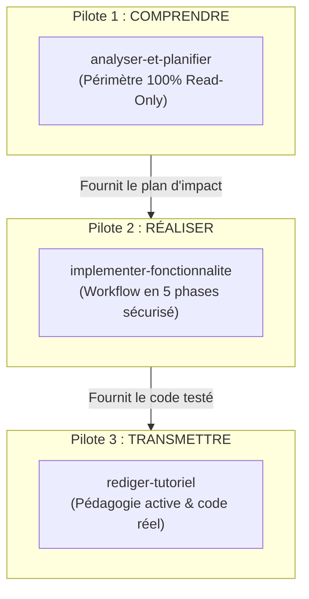

# Étape 4 : Conception & Rédaction des 3 Skills Pilotes

> **Document de Spécification des Compétences Pilotes (Étape 4)**  
> **Projet :** Hub Global `skills-workspace` & Solicode LMS  
> **Date :** 2026-10-24  
> **Statut :** Soumis à validation avant rédaction et publication des 3 `SKILL.md`  

---

## 1. Analyse Comparative des Approches pour l'Étape 4

| Dimension | Plan Personnel (`plan-gpt.md` Phase 3 : M à P) | Plan Unifié (`plan-gem.md` Partie 3 & Phase 2) | Arbitrage & Recommandation Retenue |
| :--- | :--- | :--- | :--- |
| **Sélection des 3 Pilotes** | `project-analyzer`, `feature-implementer`, `active-tutorial-writer`. | `concevoir-architecture`, `implementer-fonctionnalite`, `rediger-tutoriel`. | **Retenu :** Le trio `analyser-et-planifier` (Comprendre), `implementer-fonctionnalite` (Réaliser) et `rediger-tutoriel` (Transmettre). Ce trio couvre les 3 piliers fondateurs en évitant toute collision de déclenchement. |
| **Extraction de l'Expertise Réelle** | Recommande d'extraire les instructions depuis les tâches réelles, tickets et historiques plutôt que de rédiger des généralités. | Structure les procédures autour des flux métiers concrets de SoliLMS (`TableUI`, BLL Services, Gapp). | **Retenu :** Fusion parfaite. Les instructions intègrent directement les règles vérifiées lors de l'Étape 1 (méthode `initFieldsFilterable()`, gestion des locks `ESSARRAJ Fouad`, levée de `BlException`). |
| **Structure Interne du `SKILL.md`** | Modèle en 8 rubriques avec description pour sélection automatique par l'agent. | Modèle en 10 rubriques optimisé pour la **divulgation progressive** (*Progressive Disclosure*). | **Retenu :** Modèle unifié en 10 rubriques avec priorité explicite : Contexte Local (`.agents/local/`) > Références d'Architecture (`references/`) > Contexte Module (`AI_CONTEXT.md`). |
| **Garde-fous Anti-Régression** | Vérification d'impact par composant. | Checklist binaire stricte (Rubrique #8) et tableau d'erreurs fréquentes (Rubrique #9). | **Retenu :** Checklist binaire immédiate bloquant toute altération des classes `Base/` ou toute exécution non autorisée de `artisan migrate`. |

---

## 2. Spécification Détaillée des 3 Skills Pilotes



### Pilote 1 : `analyser-et-planifier` (Catégorie : Conception)
- **Mission :** Explorer le codebase, cartographier l'architecture d'un module ou d'un flux, analyser l'impact d'une demande et formuler un plan d'action rigoureux **SANS modifier aucun fichier**.
- **Quand l'activer :**
  - "Comment fonctionne le module PkgCreationTache ?"
  - "Analyse l'impact de l'ajout d'une colonne statut sur la table cours."
  - "Propose un plan d'implémentation pour le filtrage par session."
- **Quand NE PAS l'activer :**
  - Demande directe de modification de code ➔ Utiliser `implementer-fonctionnalite`.
  - Demande d'explication pédagogique pour apprenant ➔ Utiliser `rediger-tutoriel`.
- **Règle absolue :** Mode 100 % lecture seule. Interdiction formelle de créer ou modifier des fichiers applicatifs lors de cette phase d'analyse.

---

### Pilote 2 : `implementer-fonctionnalite` (Catégorie : Développement)
- **Mission :** Implémenter, modifier ou étendre une fonctionnalité de bout en bout sur Solicode LMS (couche Service, Traits, Contrôleur, Blade, TableUI/FilterUI) en respectant rigoureusement les fichiers protégés Gapp.
- **Quand l'activer :**
  - "Ajoute un filtre par Filière dans le CRUD des Projets."
  - "Implémente la méthode dataCalcul pour recalculer le montant dans le formulaire."
  - "Ajoute une règle métier dans beforeUpdateRules qui lève une BlException."
- **Quand NE PAS l'activer :**
  - Création complète d'une nouvelle table en BDD ➔ Utiliser `concevoir-architecture`.
  - Simple analyse sans modification ➔ Utiliser `analyser-et-planifier`.
- **Workflow en 5 phases :**
  1. *Exploration & Détection des Locks :* Vérifier les fichiers `Base/` et privilégier `custom/` pour Blade.
  2. *Clarification :* Résoudre les ambiguïtés (max 3 questions).
  3. *Conception :* Définir les méthodes surchargées et variables ViewState.
  4. *Implémentation chirurgicale :* Écriture du code minimaliste sans casser l'existant.
  5. *Checklist binaire :* Vérifier qu'aucun lock Gapp n'a été écrasé et qu'aucune commande `migrate` n'a été lancée.

---

### Pilote 3 : `rediger-tutoriel` (Catégorie : Pédagogie)
- **Mission :** Rédiger des tutoriels techniques pas-à-pas progressifs, vérifiables et basés sur des exemples réels de Solicode LMS, alignés sur le référentiel de compétences Solicode.
- **Quand l'activer :**
  - "Rédige un tutoriel pour les apprenants sur la création d'un filtre TableUI."
  - "Crée un guide pas-à-pas expliquant le découpage en Traits de la couche Service."
- **Quand NE PAS l'activer :**
  - Conception d'un sujet d'évaluation ou d'un TP autonome ➔ Utiliser `creer-atelier-pratique`.
  - Documentation brute de package ➔ Utiliser `documenter-package`.
- **Standards Pédagogiques :**
  - Application du principe de divulgation progressive (Mise en situation ➔ Prérequis ➔ Étapes numérotées ➔ Pièges fréquents ➔ Checklist d'auto-évaluation).
  - Code 100 % conforme à la stack SoliLMS (zéro code théorique ou fictif).

---

## 3. Emplacement Physique Cible

Ces 3 skills seront rédigés et stockés dans le Hub Global partagé, immédiatement accessibles dans Solicode LMS via la jonction NTFS :
```
D:\solicode-lms\skills-workspace\.agents\skills/
├── analyser-et-planifier/
│   └── SKILL.md
├── implementer-fonctionnalite/
│   └── SKILL.md
└── rediger-tutoriel/
    └── SKILL.md
```

---

## Critères de Validation pour Lancer la Rédaction (Étape 4)

Pour valider l'Étape 4 et autoriser la création des 3 fichiers `SKILL.md` :
1. Le choix et le périmètre des 3 skills pilotes (`analyser-et-planifier`, `implementer-fonctionnalite`, `rediger-tutoriel`) vous conviennent-ils ?
2. Validez-vous leurs déclencheurs et leurs garde-fous associés ?
