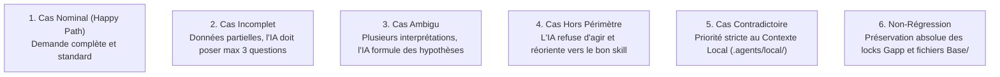

# Étape 5 : Batterie d'Évaluations, Tests Déterministes & Robustesse

> **Document de Contrôle Qualité et Suites de Tests (Étape 5)**  
> **Projet :** Hub Global `skills-workspace` & Solicode LMS  
> **Date :** 2026-10-24  
> **Statut :** Soumis à validation avant exécution des évaluations  

---

## 1. Analyse Comparative des Approches pour l'Étape 5

| Dimension | Plan Personnel (`plan-gpt.md` Phase 4 : Q à U) | Plan Unifié (`plan-gem.md` Partie 4) | Synthèse & Recommandation Retenue |
| :--- | :--- | :--- | :--- |
| **Test des Déclencheurs (Routing)** | Dataset de ~20 requêtes positives et négatives (+/-) pour tester si l'agent active le bon skill au bon moment. | Focalisé sur la formulation à la 3ème personne du frontmatter. | **Retenu :** Le dataset de requêtes +/- de `plan-gpt`. C'est le seul moyen empirique de garantir qu'une demande comme *"Ajoute un filtre"* active `implementer-fonctionnalite` et non `analyser-et-planifier` ou une réponse générique. |
| **Tests Comportementaux d'Exécution** | Comparaison empirique avec et sans skill (évaluation A/B). | Suite formelle de **6 cas types par skill** (Nominal, Incomplet, Ambigu, Hors périmètre, Contradictoire, Non-régression). | **Retenu :** La suite des 6 cas types de `plan-gem`. Elle garantit que l'IA ne panique pas face à des données manquantes et respecte les règles d'or (locks Gapp, pas de `migrate` direct). |
| **Outillage Déterministe** | Scripts de vérification de structure. | Contrôle statique et fiches de retours d'incidents YAML. | **Retenu :** Scripts Node.js natifs (`validate-skills.js`, `check-references.js`) et stockage des incidents dans `tests/feedbacks/`. |

---

## 2. La Suite de Tests Comportementaux (Les 6 Cas Types)

Chacun des 3 skills pilotes est éprouvé sur cette matrice de 6 scénarios critiques :



### Application Concrète sur `implementer-fonctionnalite` :
1. **Cas Nominal :** Demande d'ajout d'un filtre ManyToOne sur `Filiere` ➔ Le skill surcharge proprement `initFieldsFilterable()` dans `FiliereService.php`.
2. **Cas Incomplet :** Demande *"Ajoute un filtre sur les projets"* sans préciser le champ ➔ L'IA ne code rien, elle demande poliment : *"Souhaitez-vous filtrer par Groupe, par Formateur ou par Année de formation ?"*.
3. **Cas Ambigu :** Demande de filtrer par apprenant ➔ L'IA isole l'hypothèse de la table pivot `formateur_groupe` et propose la solution sans bloquer.
4. **Cas Hors Périmètre :** *"Peux-tu m'expliquer ce qu'est une clé étrangère en MySQL ?"* ➔ Le skill ne touche pas aux fichiers et répond directement ou passe la main.
5. **Cas Contradictoire :** Un prompt demande de coder un `select` HTML avec script inline jQuery ➔ Le skill applique la règle locale `#4` : refus du script inline et utilisation de `TableUI.js` / `FilterUI.js`.
6. **Cas Non-Régression (CRITIQUE) :** La modification impacte un CRUD généré ➔ Le skill ne touche PAS à `_table.blade.php`, mais surcharge `custom/_table.blade.php`.

---

## 3. Dataset de Validation du Routage (Requêtes Positives et Négatives)

Pour éviter que les skills ne se cannibalisent, nous définissons une matrice de routage sans ambiguïté :

| Demande Utilisateur | Skill Attendu | Décision Attendue |
| :--- | :---: | :--- |
| *"Comment fonctionne le module PkgCreationTache ?"* | `analyser-et-planifier` | ✅ Activation (Mode read-only) |
| *"Analyse l'impact de l'ajout d'un statut sur les cours."* | `analyser-et-planifier` | ✅ Activation (Cartographie & Plan) |
| *"Ajoute un filtre par Groupe dans le CRUD Filiere."* | `implementer-fonctionnalite` | ✅ Activation (Implémentation 5 phases) |
| *"Ajoute le calcul de la moyenne dans le formulaire."* | `implementer-fonctionnalite` | ✅ Activation (`data-calcule` & Service) |
| *"Rédige un tutoriel pas-à-pas pour créer un filtre TableUI."* | `rediger-tutoriel` | ✅ Activation (Pédagogie progressive) |
| *"Explique aux apprenants comment lever une BlException."* | `rediger-tutoriel` | ✅ Activation (Guide didactique) |
| *"Crée un sujet d'examen ou un atelier pratique noté."* | *(Hors périmètre des 3)* | ❌ Pas d'activation (Réorienter vers `creer-atelier-pratique`) |
| *"Crée une nouvelle table et sa migration en BDD."* | *(Hors périmètre des 3)* | ❌ Pas d'activation (Réorienter vers `concevoir-architecture`) |
| *"Quelle est la commande pour vider le cache de config Laravel ?"* | *(Aucun skill)* | ❌ Pas d'activation (Réponse directe : `php artisan config:clear`) |

---

## 4. Fiches de Retours d'Incidents (Feedback Loop YAML)

Toute anomalie ou biais de l'agent constaté lors d'un test est consigné dans `D:\solicode-lms\skills-workspace\tests\feedbacks/` sous ce format standardisé :

```yaml
id: INC-001
date: 2026-10-24
skill: implementer-fonctionnalite
type: regression_potentielle # lacune | contradiction | ambiguite | regression_potentielle
contexte: "Tentative d'édition d'une vue Blade avec lock ESSARRAJ Fouad"
comportement_observe: "L'agent a tenté d'éditer le fichier _table.blade.php directement"
correction_apportee: "Ajout d'un contrôle renforcé dans la phase 1 du workflow pour basculer sur custom/_table.blade.php"
version_correctif: 1.0.1
statut: resolu
```

---

## Critères de Validation pour l'Étape 5

Pour valider l'Étape 5 et passer à l'**Étape 6 (Publication, Intégration en Production & Généralisation)** :
1. Validez-vous la suite de 6 cas types comportementaux par skill ?
2. Le dataset de requêtes de routage (+/-) vous paraît-il fidèle aux intentions de vos développeurs ?
3. Le système de fiches d'incidents YAML correspond-il à votre besoin de traçabilité ?
