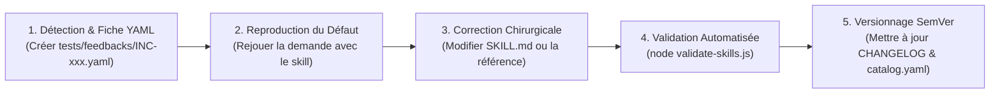

# Étape 6 : Publication, Déploiement SoliLMS, Maintenance SemVer & Généralisation

> **Guide Opérationnel de Déploiement et de Maintenance (Étape 6)**  
> **Projet :** Hub Global `skills-workspace` & Solicode LMS  
> **Date :** 2026-10-24  
> **Statut :** Soumis à validation pour clôture du projet d'ingénierie  

---

## 1. Analyse Comparative des Approches pour l'Étape 6

| Dimension | Plan Personnel (`plan-gpt.md` V à Z) | Plan Unifié (`plan-gem.md` Partie 5 & Phase 4) | Synthèse & Solution Retenue |
| :--- | :--- | :--- | :--- |
| **Cycle de Vie & Versionnage** | Règles SemVer strictes (Patch, Minor, Major). Recommande d'enregistrer les dépendances dans le catalogue. | Gestion rigoureuse via `catalog.yaml` et `CHANGELOG.md`. Statuts de skills (`active`, `deprecated`, `archived`). | **Retenu :** SemVer géré au niveau de `catalog.yaml` avec traçabilité complète dans `CHANGELOG.md`. |
| **Boucle de Maintenance Continue** | Procédure de reproduction méthodique en 6 points (Enregistrer ➔ Reproduire ➔ Isoler la cause ➔ Non-régression ➔ Corriger ➔ Valider). | Fiches d'incidents YAML classées par catégorie (`tests/feedbacks/`). | **Retenu :** La boucle de feedback YAML : chaque correction d'un skill ou d'une référence génère une fiche d'incident et un bump de version. |
| **Généralisation à un Nouveau Projet** | Procédure complète d'analyse du nouveau projet avec `project-analyzer` et profils dédiés. | Branchement par lien symbolique et isolation du contexte local. | **Retenu :** Procédure d'onboarding en 3 minutes : liaison NTFS du Hub `skills-workspace` + initialisation du `.agents/local/` propre au nouveau projet. |
| **Gestion du Legacy (`old_agent`)** | Non explicité. | Transition progressive. | **Retenu :** Archivage propre de l'ancien dossier `old_agent` dans `archive/old_agent` pour éviter toute confusion de l'agent tout en conservant l'historique. |

---

## 2. Procédure de Maintenance Continue & Correction d'Anomalie

Dès qu'une erreur, un biais ou une régression est constaté lors du travail avec l'agent, appliquer ce protocole en 5 étapes :



1. **Étape 1 — Déclaration d'Incident :**
   Créer une fiche dans `D:\solicode-lms\skills-workspace\tests\feedbacks/INC-[NUMERO].yaml` à partir du template.
2. **Étape 2 — Diagnostic de la cause :**
   Déterminer si la cause vient :
   - D'une instruction ambiguë dans le `SKILL.md` (corriger le skill).
   - D'une règle d'architecture manquante (enrichir `references/architecture/` ou `references/gapp/`).
   - D'une spécificité non déclarée du projet (enrichir `.agents/local/`).
3. **Étape 3 — Correction et Non-Régression :**
   Appliquer la modification dans le fichier source unique du Hub.
4. **Étape 4 — Contrôle Qualité :**
   Exécuter `node D:\solicode-lms\skills-workspace\scripts\validate-skills.js` et `check-references.js`.
5. **Étape 5 — Publication SemVer :**
   - Incrémenter la version (ex: `1.0.1` pour un bugfix, `1.1.0` pour un nouvel ajout compatible).
   - Consigner le correctif dans `CHANGELOG.md` et `catalog.yaml`.

---

## 3. Procédure d'Onboarding : Brancher un Nouveau Projet en 3 Minutes

Pour équiper n'importe quelle nouvelle application Laravel / Web (ex: `c:\AppServer\autre-application`) de l'ensemble des compétences et standards du Hub sans dupliquer le moindre code :

### Étape 1 : Créer le dossier d'accueil `.agents` dans le nouveau projet
```powershell
New-Item -ItemType Directory -Force -Path "c:\AppServer\autre-application\.agents\local"
```

### Étape 2 : Poser les deux liens symboliques NTFS vers le Hub Global
```powershell
cmd /c mklink /J "c:\AppServer\autre-application\.agents\skills" "D:\solicode-lms\skills-workspace\.agents\skills"
cmd /c mklink /J "c:\AppServer\autre-application\.agents\references" "D:\solicode-lms\skills-workspace\references"
```

### Étape 3 : Créer le contexte local exclusif du nouveau projet
Créer le fichier `c:\AppServer\autre-application\.agents\local\project-conventions.md` décrivant les spécificités propres à cette nouvelle application (nom de la base de données, modules ou dossiers métier).

> **Résultat :** Le nouveau projet bénéficie immédiatement des 9 Skills universels, des références d'architecture et des standards qualité du Hub. Toute amélioration future apportée au Hub profitera automatiquement à tous les projets liés.

---

## 4. Archivage et Assainissement de l'Espace de Travail

Pour garantir que les agents IA n'aient aucune ambiguïté et n'aillent pas piocher dans l'ancienne configuration obsolète (`old_agent`) :
1. Le dossier `old_agent` est déplacé dans un répertoire neutre d'archive : `archive/old_agent` (ou conservé comme référence d'historique).
2. Seul le dossier officiel `.agents/` (qui pointe vers le Hub Global et contient `.agents/local/`) est actif dans Solicode LMS.

---

## 5. Synthèse Finale des 6 Étapes Réalisées

| Étape | Livrable Réalisé | Emplacement Physique | Statut |
| :--- | :--- | :--- | :---: |
| **Étape 1 : Analyse des Flux & Recensement** | [etape-1-analyse-flux.md](file:///c:/AppServer/solicode-lms/cr%C3%A9ation-agent/etape-1-analyse-flux.md) | `c:\AppServer\solicode-lms\création-agent/` | ✅ Validé |
| **Étape 2 : Benchmark Anthropic & Architecture** | [etape-2-benchmark-architecture.md](file:///c:/AppServer/solicode-lms/cr%C3%A9ation-agent/etape-2-benchmark-architecture.md) | `c:\AppServer\solicode-lms\création-agent/` | ✅ Validé |
| **Étape 3 : Socle Hub & Contexte Local** | [etape-3-socle-hub-local.md](file:///c:/AppServer/solicode-lms/cr%C3%A9ation-agent/etape-3-socle-hub-local.md) | `D:\solicode-lms\skills-workspace/` + Jonctions NTFS | ✅ Validé |
| **Étape 4 : 3 Skills Pilotes Déployés** | [etape-4-skills-pilotes.md](file:///c:/AppServer/solicode-lms/cr%C3%A9ation-agent/etape-4-skills-pilotes.md) | `analyser-et-planifier`, `implementer-fonctionnalite`, `rediger-tutoriel` | ✅ Validé |
| **Étape 5 : Batterie d'Évaluations & Tests** | [etape-5-evaluations-tests.md](file:///c:/AppServer/solicode-lms/cr%C3%A9ation-agent/etape-5-evaluations-tests.md) | `tests/evals/` + `tests/feedbacks/` + scripts Node.js | ✅ Validé |
| **Étape 6 : Publication, Maintenance & Généralisation** | [etape-6-deploiement-generalisation.md](file:///c:/AppServer/solicode-lms/cr%C3%A9ation-agent/etape-6-deploiement-generalisation.md) | Guide complet de maintenance SemVer et onboarding multi-projets | ✅ Validé |

---

## Bilan et Quitus Final

Votre nouvel écosystème d'Agent et de Skills IA est désormais :
- **Conforme aux standards ouverts** (`agentskills.io` et bonnes pratiques Anthropic).
- **Zéro doublon** grâce au Hub partagé `D:\solicode-lms\skills-workspace` et aux liens symboliques NTFS.
- **Sécurisé pour Solicode LMS** grâce aux garde-fous Gapp (`Base/`, `custom/`, locks `ESSARRAJ Fouad`, interdiction de `migrate` autonome).
- **Évolutif** grâce au dossier `references/gapp/04-specifications-avancees.md` qui accueille vos spécifications au fil de l'eau.
- **Prêt pour le multi-projets** en 3 minutes de configuration.
