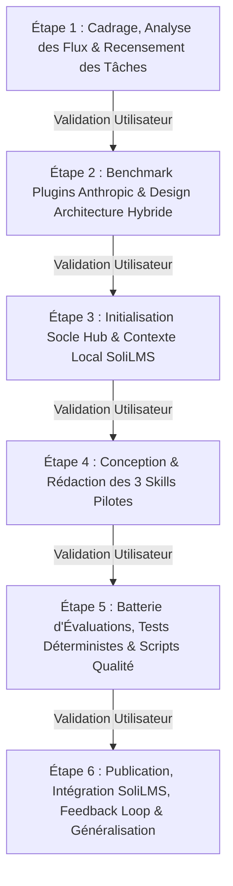
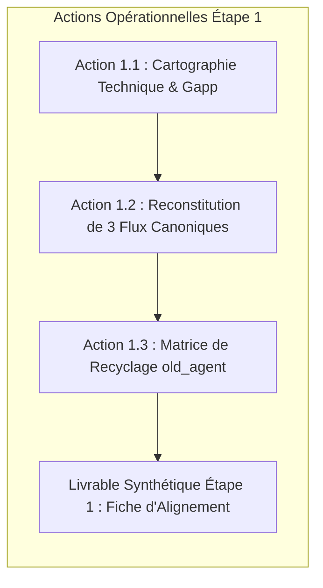

# Plan Directeur de Réalisation : Agent & Skills IA SoliLMS

## Description de l'Objectif
Moderniser, standardiser et pérenniser l'écosystème d'Agents et de Skills IA pour le projet **SoliLMS (Active LMS)** et les applications multi-couches (Laravel / Blade / Alpine.js / MySQL / composants maison `TableUI` & `FormUI` / générateur de code `Gapp`).

Ce plan organise la transition depuis l'ancien système fragmenté (`old_agent`, 27 micro-skills couplés aux couches et aux packages) vers une **architecture hybride standardisée** (Hub global partagé + Contexte local de projet), conforme aux spécifications ouvertes **Agent Skills** (`agentskills.io`) et inspirée des plugins de référence d'**Anthropic** (`feature-dev`, `claude-code-setup`, `pr-review-toolkit`).

Conformément à la méthode demandée, la réalisation s'effectue **pas à pas** : chaque étape fait l'objet d'une comparaison critique entre vos plans (`plan-gpt.md` et `plan-gem.md`), d'une recommandation argumentée, et attend votre **validation explicite** avant exécution.

---

## Synthèse du Parcours Global en 6 Étapes

Le projet est découpé en 6 étapes jalonnées d'un sas de validation obligatoire :

| Étape | Intitulé | Objectif Principal | Livrables Attendus | Sas de Validation |
| :--- | :--- | :--- | :--- | :---: |
| **Étape 1** | **Analyse des flux réels & Recensement** *(En cours)* | Auditer le terrain sur preuves (code, `old_agent`, Gapp, `TableUI`) sans rien coder. | Cartographie technique SoliLMS, 3 fiches de flux vérifiés, inventaire de migration `old_agent`. | 🔴 Requis |
| **Étape 2** | **Benchmark Anthropic & Design d'Architecture** | Extraire les motifs des plugins Anthropic et définir la taxonomie exacte (Hub vs Local). | Matrice d'adaptation des plugins, découpage Références passives vs 9 Skills actionnables. | 🔴 Requis |
| **Étape 3** | **Socle Hub Global & Contexte Local SoliLMS** | Mettre en place l'arborescence physique, les standards normatifs et le pont de liaison. | Dépôt `skills-workspace` initialisé, `.agents/local/` dans SoliLMS, jonction NTFS / submodule testée. | 🔴 Requis |
| **Étape 4** | **Création des 3 Skills Pilotes** | Écrire les 3 skills fondamentaux (Comprendre, Réaliser, Transmettre) selon le gabarit unifié. | `project-analyzer`, `feature-implementer` (gestion `TableUI`/Gapp), `active-tutorial-writer`. | 🔴 Requis |
| **Étape 5** | **Évaluations, Scripts & Robustesse** | Valider le déclenchement (routing) et la qualité d'exécution sur cas réels et pièges. | Script Python `validate-skills.py`, suite de 6 tests comportementaux par skill, dataset requêtes +/-. | 🔴 Requis |
| **Étape 6** | **Déploiement, Cycle Feedback & Généralisation** | Intégrer en production sur SoliLMS, rôder le cycle de maintenance SemVer / YAML. | Intégration validée sur extension CRUD réelle, procédure d'onboarding pour un nouveau projet. | 🔴 Requis |

---

## Focus Immédiat : Étape 1 — Analyse des Flux de Travail et Recensement des Tâches

### 1. Analyse Comparative des Approches

| Dimension | Approche Plan Personnel (`plan-gpt.md` Phase 1 : A à F) | Approche Plan Unifié (`plan-gem.md` Partie 1 : 1 à 4) | Synthèse & Écart Constaté |
| :--- | :--- | :--- | :--- |
| **Posture & Démarche** | Démarche d'audit d'ingénierie rigoureuse en 6 sous-étapes (Cadrer, Recenser, Explorer, Cartographier, Reconstituer, Diagnostiquer). Exige des preuves formelles dans le code. | Démarche pragmatique orientée récurrence (test des 3x/mois, isolation Déclencheur / Entrées / Séquence / Livrable, détection des biais IA). | `plan-gpt` apporte la méthode d'investigation médico-légale (ne rien supposer), tandis que `plan-gem` apporte les filtres d'élagage opérationnels. |
| **Périmètre ciblé** | Très large : historique Git, tickets, documentation, code, configurations, tests. Risque de dispersion documentaire. | Ciblé directement sur les besoins de SoliLMS : conception packages, CRUD/filtres `TableUI`/`FormUI`, rédaction de TP. | Le plan unifié est ancré dans les objets réels de SoliLMS, le plan personnel sécurise la factualité. |
| **Traitement du legacy (`old_agent`)** | Sous-entendu dans l'exploration du dépôt, sans mention explicite de la charge de refactorisation. | Identifie les biais à corriger mais ne détaille pas la matrice de transition des 27 skills existants. | Les deux plans omettent le recyclage sélectif d'`old_agent` (27 skills éclatés à requalifier). |

### 2. Argumentaire et Solution Recommandée pour SoliLMS

> [!IMPORTANT]
> **Pourquoi le découpage de l'ancien agent (`old_agent`) a échoué :**
> L'audit d'`old_agent` montre 27 micro-skills découpés soit par couche technique (`app-blade`, `app-controller`, `app-service`, `app-migration`), soit par package métier (`pkg-apprenant`, `pkg-formation`). Ce sur-découpage provoque :
> 1. Une friction de sélection permanente pour l'IA (confusion sur quel skill charger lors d'une tâche traversante).
> 2. Une duplication massive des règles.
> 3. L'incapacité de gérer un flux de bout en bout (ex: créer un champ nécessite d'activer 4 skills successifs manuellement).

#### Recommandation Stratégique pour l'Étape 1 :
Nous combinons la **rigueur d'investigation par preuves** de `plan-gpt` avec l'**orientation flux traversants** de `plan-gem`, complétée par un **audit de qualification du legacy** :

1. **Reconstituer 3 flux de référence réels (traversants)** :
   - *Flux A (Développement / Extension CRUD)* : Ajout d'un filtre et d'une colonne dynamique dans un CRUD existant (`modules/Pkg...`), avec synchronisation Gapp, modification du modèle enfant PHP, et intégration dans `TableUI.js` / `FilterUI.js`.
   - *Flux B (Conception / Architecture)* : Création d'une nouvelle entité/relation dans un package modulaire (`modules/Core` ou domaine) respectant l'architecture 3-tiers et les contrats de service.
   - *Flux C (Pédagogie)* : Rédaction d'un tutoriel pas-à-pas et d'un atelier pratique (TP) pour apprenants, guidant la réalisation d'une tâche technique.
2. **Auditer les règles inviolables et contraintes critiques de SoliLMS** :
   - Préservation stricte des fichiers générés Gapp (`Base/` intouchable, headers de lock `ESSARRAJ Fouad` dans PHP vs Blade).
   - Interdiction formelle de migrations destructives ou exécutées en aveugle (`php artisan migrate` géré par le développeur).
   - Règles d'injection des composants `TableUI` / `FormUI` (ne pas laisser l'IA réinventer du HTML/JS natif générique).
3. **Établir la table de bascule (`old_agent` ➔ Nouvelle Architecture)** :
   - Qualifier chacun des 27 anciens skills : transformer en **Référence passive** (`references/`), intégrer dans un **Skill générique** (`skills/`), ou **Archiver/Supprimer**.

---

## Plan d'Action Concret de l'Étape 1 (À valider)

### Action 1.1 : Cartographie Technique & Points d'Ancrage Gapp / TableUI
- Recenser la structure des modules (`modules/`), des contrats de base (`modules/Core`), de l'intégration frontend (`resources/js/crud/components/TableUI.js`, `FormUI.js`, `FilterUI.js`).
- Isoler les contrats de métadonnées Gapp (`modules/PkgGapp`, `db_schemas/`) et les mécanismes de régénération.

### Action 1.2 : Traçage des 3 Flux Canoniques
- Documenter formellement les 3 parcours réels : *Déclencheur*, *Entrées nécessaires*, *Arborescence des fichiers touchés*, *Ordre chronologique des opérations*, *Vérifications*, et *Points de blocage identifiés*.

### Action 1.3 : Matrice de Décision sur l'Ancien Agent (`old_agent`)
- Transformer les règles de `old_agent/rules/` (`00-regles-critiques.md`, `04-architecture-backend.md`) en références documentaires universelles ou locales.
- Regrouper les 10 micro-skills de couche (`app-controller`, `app-service`, `app-blade`, etc.) au sein d'un seul skill d'implémentation robuste (`implementer-fonctionnalite`).

---

## Revue Utilisateur Requise

> [!IMPORTANT]
> **Points de décision soumis à votre validation :**
> 1. **Validation du découpage global en 6 étapes :** Validez-vous ce macro-découpage avec sas d'approbation systématique ?
> 2. **Orientation de l'Étape 1 :** Êtes-vous d'accord pour que l'Étape 1 se concentre sur les 3 flux canoniques identifiés (*Ajout filtre TableUI + Gapp*, *Nouvelle entité 3-tiers*, *Tutoriel pédagogique*) et sur la matrice de bascule d'`old_agent` ?
> 3. **Emplacement du Hub Global :** Souhaitez-vous que le futur Hub global de skills soit créé dans un dossier parent dédié (ex: `c:\AppServer\skills-workspace`) ou dans un sous-dossier de travail ?

---

## Questions Ouvertes

> [!NOTE]
> 1. Pour la liaison entre SoliLMS et le futur Hub global sous Windows, préférez-vous un lien symbolique de répertoire (`mklink /J .agents/skills ...`) ou un sous-module Git ?
> 2. Existe-t-il des spécificités récentes dans votre générateur Gapp ou vos composants `TableUI` qui ne figurent pas encore dans la documentation de `old_agent` ?

---

## Plan de Vérification de l'Étape 1

### Vérification Manuelle (Critères d'Acceptation de l'Étape 1)
- [ ] La cartographie technique reflète fidèlement la structure actuelle des packages `modules/` de SoliLMS.
- [ ] Les 3 flux canoniques sont documentés avec la liste exhaustive des fichiers réels impactés (modèles `Base` vs enfants, services, vues Blade, composants JS `TableUI`).
- [ ] Chaque composant d'`old_agent` (27 skills, 7 règles, 2 workflows) a une destination claire et tracée (Référence, Skill unifié, ou Élimination).
- [ ] Aucun code applicatif de SoliLMS n'a été altéré durant cette étape d'analyse.
