# Spécification & Conception : Filtres par Situation Pédagogique et Multi-États Personnalisés

## 1. Contexte & Problématique Métier

Dans l'interface de gestion des tâches (`RealisationTache`), le suivi pédagogique par les formateurs nécessite une vision synthétique de l'avancement des apprenants. 
Actuellement, le filtrage s'effectue état par état (`etat_realisation_tache_id` ou code `WorkflowTache`). Cette granularité unitaire est inadaptée aux besoins de supervision globale :
- Un formateur doit pouvoir identifier instantanément **qui est en train de travailler** (toutes tâches actives confondues).
- Un formateur doit détecter en urgence **les apprenants en blocage** (tâches en remédiation, révisions, retards) pour intervenir rapidement.
- Un formateur souhaite pouvoir composer **son propre groupe d'états à surveiller** (filtre personnalisé multi-états).

---

## 2. Définition des Situations Pédagogiques (Presets)

Quatre macro-situations fonctionnelles sont définies, basées sur les codes normalisés de `WorkflowTache` :

```mermaid
graph TD
    subgraph S1["🔨 Situation : En Travail"]
        direction TB
        E1["IN_PROGRESS (En cours)"]
        E2["REVISION_NECESSAIRE (Révision nécessaire)"]
        E3["EN_REMEDIATION (En remédiation)"]
        E4["IN_LIVE_CODING (En session Live Coding)"]
        E5["PAUSED (En pause)"]
    end

    subgraph S2["⚠️ Situation : En Blocage"]
        direction TB
        B1["EN_REMEDIATION (Remédiation didactique)"]
        B2["REVISION_NECESSAIRE (Corrections requises)"]
        B3["LATE (En retard sur les délais)"]
        B4["NOT_VALIDATED (Non validée)"]
        B5["PAUSED (Suspendue sur difficulté)"]
    end

    subgraph S3["⏳ Situation : En Attente Formateur"]
        direction TB
        A1["TO_APPROVE (À valider)"]
        A2["READY_FOR_LIVE_CODING (Prêt pour Live Coding)"]
        A3["A_VALIDER_LIVE_CODING (À valider Live Coding)"]
    end

    subgraph S4["✅ Situation : Terminée"]
        direction TB
        T1["APPROVED (Validée avec succès)"]
    end

    style S1 fill:#e6f7ff,stroke:#1890ff,stroke-width:2px;
    style S2 fill:#fff1f0,stroke:#f5222d,stroke-width:2px;
    style S3 fill:#fffbe6,stroke:#faad14,stroke-width:2px;
    style S4 fill:#f6ffed,stroke:#52c41a,stroke-width:2px;
```



### Détail des Profils :

| Code Situation | Libellé Affiché | Règle Métier & États Associés |
| :--- | :--- | :--- |
| `SITUATION_TRAVAIL` | **En Travail** (Actives) | Tâches sur lesquelles l'apprenant intervient activement :<br>`IN_PROGRESS`, `REVISION_NECESSAIRE`, `EN_REMEDIATION`, `IN_LIVE_CODING`, `PAUSED`. |
| `SITUATION_BLOCAGE` | **En Blocage** (Alerte) | Tâches nécessitant un déblocage ou une attention pédagogique :<br>`EN_REMEDIATION`, `REVISION_NECESSAIRE`, `LATE`, `NOT_VALIDATED`, `PAUSED`. |
| `SITUATION_ATTENTE` | **En Attente de Validation** | Tâches finalisées par l'apprenant en attente d'évaluation formateur :<br>`TO_APPROVE`, `READY_FOR_LIVE_CODING`, `A_VALIDER_LIVE_CODING`. |
| `SITUATION_TERMINEE` | **Terminées / Validées** | Tâches validées :<br>`APPROVED`. |
| `SITUATION_CUSTOM` | **Personnalisée** | Combinaison libre d'états sélectionnés par le formateur. |

---

## 3. Conception Fonctionnelle du Filtre Personnalisé (Multi-États)

En complément des situations prédéfinies :
1. **Mode Sélection Libre :** Le formateur a accès à un sélecteur multiple (liste déroulante multi-select avec cases à cocher ou tags) répertoriant tous les états de son workflow.
2. **Mémorisation Session (`ViewState`) :** La sélection active est stockée sous la clé :
   `filter.realisationTache.custom_etats`
3. **Synchronisation :**
   - Lorsqu'un preset (ex: *En Blocage*) est sélectionné, les cases d'états correspondantes sont pré-cochées automatiquement.
   - Si le formateur modifie manuellement une case, le filtre bascule automatiquement sur *Personnalisé*.

---

## 4. Architecture & Implémentation Technique

### 4.1. Couche Backend Service (`RealisationTacheGetterTrait.php`)

La mécanique s'appuie sur le framework de requêtage de `QueryBuilderTrait` et la déclaration dans `initFieldsFilterable()` :

#### A. Déclaration dans `initFieldsFilterable()` :
```php
// Filtre par macro-situation pédagogique
$this->fieldsFilterable[] = [
    'label' => __('PkgRealisationTache::realisationTache.situation_pedagogique'),
    'field' => 'situation_pedagogique',
    'type' => 'CustomDropdown',
    'options' => [
        ['id' => 'ALL', 'label' => __('Toutes les situations')],
        ['id' => 'SITUATION_TRAVAIL', 'label' => __('🔨 En Travail')],
        ['id' => 'SITUATION_BLOCAGE', 'label' => __('⚠️ En Blocage')],
        ['id' => 'SITUATION_ATTENTE', 'label' => __('⏳ En Attente de Validation')],
        ['id' => 'SITUATION_TERMINEE', 'label' => __('✅ Terminées')],
        ['id' => 'SITUATION_CUSTOM', 'label' => __('🎯 Personnalisée...')],
    ],
];

// Filtre multi-états personnalisable
$this->fieldsFilterable[] = [
    'label' => __('PkgRealisationTache::realisationTache.etats_personnalises'),
    'field' => 'custom_etats',
    'type' => 'MultipleSelect',
    'options' => $etatsDisponibles,
];
```

#### B. Interception de la Requête dans `allQuery()` :
Surcharger la construction de la requête dans `RealisationTacheGetterTrait.php` pour appliquer les regroupements sans impacter les classes `Base/` :

```php
public function allQuery(array $params = [], $query = null): Builder
{
    $query = parent::allQuery($params, $query);

    $situation = $this->viewState->get('filter.realisationTache.situation_pedagogique');
    $customEtats = $this->viewState->get('filter.realisationTache.custom_etats');

    if ($situation === 'SITUATION_TRAVAIL') {
        $query->whereHas('etatRealisationTache.workflowTache', function ($q) {
            $q->whereIn('code', [
                'IN_PROGRESS', 
                'REVISION_NECESSAIRE', 
                'EN_REMEDIATION', 
                'IN_LIVE_CODING', 
                'PAUSED'
            ]);
        });
    } elseif ($situation === 'SITUATION_BLOCAGE') {
        $query->whereHas('etatRealisationTache.workflowTache', function ($q) {
            $q->whereIn('code', [
                'EN_REMEDIATION', 
                'REVISION_NECESSAIRE', 
                'NOT_VALIDATED', 
                'LATE', 
                'PAUSED'
            ]);
        });
    } elseif ($situation === 'SITUATION_ATTENTE') {
        $query->whereHas('etatRealisationTache.workflowTache', function ($q) {
            $q->whereIn('code', [
                'TO_APPROVE', 
                'READY_FOR_LIVE_CODING', 
                'A_VALIDER_LIVE_CODING'
            ]);
        });
    } elseif ($situation === 'SITUATION_TERMINEE') {
        $query->whereHas('etatRealisationTache.workflowTache', function ($q) {
            $q->where('code', 'APPROVED');
        });
    } elseif ($situation === 'SITUATION_CUSTOM' && !empty($customEtats)) {
        $query->whereIn('etat_realisation_tache_id', (array) $customEtats);
    }

    return $query;
}
```

---

### 4.2. Couche Interface Utilisateur (Frontend)

L'UI offre une double modalité :
1. **Dropdown Rapide dans `FilterUI` :** Intégration native dans le bandeau de filtres AJAX standard `FilterUI.js`.
2. **Badges de Filtrage Direct (Header TabUI) :**
   Dans la vue Blade `custom/_index.blade.php`, insertion d'un composant de filtres rapides cliquables au-dessus du tableau :
   ```blade
   <div class="situation-filter-pills mb-3">
       <button class="btn btn-sm btn-outline-primary" data-situation="SITUATION_TRAVAIL">
           <i class="fas fa-hammer"></i> En Travail
       </button>
       <button class="btn btn-sm btn-outline-danger" data-situation="SITUATION_BLOCAGE">
           <i class="fas fa-exclamation-triangle"></i> En Blocage
       </button>
       <button class="btn btn-sm btn-outline-warning" data-situation="SITUATION_ATTENTE">
           <i class="fas fa-hourglass-half"></i> En Attente
       </button>
       <button class="btn btn-sm btn-outline-success" data-situation="SITUATION_TERMINEE">
           <i class="fas fa-check-circle"></i> Terminées
       </button>
   </div>
   ```

---

## 5. Critères d'Acceptation & Checklist de Validation

- [ ] La sélection d'une macro-situation filtre instantanément le tableau TableUI via requête AJAX sans rechargement de page.
- [ ] Le filtre "En Travail" remonte bien toutes les tâches actives (`IN_PROGRESS`, `REVISION_NECESSAIRE`, `EN_REMEDIATION`, `IN_LIVE_CODING`).
- [ ] Le filtre "En Blocage" isole précisément les apprenants nécessitant une assistance pédagogique.
- [ ] Le filtre "Personnalisé" permet au formateur de cocher arbitrairement plusieurs états et d'obtenir le résultat exact.
- [ ] L'état du filtre est préservé lors de la pagination et du changement d'onglet via `ViewState`.
- [ ] Aucun fichier du dossier `Base/` n'a été altéré.