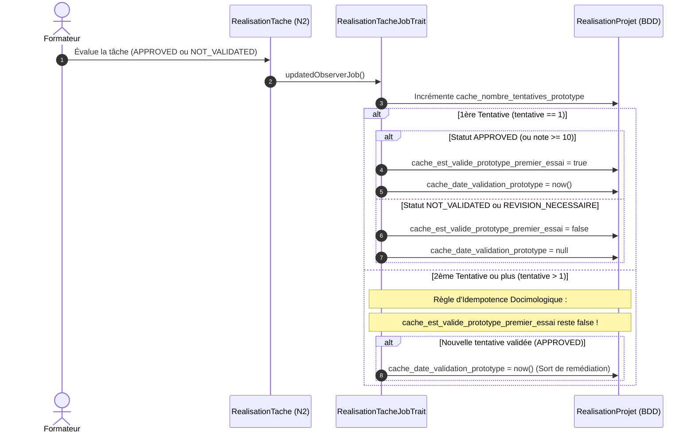

# Calcul & Fonctionnement : Indicateur de Validation du Prototype au 1er Essai ($R_{\text{gating}}$)

> **Module principal** : `PkgTableauBord`  
> **Modules contributeurs** : `PkgRealisationTache`, `PkgRealisationProjets`, `PkgCreationProjet`, `PkgCompetences`  
> **Traits backend** : `DashboardIndicateur02Trait`, `RealisationTacheJobTrait`  
> **Composant UI V2** : `kpi-gating.blade.php`

---

## 1. Définition Métier & Rôle Didactique

L'indicateur **$R_{\text{gating}}$** (Validation du Prototype au 1er essai) mesure la proportion d'apprenants qui réussissent l'épreuve de validation technique (Live Coding) dès leur première tentative.

$$R_{\text{gating}} = \frac{N_{\text{validés\_1er\_essai}}}{N_{\text{évalués}}} \times 100$$

- **Rôle didactique** : Mesurer l'autonomie et l'assimilation des fondamentaux techniques (**Niveau 2 — Adapter**) avant d'accorder le déblocage du Projet Fil Rouge (**Niveau 3 — Transposer**).
- **Règle de Gating** : L'accès au Niveau 3 est conditionné à la validation de cette épreuve pivot.

---

## 2. Comment le Système Reconnait une Tâche de type "Prototype" ?

Le système ne se base pas sur un titre textuel ou un mot-clé arbitraire. Il s'appuie sur la classification pédagogique formelle :

> [!IMPORTANT]
> Une tâche est formellement identifiée comme **épreuve Prototype** si sa phase d'évaluation associée est de niveau 2 (**N2** — *Adaptation / Live Coding*).

### Détection dans le Code :
```php
// Dans RealisationTache / RealisationTacheJobTrait :
public function isPrototype(): bool
{
    return $this->tache?->phaseEvaluation?->code === 'N2';
}
```

- Les phases d'évaluation sont définies dans `phase_evaluations` :
  - `N1` : Apprentissage guidé / Imitation (Tutoriels)
  - **`N2` : Adaptation / Live Coding $\rightarrow$ Épreuve Prototype**
  - `N3` : Transposition / Projet Fil Rouge

---

## 3. Détection des Différents États et Cycle de Vie Événementiel

### A. Colonnes Dénormalisées de Cache (`realisation_projets`)

Pour garantir un calcul instantané à chaque consultation sans balayer des tables d'historique volumineuses, les résultats sont dénormalisés sur `realisation_projets` avec le préfixe obligatoire `cache_` :

| Colonne | Type | Description |
| :--- | :---: | :--- |
| `cache_nombre_tentatives_prototype` | `int` | Nombre total d'évaluations/passages subis par l'apprenant sur l'épreuve N2. |
| `cache_est_valide_prototype_premier_essai` | `bool\|null` | **Fige** le résultat du premier passage : `true` si validé du 1er coup, `false` si ajourné, `null` si non encore évalué. |
| `cache_date_validation_prototype` | `datetime\|null` | Date à laquelle le prototype a été validé (lors du 1er essai OU lors d'une remédiation ultérieure). |

---

### B. Cycle de Vie lors de l'Évaluation (`RealisationTacheJobTrait`)

Lorsqu'un formateur évalue la tâche N2 (Live Coding) d'un apprenant, l'Observer déclenche `RealisationTacheJobTrait` :



---

## 4. Comment le Système Sait Quels Apprenants Sont "En Remédiation" ?

Un apprenant est formellement qualifié **"En Remédiation"** par le système si et seulement si :

$$\text{En Remédiation} \iff (\text{Tentatives} > 0) \land (\text{Premier Essai} = \text{false}) \land (\text{Date Validation} = \text{null})$$

```php
// Extrait de DashboardIndicateur02Trait::getIndicateurGatingFormateur()
$estEnRemediation = ($premierEssai === false) && is_null($rp->cache_date_validation_prototype);

if ($estEnRemediation) {
    $enRemediation++;
    $apprenantsEnRemediation[] = [
        'id' => $rp->apprenant_id,
        'nom_complet' => $rp->apprenant->prenom . ' ' . $rp->apprenant->nom,
        'avatar' => $rp->apprenant->profile_image,
        'tentatives' => $tentatives,
    ];
}
```

### Cas de Sortie de Remédiation :
Dès que l'apprenant repasse sa soutenance et que le formateur passe la tâche à `APPROVED` :
- `cache_est_valide_prototype_premier_essai` **reste à `false`** (l'indicateur didactique de premier essai conserve la vérité historique).
- Mais `cache_date_validation_prototype` est renseignée avec la date de validation.
- Résultat : l'apprenant **disparaît automatiquement de la liste des apprenants en remédiation** et son accès au Projet Fil Rouge (Niveau 3) est débloqué !

---

## 5. Déclinaison par Acteur (Tableaux de Bord V2)

### 1. Vue Apprenant (`tableau-bord.apprenant`)
- **Validé (1er essai)** (Badge émeraude) : Si `cache_est_valide_prototype_premier_essai === true`.
- **En remédiation** (Badge ambre) : Si `cache_est_valide_prototype_premier_essai === false` et prototype non validé.
- **Validé après rattrapage** (Badge bleu) : Si `cache_est_valide_prototype_premier_essai === false` mais validé ultérieurement.
- **En attente d'évaluation** (Badge gris) : Si aucune évaluation n'a encore eu lieu.
- **Droit d'accès Niveau 3** : `Débloqué` si validé, `Verrouillé` sinon.

### 2. Vue Formateur (`tableau-bord.formateur`)
- **Taux de gating cohorte** : Pourcentage d'apprenants ayant validé dès le premier passage.
- **Seuils didactiques** :
  - $\ge 80\%$ : **Excellence didactique** (Badge émeraude).
  - $65\% \le R_{\text{gating}} < 80\%$ : **Vigilance** (Badge ambre).
  - $< 65\%$ : **Alerte pédagogique** (Badge rouge) $\rightarrow$ révision collective nécessaire.
- **Bloc Remédiation** : Liste nominative avec avatars et boutons d'action rapide pour organiser l'atelier d'étayage.

### 3. Vue Responsable (`tableau-bord.responsable`)
- **Taux macroscopique global** : Moyenne sur l'ensemble des promotions actives.
- **Benchmark inter-promotions** : Matrice comparant le $R_{\text{gating}}$ entre différentes promotions sur la même session de formation.

---

## 6. Périmètre des Projets Pris en Compte (`is_session_formation`)

Le système exclut automatiquement des calculs tous les projets qui ne sont pas des sessions de formation :

```php
// Filtre appliqué dans DashboardIndicateur02Trait
RealisationProjet::whereHas('affectationProjet.projet', function ($q) {
    $q->sessionsFormation(); // is_session_formation = true
});
```

Les projets créés par les formateurs à titre de gabarits techniques ou de générateurs de tâches ne faussent donc jamais les statistiques.

---

## 7. Commande Artisan de Rattrapage & Audit

Pour recalculer ou vérifier l'état du parc existant :

```bash
# Vérification et rattrapage standard (idempotent)
php artisan dashboard:recalculer-gating

# Forcer le recalcul complet d'après l'historique complet
php artisan dashboard:recalculer-gating --force
```
